# 机器学习可解释性入门

一片 wafer 上，某个测点（site）的 $dx$ 残差被模型预测为 $+2.0\,\mathrm{nm}$。这个数偏大的原因是什么？模型在其他 wafer 上也这么判断吗？如果真去调温度，实测残差会变小吗？

三个问题分别指向**一次预测、一批数据、一次真实干预**。接下来就用这条线索学习怎样拆解预测、怎样用输入变化测试一个模型，以及怎样把模型发现的线索变成可检验的工艺假设。本文接续 [Python 数据处理与机器学习讲义](../v3/python_ml_seminar/1030.md)，文中的算例用小模型和合成数据，方便跟算。

## 阅读路线

| 想学什么 | 从哪里读 |
| --- | --- |
| 拿到一个预测，知道该问什么 | 第 1–2 节，从 wafer 残差与解释对象入手 |
| 看懂模型怎么得到这个数 | 第 3 节读模型本身，第 4–5 节学训练后的解释 |
| 看懂热图、隐藏表示和 attention | 第 6 节，从输入变化看到网络内部 |
| 验证解释，判断能否用来做决定 | 第 7–9 节，区分模型实验和工艺实验，读一遍完整的 wafer 诊断 |
| 把同一套思路用于语言模型 | 第 10 节，从候选词的分数追到中间激活和计算路径 |

## 1. 先把「为什么」问具体

假设任务是在**曝光前**预测每个 site 的有符号 $dx$ 残差。模型的输入可以包括 site 的位置、mark 类型、机台、recipe 和当时能读到的传感器值。看见某个边缘 site 的预测值偏大，可以做三件不同的事。

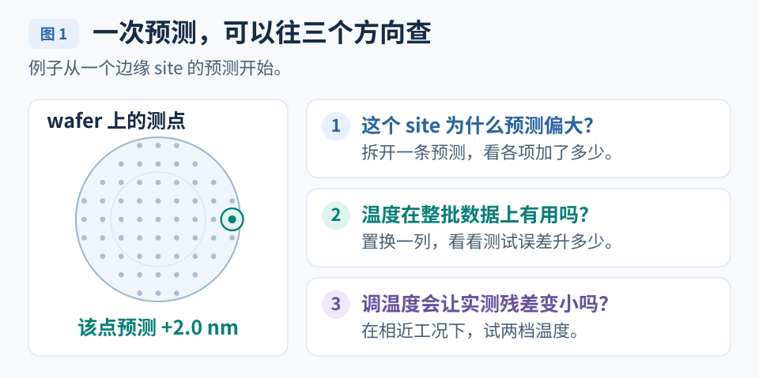

*图 1。先选要看的对象。单点解释沿着一个样本往下查。全局解释汇总一批样本。工艺问题用对照试验比较量测。*

- **查这个点。** 固定这条记录，看看哪些输入把预测从参照值推到了 $+2.0\,\mathrm{nm}$。
- **查这一批。** 把测试集的温度列打乱，保留标签和其他列，看看误差是否普遍变大。也可以把误差按边缘和中心、机台或批次分组，找出容易出错的区域。
- **查一次操作。** 让相近工况的 wafer 用不同温度设定，比较实际量到的残差。操作、对照组和量测口径都要先定好。

决策时点会改变排查结果。假如一项曝光后量测在特征榜单里排第一，先沿着数据流查它何时生成。这项信息在曝光前用不上，进入训练或评估就会造成**数据泄漏**。同样，如果训练和测试分别拿了同一片 wafer 上的不同 site，模型可能靠 wafer 编号认出了见过的晶圆。若部署任务是预测新 wafer，测试就按 wafer 分开。若要预测未来批次，还要用符合时间顺序的划分。填补缺失值或标准化时，也只用训练集估计所需的统计量，再应用到验证集和测试集。

## 2. 把问题、方法和读者对上

### 2.1 要解释哪一层

设 $f(x)$ 是已训练模型的预测，$x$ 是一条记录。下表的左列是要问的问题，右列是拿来回答它的工具。同一个任务常常需要连做两三项。

| 要问的问题 | 看的对象 | 可以从哪里入手 |
| --- | --- | --- |
| 这个 site 的预测怎样凑成？ | 一条预测，局部解释 | 线性贡献、树路径、SHAP、LIME |
| 打乱温度后，整批数据的预测误差增加多少？ | 一批预测的误差 | 置换重要性 |
| 模型怎样随温度变化？各条记录的方向一样吗？ | 平均响应与逐条响应 | PDP、ICE、ALE |
| 哪些 wafer 特别容易预测错？ | 数据覆盖和分组误差 | 按机台、批次或位置切片 |
| 神经网络中哪一层保留了 mark 信息？ | 中间表示和计算路径 | 激活图、探针、内部扰动 |
| 在允许的设定内，怎样让模型预测达标？ | 修改后的输入与输出 | 反事实搜索 |

### 2.2 从模型里面读，还是从模型外面试

浅决策树可以直接顺着分叉走到叶子。这类模型把解释写在自己的结构里，称为**本身可解释的模型**。如果已经有一个复杂模型，可以固定它的参数，用别的方法来读它，称为**事后解释**。

事后解释也有两种入口。能调用预测接口就能做置换或 LIME，这是**模型无关**的方法。能拿到内部结构，还可以沿着树的分裂算贡献，或者对神经网络求梯度，这是**模型特定**的方法。选择入口后，再决定读一个样本还是整批样本。

### 2.3 给读者看什么

数据科学家拿到「温度重要」，会去检查数据泄漏、时间切分和相关变量。工艺同事会问这个温度是可调设定值还是只读传感器值，以及调它时其他工况是否一起变。现场决策需要再往前一步，把能调的量、目标区间和验证办法写清楚。同一个发现可以分别写成**调试记录、试验假设和操作方案**。

## 3. 先读懂模型自己的计算

### 3.1 线性模型怎样把预测加出来

先用一个线性模型算开头的 $+2.0\,\mathrm{nm}$。用 $t$ 表示相对 $92\,^\circ\mathrm C$ 的温差，用 $r$ 表示从中心 $0$ 到边缘 $1$ 的归一化半径，用 $p$ 表示相对参考压力的偏差。把 $t$ 和 $p$ 分别以摄氏度和 kPa 记数，预测值以 nm 记数。

$$
f(t,r,p)=0.8+0.4t+2(r-0.5)-0.2p.
$$

先找一个方便对比的点 $(t,r,p)=(0,0.5,0)$，这里的预测是 $0.8\,\mathrm{nm}$。对于温度 $94\,^\circ\mathrm C$、半径 $0.9$、压力高出参考值 $2\,\mathrm{kPa}$ 的 site，从 $0.8$ 起步，依次加 $0.8$、加 $0.8$、减 $0.4$，就得到 $2.0$。

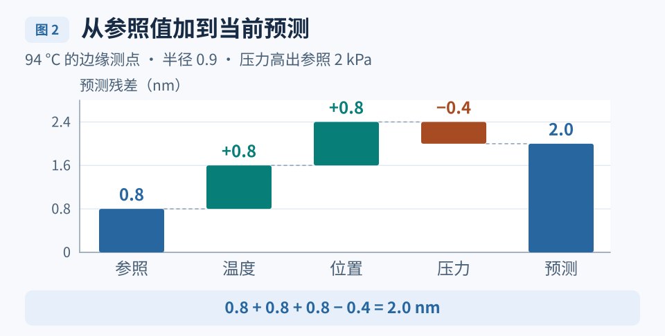

*图 2。每根悬空的柱子从上一步的高度起跳。柱子的长度是这一项改了多少，柱子的端点是加完之后的预测。*

一般地，若 $f(x)=\beta_0+\sum_j\beta_jx_j$，选一个参照输入 $x^{\mathrm{ref}}$，则

$$
f(x)=f(x^{\mathrm{ref}})
+\sum_j\underbrace{\beta_j(x_j-x_j^{\mathrm{ref}})}_{\text{第 }j\text{ 项的贡献}}.
$$

系数 $\beta_j$ 表示其他输入固定时，$x_j$ 每增加一个单位，模型预测改多少。贡献还要乘以这个样本相对参照偏了多少。比较不同量纲的斜率时，可以先用训练集的标准差把各变量换成相同尺度，比较「各变一个标准差」带来的变化。

逻辑回归也做加法。若 $\pi$ 表示事件发生的概率，各项加在**对数胜算** $\log[\pi/(1-\pi)]$ 上。胜算是「事件发生的概率除以不发生的概率」。若一个输入增加一单位带来 $\beta_j=\log 2$，胜算就乘 $2$。从 $\pi=0.2$ 出发，胜算由 $1/4$ 变成 $1/2$，概率变为 $1/3$。读分类归因图时，先找横轴究竟是对数胜算还是概率。

### 3.2 决策树怎样给出一条规则

决策树把预测变成一连串判断。下图的例子先问温度是否达到 $93\,^\circ\mathrm C$。达到后再看 mark 是否为 AIM。对于 $94\,^\circ\mathrm C$ 的 AIM 测点，沿两次「是」走到叶子，预测就是 $+2.0\,\mathrm{nm}$。

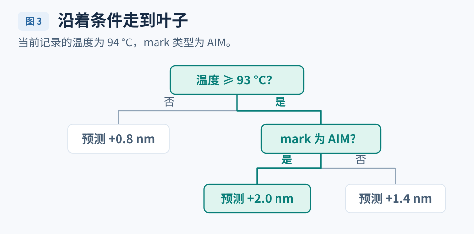

*图 3。路径解释记录每次判断和最后的叶子。想比较哪次切分在训练中改善最多，可以看各节点分裂前后的误差下降。*

如果温度和压力在训练数据里经常一起变，重新抽一批 wafer 训练时，树的第一刀可能从温度换成压力。两个版本都能把预测做得差不多。想判断哪条规则更稳，就在几次按 wafer 分组的训练中比较分裂路径和独立数据上的误差。

### 3.3 把直线换成曲线，仍然可以逐项相加

如果从 $90$ 升到 $91\,^\circ\mathrm C$ 的变化很小，从 $94$ 升到 $95\,^\circ\mathrm C$ 的变化却很大，一个固定斜率就画不出这条关系。**广义可加模型（GAM）** 给每个特征一条自己的曲线。

$$
g\big(\mathbb E[Y\mid x]\big)=\beta_0+f_1(x_1)+\cdots+f_p(x_p).
$$

回归中可以取 $g$ 为恒等函数，二分类中可以取 $g$ 为 logit。以回归为例，读一次预测就像查几个刻度表。先在温度曲线上找到 $94\,^\circ\mathrm C$ 对应的高度，再在半径曲线上找到 $0.9$ 对应的高度，把它们与其他项、常数项相加。通常把各条曲线按训练样本中心化，让零表示这项的平均水平。

如果「高温的影响在 wafer 边缘更强」，可以加一项 $f_{t,r}(t,r)$，用二维图看这项交互。选模型时，可以先把这类能直接读出路径或贡献的模型，与复杂模型在同一份留出数据上比较，看看可读性和预测误差各是什么水平。

## 4. 看一批数据上的模型行为

### 4.1 用置换重要性衡量一列数据的用处

保留所有温度读数，把它们换到别的行，就打乱了温度与各 site 的对应关系。用同一个模型重新预测，算误差多了多少。这个增量叫 **置换重要性（permutation importance）**。

固定训练好的 $f$，在留出集 $D$ 上算原始误差 $L_0$。打乱第 $j$ 列得到 $D_{\mathrm{perm}(j)}$，重新算误差 $L_j$。用 RMSE、MAE 或 log loss 这类越低越好的指标时，重要性就是 $L_j-L_0$。如果用准确率或 $R^2$ 这类越高越好的分数，就用「原分数减打乱后的分数」。

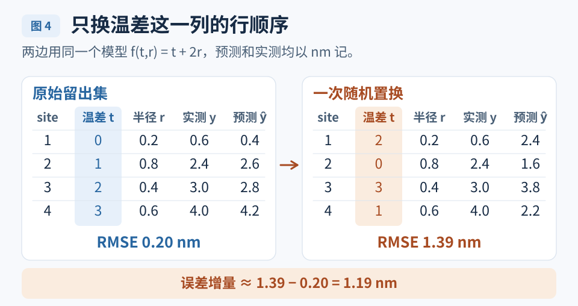

*图 4。左、右两表的半径 $r$ 和实测值 $y$ 逐行相同。用同一个 $f(t,r)=t+2r$ 计算预测，误差由 $0.20$ 增至约 $1.39\,\mathrm{nm}$。这一次的置换重要性约为 $1.19\,\mathrm{nm}$。*

实际计算时，先确认模型在留出集上的预测有用，再换几种随机顺序，记录平均和波动。若温度以 wafer 为单位记录、同片上所有 site 共用一个读数，可按 wafer 做置换并把替换值带到该片的所有 site。若温度和压力高度相关，单列打乱既可能留下另一份近似信息，也可能造出少见的组合。可以追加一次**成组置换**，用同一个随机顺序移动整组列。第 7.2 节会算一个例子。

树模型还有一份现成的榜单，叫**基于不纯度下降的重要性**（impurity-based importance，也叫 MDI）。回归树常用平方误差衡量节点内的离散程度。某个特征参与切分时，模型按经过该节点的样本权重累计下降量。候选切分多的变量更容易获得较高分数，例如取值很多的编号。用留出集的置换结果对照，再沿着时间和来源查特征，可以区分训练时常拿来切分的变量、测试时有用的变量，以及有泄漏风险的变量。[scikit-learn 的置换重要性说明](https://scikit-learn.org/stable/modules/permutation_importance.html)

### 4.2 用 PDP、ICE 和 ALE 看模型怎样响应输入

重要性给出一个数。如果想知道温差从 $-2$ 到 $+2$ 时模型怎样响应，就要换一种问法。

画 **部分依赖图（PDP）** 时，拿来整批数据，把每一行的温差都改成 $z$，保留其他列，再对所有预测取平均。对每个 $z$ 重复一次，就得到曲线。

$$
\mathrm{PDP}_j(z)=\frac1N\sum_{i=1}^N f(z,x_{i,-j}).
$$

$x_{i,-j}$ 是第 $i$ 条记录中除第 $j$ 列以外的特征。先保留每条记录的预测 $f(z,x_{i,-j})$，沿着 $z$ 把它画成一条线，就得到 **个体条件期望图（ICE）**。一条线对应一条记录，同一温差下把所有线的高度平均，就回到 PDP。

例如，模型 $f(t,p)=t\,p$ 用温差 $t$ 和压力偏差 $p$ 预测残差。取四条记录，各自的压力偏差为 $-1.5$、$-0.5$、$+0.5$、$+1.5$。每条记录固定自己的 $p$，只改变 $t$。这样一来，每条线的斜率正好就是该记录的 $p$。

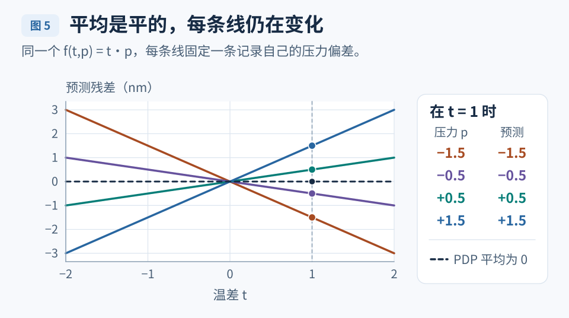

*图 5。在 $t=1$ 的竖线上，四条曲线的预测分别是 $-1.5$、$-0.5$、$+0.5$ 和 $+1.5\,\mathrm{nm}$，平均为零。两种方向抵消了，单条曲线上的变化仍然清楚可见。*

同样升温，压力偏差为正时预测上升，压力偏差为负时预测下降。式子里的乘积 $t\,p$ 就是温度与压力的交互项。

ICE 和 PDP 都靠替换输入算出这些曲线。如果高温往往伴随高压力，把一条低压记录的温度一路扫到高温，就会经过数据里少见的组合。围绕常见组合比较时，可以按原来的温差选记录，只在各自的小区间里改温差。[Goldstein 等人的 ICE 论文](https://arxiv.org/abs/1309.6392)

画 **累积局部效应图（ALE）** 时，每次只在一个小区间里比较。拿温差在 $[0.5,1.0]$ 内的行，对每一行分别把温差改为 $1.0$ 和 $0.5$，做两次预测并相减，再把差值平均。沿着温差轴把各个区间的平均差值累加，最后减去曲线在样本上的平均高度，使零对应平均效应。

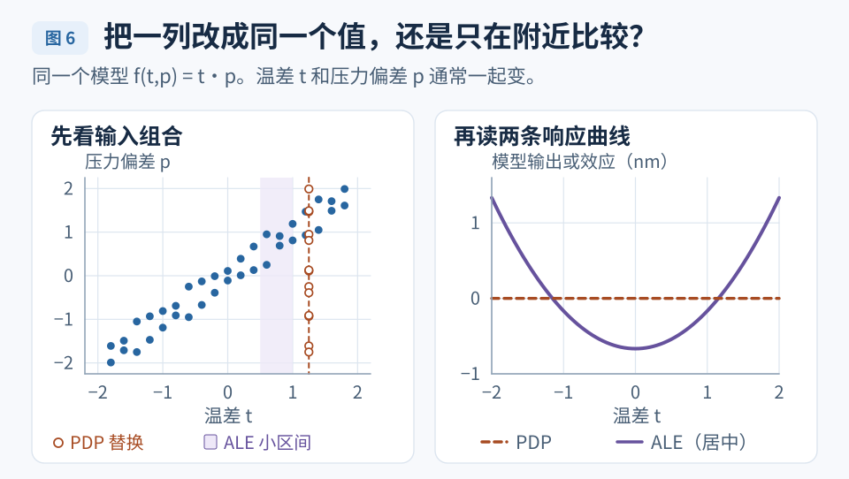

*图 6。左图的蓝点表示观测组合，橙色空心点表示把温差统一改成 $1.25$ 后的部分组合，浅紫带是一次局部比较用的区间。右图对照 PDP 的整批平均与 ALE 累积起来的局部变化。*

右图仍用 $f(t,p)=t\,p$。现在让温差均匀分布在 $[-2,2]$，温差为 $t$ 时的平均压力偏差也是 $t$。因此整批的平均压力偏差 $\mathbb E[P]=0$。

- PDP 固定 $t=z$，用整批的 $p$，结果是 $z\,\mathbb E[P]=0$。
- ALE 在 $[0.5,1.0]$ 里的局部差是 $(1.0-0.5)p$。这个区间的平均 $p=0.75$，平均差就是 $0.375$。当区间越来越窄，局部斜率的平均值是 $t$，沿横轴积分得到 $z^2/2$ 再加一个常数。减去它在 $[-2,2]$ 上的平均值，就得到右图的 $z^2/2-2/3$。

遇到紧密相关的变量，可以把响应曲线和数据散点放在一起读。PDP 让你看见统一替换的结果，ALE 让你看见沿常见组合累计的小变化。样本稀少的区间里，局部平均也容易波动，可以把分箱计数一起画出来。[Apley 与 Zhu 的 ALE 原论文](https://arxiv.org/abs/1612.08468)

### 4.3 用简单模型模仿复杂模型

另一个办法是让浅树或短规则表模仿复杂模型 $f$，得到一个**代理模型（surrogate model）**。准备一批输入，让 $f$ 给每条记录打一份预测，再以这些预测为目标训练 $g$。例如，以平方误差拟合时，可以最小化 $\sum_i[g(x_i)-f(x_i)]^2$，再限制树的深度，方便阅读。

训练完用留出输入检查**拟合保真度（surrogate fidelity）**。回归可用 $g(x)$ 相对 $f(x)$ 的 RMSE 或 $R^2$，分类可比较两者的类别一致率或预测概率差。还可以按 wafer 位置分组，检查代理模型在中心和边缘是否都跟得上原模型。原模型对实测 $y$ 的准确程度另算。

## 5. 拆开一条预测

### 5.1 SHAP 怎样分配有交互的贡献

在线性模型里，每一项直接加上去。如果高温和边缘位置同时出现会多带来一段变化，这段变化归给谁？

用 $a$ 表示是否处于高温档，用 $b$ 表示是否位于边缘，取值都是 $0$ 或 $1$。模型为

$$
f(a,b)=0.8+0.4a+0.2b+0.6ab.
$$

要解释 $(a,b)=(1,1)$ 的 $2.0\,\mathrm{nm}$，从「低温、中心」的 $0.8$ 出发。如果先加高温，预测先增加 $0.4$，再加边缘会增加 $0.8$。如果先加边缘，预测先增加 $0.2$，再加高温会增加 $1.0$。**Shapley 值**对两种顺序取平均。高温分到 $(0.4+1.0)/2=0.7$，边缘分到 $(0.8+0.2)/2=0.5$。

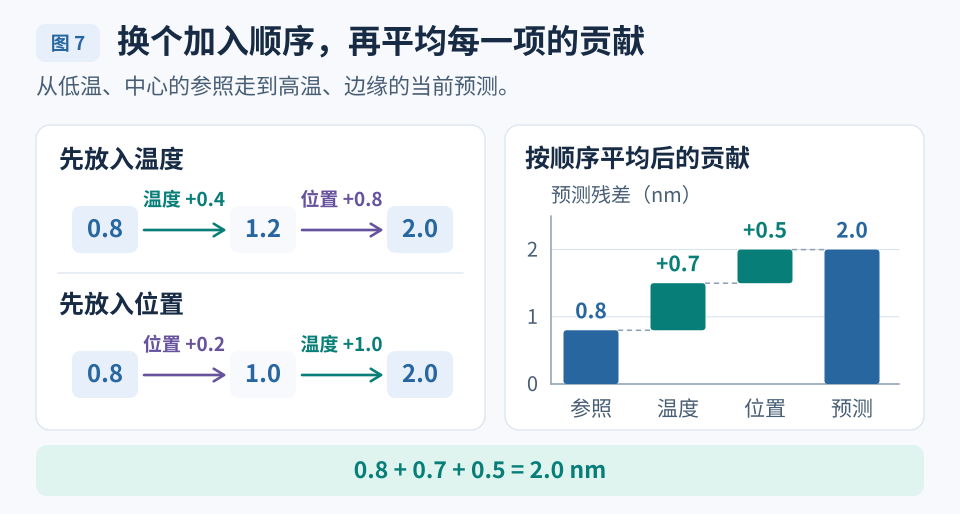

*图 7。左侧的每条路径都从同一个参照走到同一个预测。右侧瀑布图画的是按顺序平均后的贡献，高温 $+0.7$，边缘 $+0.5$。*

SHAP（SHapley Additive exPlanations）把这个分账方法用于模型预测。设 $v_x(S)$ 是把集合 $S$ 中的特征设为当前样本的值、其余特征补上背景值后得到的平均输出。上面的背景只有一条 $(0,0)$。如果有一批背景记录，可以直接取它们的值来填补（按边际分布），也可以用和已知特征匹配的值来填补（按条件分布）。温度和压力相关时，两种做法可能给出不同的分账。

不管有多少个特征，每种加入顺序里的差值都会加回起点与终点的差。所以对选定的输出尺度与参照，有

$$
f(x)=v_x(\varnothing)+\sum_j\phi_j(x).
$$

沿用图 7 的例子，把参照换成「低温、边缘」$(0,1)$。起点变成 $1.0$，位置已取当前样本的值，贡献为 $0$。高温分到从 $1.0$ 变成 $2.0$ 的这段差值，贡献为 $+1.0$。

读一张 SHAP 图时，先看基准值取自什么背景，再看输出尺度和正负号。分类模型用原始分数画图时，贡献也在原始分数的尺度上。树模型可用 TreeSHAP 按指定的缺失特征处理方式高效计算，KernelSHAP 用加权回归和模型调用近似这类分配。多特征时的权重写在附录 B。[SHAP 原论文](https://arxiv.org/abs/1705.07874) · [TreeExplainer 的输出尺度与背景设置](https://shap.readthedocs.io/en/stable/generated/shap.TreeExplainer.html)

### 5.2 LIME 在这条记录附近画一条直线

如果你只关心温差 $z=1.2$ 附近模型如何变化，可以在它周围做一些小改动，让原模型 $f$ 给出预测，再用一条线近似这段曲线。离 $1.2$ 越近的点权重越大，这就是 **LIME** 的基本思路。

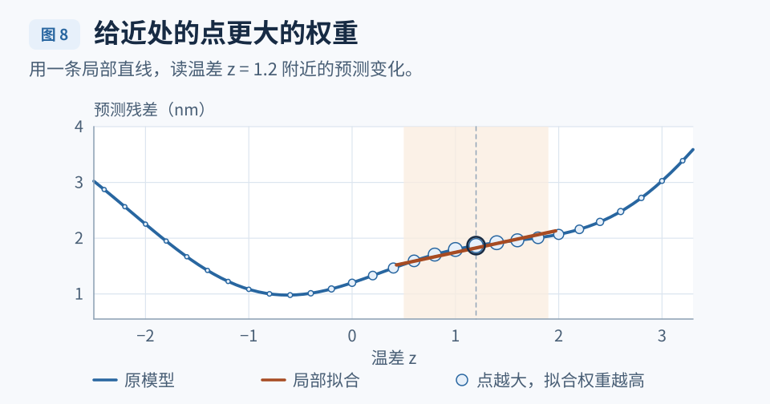

*图 8。先读深色圈出的当前样本，再看大点密集的区域。橙线拟合的是这里的走势，斜率表示在这套邻域和权重下的近似变化。*

具体做法是生成一批扰动样本 $z_i$，计算与当前样本 $x$ 的距离，给每个点一个权重 $w_i$。然后求一个简短的模型 $g$，例如最小化加权平方误差 $\sum_i w_i[f(z_i)-g(z_i)]^2$，并限制能写进解释的变量数。图片可以用开关表示某块区域是否可见，表格则可以用原变量或离散区间表示这些变化。

同一个样本，把邻域放大或缩小，拟合到的斜率可能变。读 LIME 的系数时一起看采样范围、邻域内的拟合误差，以及换随机种子后主要方向是否一致。[Ribeiro 等人的 LIME 原论文](https://arxiv.org/abs/1602.04938)

### 5.3 用反事实找能达标的输入

如果关心的是「把什么调到多少，模型预测才会达标」，可以让模型做一连串 What-if 试算。从当前输入 $x$ 出发，在可调的范围 $\mathcal C$ 里找成本最低、预测能进入目标集合 $\mathcal T$ 的 $x'$。

$$
x^*=\arg\min_{x'\in\mathcal C} d(x,x')
\qquad\text{满足}\qquad f(x')\in\mathcal T.
$$

比如，只开放两个已换算到统一调节尺度的旋钮 $t$ 和 $d$，分别表示温度和剂量的设定。模型为 $f(t,d)=0.8+0.4t-0.2d$。当前设定 $(2,0)$ 预测为 $1.6\,\mathrm{nm}$，目标是 $\hat y\leq 1.0\,\mathrm{nm}$，也就是 $d\geq 2t-1$。设允许范围为 $1\leq t\leq 3$ 和 $0\leq d\leq 2$。图上两轴等比例，用点之间的直线距离表示调节成本。

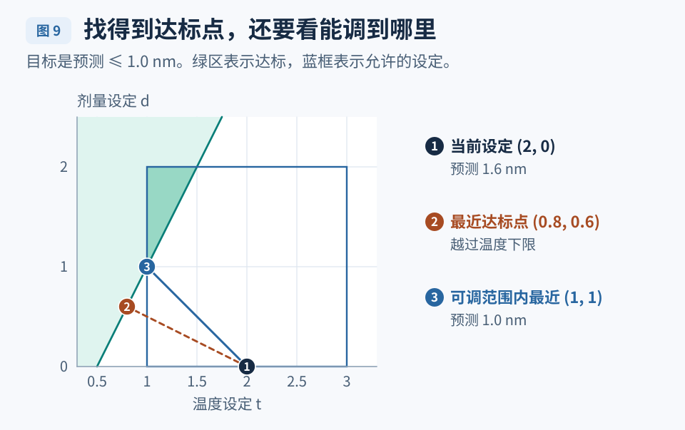

*图 9。绿色区域里的设定都能让模型预测达标。蓝框圈出可调范围。加上范围后，最近点从 $(0.8,0.6)$ 移到 $(1,1)$，两个点的模型预测都是 $1.0\,\mathrm{nm}$。*

暂时拿掉蓝框，从当前点向达标边界作垂线，垂足是 $(0.8,0.6)$，落在温度下限左边。把蓝框放回来，只在深绿色的三角形里找，离当前点最近的就是下方那个角 $(1,1)$。

真实任务里，先列出在决策时刻能调的量、联合约束和成本。wafer 编号是固定输入，读数也要区分可调设定与只能观测的响应量。找到候选设定后，用有对照的试验量出实际结果。第 7 节会说明为什么模型试算和工艺试验可能给出不同方向。

## 6. 从输出往神经网络里面查

### 6.1 梯度看眼前，积分梯度看一路

给一张 mark 图像，先选定要解释的输出 $f_c(x)$，例如模型给 AIM 类的分数。对第 $j$ 个像素求偏导 $\partial f_c/\partial x_j$，得到「这里稍微亮一点，分数朝哪边变、变得有多快」。取绝对值后，就能把变化最敏感的位置画成**显著性图（saliency map）**。如果以零输入为起点，梯度乘输入 $x_j\,\partial f_c/\partial x_j$ 相当于用终点的斜率乘上走过的距离，近似这项带来的分数变化。

当前位置的斜率有时很小，前面走过的路却很陡。看一维函数 $f(s)=2s-s^2$。从 $s=0$ 走到 $s=1$，输出增加了 $1$，终点斜率恰好为 $0$。**积分梯度（Integrated Gradients，IG）** 把沿途的斜率都算进去。

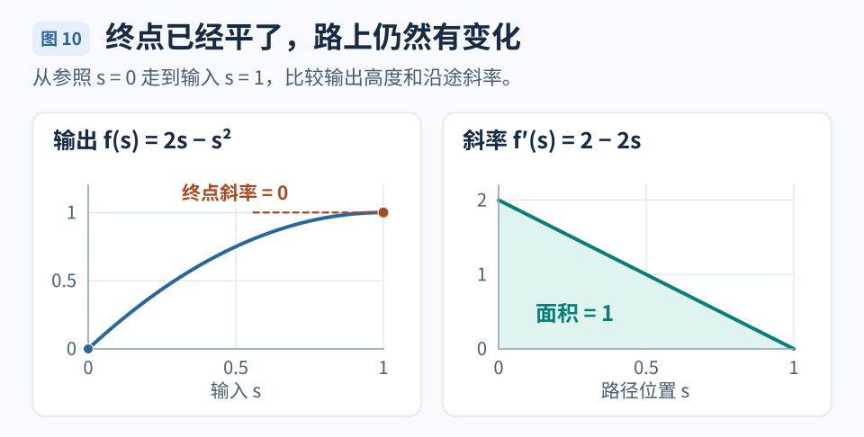

*图 10。左图是输出随输入的变化。右图把沿路的斜率单独画出来，曲线下的面积是 $1$，正好等于左图两端的高度差。*

有多个输入时，从参照 $x^{\mathrm{ref}}$ 向当前输入 $x$ 走直线。第 $j$ 项的贡献是「它走过的距离」乘以「它沿途的平均偏导」。

$$
\mathrm{IG}_j(x)
=(x_j-x_j^{\mathrm{ref}})\int_0^1
\frac{\partial f_c(x^{\mathrm{ref}}+\alpha(x-x^{\mathrm{ref}}))}{\partial x_j}
\,\mathrm d\alpha.
$$

把各项相加，就沿路径把总变化积了回来，即 $\sum_j\mathrm{IG}_j=f_c(x)-f_c(x^{\mathrm{ref}})$。实际用有限个点近似积分，可以检查两边差多少。用模糊图当参照时，热图在分配「清晰图比模糊图多出的分数」。若换成黑图，起点和要分的分数也会变。[积分梯度原论文](https://arxiv.org/abs/1703.01365)

### 6.2 用遮挡测试模型到底对哪里敏感

如果热图在 mark 中心很亮，可以把中心一小块换成附近背景，再比较 AIM 分数。接着遮同样大小的边角，或随机挑几块做对照。表格可以替换一个字段，文本可以换一个词或一句话。每次都固定模型，记录改了什么、分数改了多少。

遮挡图像时，纯黑方块、模糊和背景填补会给模型不同的信号。可以并排试几种遮挡，再看哪些区域反复出现。如果不同填补方式给出不同位置，就把差异也记录下来。第 8.1 节把这类操作做成一条曲线。

### 6.3 从中间表示里读出信息

把网络想成一串表征变换 $x\to h_1\to h_2\to\cdots\to\hat y$。解释中间层时可以由浅入深地做三件事。

1. **先看哪些地方会激活。** 把卷积通道的激活画回图像位置，再找最能激活该通道的几张输入。看看它经常响应的是 mark 的边、边缘噪声，还是背景条纹。也可以反过来优化输入，寻找能让这个通道强响应的图案，这叫激活最大化。
2. **再试能否读出一个概念。** 冻结模型，在 $h_\ell$ 上训练一个简单分类器，试着区分 AIM 和其他 mark。这类小分类器叫**探针（probe）**。在新 wafer 上检验，并与简单基准比较。如果只是想先看看数据怎样聚在一起，可以用 PCA、UMAP 或 t-SNE 画投影，再回到原空间检验邻居和分组差异。
3. **最后查模型是否用到这份信息。** 如果探针能从某层读出 mark 类型，可以在那一层做受控替换，例如用配对样本的表示换掉同一个位置，并以相同类型替换作对照，看原模型的输出如何改变。

第一步找位置，第二步测试信息能否读出来，第三步量出这次内部替换怎样改变输出。[Hewitt 与 Liang 的探针对照实验](https://aclanthology.org/D19-1275/)

### 6.4 读 attention 时，把权重和值一起看

在一层的一个注意力头里，当前位置从多个位置取值。设第 $i$ 个位置的权重是 $a_i$，传来的向量是 $v_i$，该头的读出就是 $\sum_i a_i v_i$。注意力图通常展示 $a_i$。如果想追踪实际送入下一步的量，还得看 $a_i v_i$。

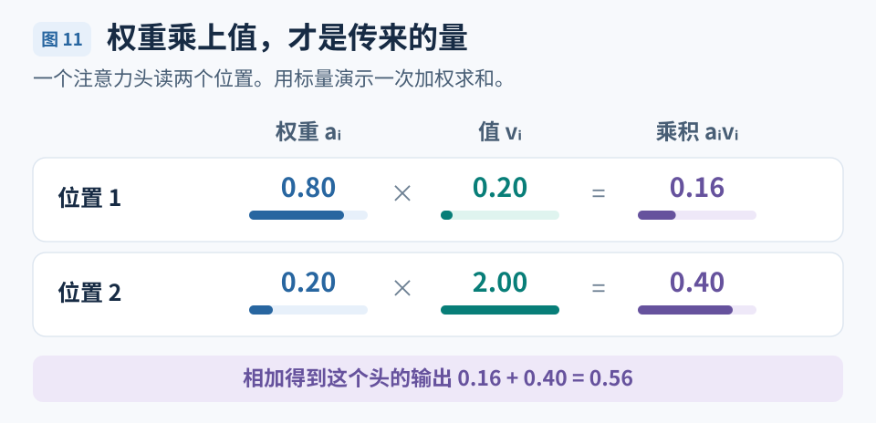

*图 11。这里用一个标量演示注意力头的计算。两个位置分别传来 $0.16$ 和 $0.40$，相加得到 $0.56$。*

在真实 Transformer 里，向量还会经过多个头、输出投影、残差通路和后续层。可以先用 attention 图挑出值得检查的位置，再把同一个输入送两次，只在第二次改变选定注意力头的输出，观察最终的目标类别分数或下一个 token 的分数。若直接改输入词，也记录替换方式，因为词变了以后，权重和值通常都会跟着变。[Transformer 原论文](https://arxiv.org/abs/1706.03762) · [注意力解释的对照实验](https://aclanthology.org/N19-1357/) · [如何设计这些对照](https://aclanthology.org/D19-1002/)

## 7. 从模型里的变化走到工艺里的变化

### 7.1 日志里的两组 wafer，本来可能就不一样

假设从日志看，高温组的平均残差更大。但高温经常用在已经发生偏移的工况上。要看温度本身会带来什么变化，可以把常态和偏移态分开，在每种工况里比较两个温度档。

| 工况 | 低温时的残差 | 高温时的残差 | 同工况下的变化 |
| --- | ---: | ---: | ---: |
| 常态 | $1.0\,\mathrm{nm}$ | $0.6\,\mathrm{nm}$ | $-0.4\,\mathrm{nm}$ |
| 偏移态 | $2.2\,\mathrm{nm}$ | $1.8\,\mathrm{nm}$ | $-0.4\,\mathrm{nm}$ |

在这个例子里，日志中低温组有 $8$ 次常态、$2$ 次偏移态，平均是 $(8\times1.0+2\times2.2)/10=1.24$。高温组正好反过来，平均是 $(2\times0.6+8\times1.8)/10=1.56$。直接看总平均，方向翻转了。让两组的工况各占一半后，平均就从 $1.60$ 降到 $1.20$。

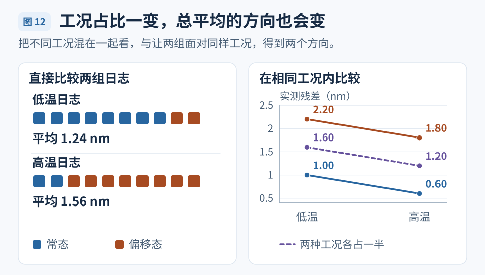

*图 12。左图对比两组日志的工况组成。右图在相同工况内对照两档温度，实线为常态和偏移态，虚线为两种工况各占一半时的平均。*

这里工况同时影响温度选择和残差，是一个**混杂因素**。用因果记号写，$P(Y\mid T=t)$ 是「日志中温度为 $t$ 的记录，残差怎样分布」，$P(Y\mid \operatorname{do}(T=t))$ 是「主动把温度设为 $t$ 后，残差怎样分布」。想估计第二个量，可以在相近工况内随机分配温度档，再比较量测。用历史数据调整时，先说明哪些变量在温度设定之前发生、哪些可能同时影响两边。

### 7.2 同一份信息，换个输入也能用

把温度输入标准化成 $t$，再加一列备份温度 $z$。设四条记录的 $t$ 各有两个 $-1$ 和 $+1$，备份逐行等于 $t$，标签是 $y=3t$。比较两个模型。

$$
f_A(t)=3t,\qquad f_B(t,z)=1.5t+1.5z.
$$

两者在原始数据上逐行给出同样的预测。用 MSE 做置换检查时，模型 A 打乱温度，整个温度项都乱了。模型 B 只打乱温度时，另一半仍按原行保留。把 $t,z$ 用同一个顺序一起打乱，才会把整组信息挪到别的行。对所有置换取平均后，B 中单列置换的 MSE 增量为 $4.5\,\mathrm{nm}^2$，成组置换的增量为 $18\,\mathrm{nm}^2$。

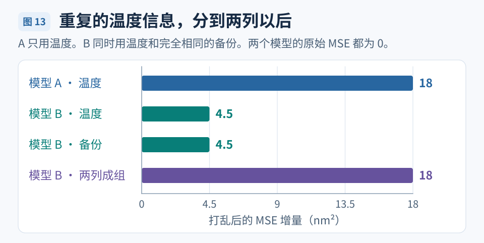

*图 13。两模型的原始 MSE 都为 $0$。单列置换分数取决于模型把重复信息放在哪里，成组置换直接测试整组。附录 B 给出手算。*

遇到温度传感器、压力读数或机台编号这类彼此带有重叠信息的特征，先看相关图、分组和数据来源。需要查某一组是否有用，就做成组置换。需要比较两个可独立操作的量，就设计让它们分别变化的试验。如果一个变量只是跟随工况变化的**代理变量（proxy）**，它仍可能有预测价值。下一步是查清它代表哪段流程、是否会随部署条件改变。

### 7.3 把模型候选变成试验记录

第 5.3 节算出的 $(1,1)$ 可以放进试验计划。在允许的工况内，温度设定改到 $t=1$、剂量设定改到 $d=1$，用同一量测流程检验残差能否进入目标区间。

试验记录写清楚哪些 wafer 可以进入试验、对照组怎样选、两项设定怎样修改、用哪个统计量比较结果。如果只想知道温度这一个因素的效应，设计里要让温度和剂量可以分开比较。如果只想验证组合方案，就把这对设定当成一个整体，与现有方案对照。

## 8. 怎样判断一个解释有用

### 8.1 按解释指的地方动手，检查保真度

如果解释说温度把当前分数往上推，就把温度换成约定参照值，记录同一个模型的分数。接着继续替换下一项。用**解释排序**和**随机排序**分别做一次，比较两条曲线，这叫删除检查（deletion check）。「删除」在这里是把信息替换掉，模型仍收到它需要的输入形状。

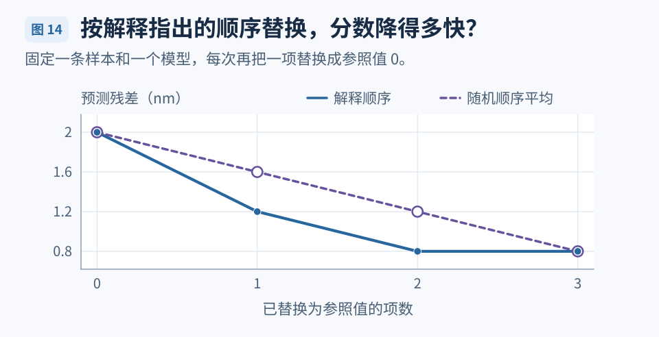

*图 14。用同一条样本和同一个模型。第一步替换温度，分数从 $2.0$ 降到 $1.2$，随机替换一项的平均分数是 $1.6$。第三步所有输入都回到参照，两条线在 $0.8$ 汇合。*

图中模型为 $f(t,p,z)=0.8+0.8t+0.4p$，从 $(1,1,1)$ 开始，每步把一项换成 $0$。随机曲线枚举三项的六种顺序后取平均。想从反方向验证，也可以从全参照输入起步，按解释顺序放回输入，观察分数恢复得有多快，这叫插入检查（insertion check）。

对于正向贡献，可以看替换后分数降多少。检查负向贡献时，预期方向相反。做整批检查时还可以看 RMSE 或准确率的变化。曲线的含义取决于怎样填补、测试了哪些样本，强相关变量可以按组一起替换。对于加法归因，还可另查「各项能否加回预测差」，它检验的是分账和计算是否对得上。

### 8.2 换一种合理设置，检查稳定性

如果相近 wafer 的预测差不多，解释却从「温度主导」跳到「压力主导」，可以按下面顺序排查。

| 改动 | 可以看出什么 |
| --- | --- |
| 固定模型、样本和参照，换采样种子 | LIME 或近似 SHAP 的采样波动 |
| 固定模型，换相邻 site 或相近工况 | 局部解释随输入怎样变化 |
| 固定样本，换一个有意义的参照 | 解释对起点有多敏感 |
| 按 wafer 或批次重采样并重训 | 学到的分裂、曲线或贡献是否跟着训练数据变 |

还可以把网络部分或全部参数随机化，再生成同一种热图。若热图几乎原样出现，检查它是否主要在描画输入本身的边缘。把这类模型随机化检查与扰动结果一起看，能更容易判断解释是在读模型，还是在读图像外观。[Adebayo 等人的显著性图检查](https://arxiv.org/abs/1810.03292)

### 8.3 写一份别人能复查的解释记录

| 写哪一项 | 放什么进去 |
| --- | --- |
| 任务 | 输出单位、预测时点、使用者要做的决定 |
| 数据和模型 | 版本、独立的划分单位、测试表现和容易错的工况 |
| 解释做法 | 单点或全局、参照、替换方式、采样次数和种子、相关变量如何分组 |
| 结果与复核 | 主要数字、重复计算的波动、随机对照或代理保真度 |
| 后续验证 | 哪些变量可调、候选设定和成本、怎样安排工艺试验 |

## 9. 一次 wafer 残差模型的排查

### 9.1 整体误差背后的边缘问题

这次仍在曝光前预测各 site 的 $dx$ 残差，用一份合成数据走完整个诊断。共有 24 片 wafer，按整片分成训练、诊断和最终测试三组，每组 8 片。训练组用来拟合，诊断组用来看哪里出错，最后留一组新片比较改动前后的表现。

每片有 6 个中心区测点和 2 个边缘测点。位置用 $e$ 表示，中心取 $0$，边缘取 $1$。同一片共用曝光前记录的温差档 $t$ 和压力偏差档 $p$，低档取 $-1$，高档取 $+1$。每组中，低温低压和高温高压各有 3 片，另外两种组合各有 1 片。用训练组做线性回归，得到预测值，单位是 nm。

$$
f(t,p,e)=2.0+0.8t+0.4p+0.4e.
$$

把模型用在诊断组，全部测点的 RMSE 约为 $0.36\,\mathrm{nm}$。按位置拆开后，中心区约为 $0.22\,\mathrm{nm}$，边缘约为 $0.61\,\mathrm{nm}$。中心测点占四分之三，合在一起看，边缘问题容易被盖住。

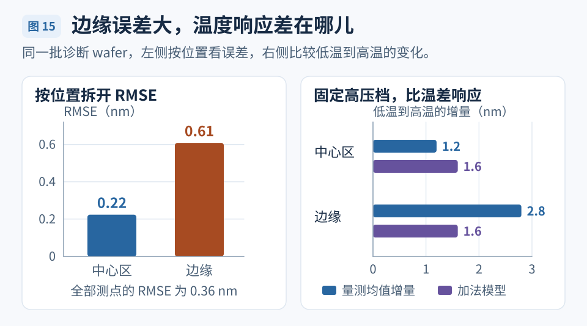

*图 15。左侧用同一个模型按位置汇总诊断误差。右侧固定在高压档，比较温差从低档切到高档时，量测均值和模型预测各增加了多少。*

### 9.2 先查模型依赖哪组输入，再拆开一个边缘预测

温度和压力常一起变化。要看模型依赖这组读数的程度，可以在诊断组里按 wafer 置换。每片的 8 行共用同一个替换值。成组置换时，把温度和压力作为一对，用同一个随机顺序一起移动，保留两列之间的对应关系。

这里用 MSE 比较，平方误差的单位为 $\mathrm{nm}^2$。每片轮流取一遍 8 片 wafer 的读数，再把所有平方误差平均。这等于对所有置换取 MSE 均值，因为每片取到每个来源的机会相同。

| 诊断数据怎样改 | MSE（$\mathrm{nm}^2$） | 比原来增加 |
| --- | ---: | ---: |
| 保留原始读数 | $0.13$ | — |
| 只置换温度 | $1.41$ | $1.28$ |
| 只置换压力 | $0.45$ | $0.32$ |
| 温度和压力一起置换 | $2.37$ | $2.24$ |

成组移动读数时，误差上升最多。再看一个高温、高压的边缘点 $(1,1,1)$，模型预测 $3.6\,\mathrm{nm}$，量到的是 $4.3\,\mathrm{nm}$。用训练组的平均输入 $(0,0,0.25)$ 作参照，归因分配的是这个点与参照之间的预测差 $3.6-2.1=1.5\,\mathrm{nm}$。温度分到 $+0.8$、压力分到 $+0.4$、位置分到 $+0.3$。

固定位置，把这一对读数换成数据中也出现过的低温低压 $(-1,-1)$，模型的预测降到 $1.2\,\mathrm{nm}$。两个输入都从 $+1$ 变为 $-1$，温度和压力项共减少 $2(0.8+0.4)=2.4\,\mathrm{nm}$。接下来查的是量测与预测的差 $4.3-3.6=0.7\,\mathrm{nm}$，要回到量测记录，比较不同位置的温度响应。

### 9.3 从低温到高温，边缘的变化更大

看图 15 右侧。只取高压档，分别汇总低温和高温的量测。中心区的平均值从 $1.8$ 增至 $3.0$，增加 $1.2\,\mathrm{nm}$。边缘从 $1.4$ 增至 $4.2$，增加 $2.8\,\mathrm{nm}$。加法模型给两处用的是同一个温度斜率 $0.8$，所以两处都只加 $1.6\,\mathrm{nm}$。它在边缘把低温的预测抬高了，把高温的预测压低了。

这组数据提示模型要加一项**温度与位置的交互** $t\,e$。用原训练组重新拟合后，中心区的温度斜率为 $0.6$，边缘为 $0.6+0.8=1.4$。最后在留出的第三组 wafer 上跑两版模型，整体 RMSE 从约 $0.36$ 降到 $0.10\,\mathrm{nm}$。如果要把这条线索用于工艺调参，可以在同一压力档安排两档温度的对照试验，分别量中心区和边缘。

> **合成数据的来历。** 每个 site 的量测值由 $y=2.0+0.6t+0.4p+0.4e+0.8te+\varepsilon$ 生成，单位为 nm。每片的中心区和边缘各有一半点的 $\varepsilon$ 取 $+0.1$，另一半取 $-0.1$。因此同一工况下，每个区域的均值都能直接从式子读出来。

## 10. 大模型怎样把线索变成下一个 token

第 6 节解释的是模型为什么给一张图较高的 AIM 分数。换成语言模型，可以先问一个更小的问题。读到句子的这个位置，为什么 B 的分数高过 A？从这个输出位置出发，可以先改提示看模型行为，再打开 Transformer 看哪段计算影响了它。[大模型入门讲义](../大模型入门/1106.md)

### 10.1 先选一个能量出来的目标

给模型两条几乎一样的提示，两条都停在「接收人是」后面。只交换递文件的人，看看模型会不会跟着换接收人。

| 运行 | 送给模型的文字 | 题意对应的答案 |
| --- | --- | --- |
| 参考 | 仓库里只有 A 和 B。A 把文件递给了另一人。接收人是 | B |
| 对照 | 仓库里只有 A 和 B。B 把文件递给了另一人。接收人是 | A |

假设 A、B 在这个位置各对应一个候选 token，先用 tokenizer 确认对应的编号。模型在当前位置给词表中每个 token 一个原始分数，叫 **logit**。固定比较 B 和 A，把「更偏向 B 还是 A」写成

$$
\Delta(x)=\ell_B(x)-\ell_A(x)
          =\log\frac{P(B\mid x)}{P(A\mid x)}.
$$

等式来自 softmax 的共同分母。$\Delta>0$ 表示在这两个候选里更偏向 B，$\Delta<0$ 表示更偏向 A。对照运行的正确答案虽变成 A，计算时仍用 B 的分数减 A 的分数，这样三个运行的数字可以直接比较。候选由多个 token 组成时，可以把每步的条件对数概率相加，比较整段候选。

可以先在一组提示上做这个行为实验。换名字、交换名字出现的顺序、改写句式，每组只改想测试的线索。有候选分数就记录 $\Delta$，只拿得到文本时可以记录选对接收人的比例。这样能看出模型是跟着「谁递出文件」走，还是偏爱某个名字或位置。

### 10.2 读出中间层的线索，再替换一格试试

把每层残差流想成一张表，一行对应一个 token，每行是一条向量。注意力和前馈网络逐层更新这张表。正常生成时，模型读最后一层、最后一个输入 token 的向量，经最终归一化和词表输出头算出 logit。

可以把同一个输出头提前接到中间层，带上模型原有的最终归一化，看看这一层的向量会读出多大的 B 与 A 分数差。这叫 **logit lens**。逐层读一遍，可以看到分数差在哪几层朝 B 的方向移动。**Tuned lens** 给每一层再学一个变换，让读出的概率分布尽量接近原模型的最终分布。[Belrose 等人的 Tuned Lens 论文](https://arxiv.org/abs/2303.08112)

要查一格里的信息怎样影响最后的答案，可以做 **激活替换（activation patching）**。固定同一个模型和答案槽位，做三次计算。

1. 跑「A 递文件」的参考提示，记下 $\Delta_{\mathrm{ref}}$，并保存第 $\ell$ 个块结束后、最后一个输入 token 位置的向量。
2. 跑「B 递文件」的对照提示，记下 $\Delta_{\mathrm{ctrl}}$。
3. 再跑一次对照提示。到同一层、同一对应位置时，放入第 1 步保存的向量。其余位置按这次运行正常计算，后续各层用替换后的状态继续计算，得到 $\Delta_{\mathrm{patch}}$。

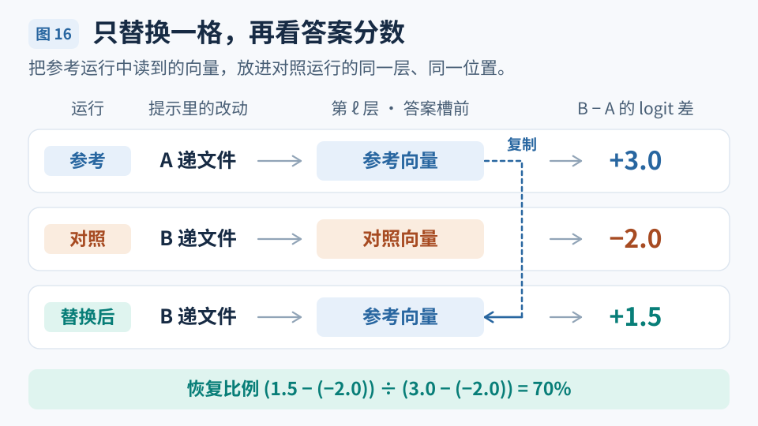

*图 16。三个数都读同一个输出槽位。第三次沿用对照提示，只换图中的一条向量。示例中分数朝参考运行的方向移了 $3.5$，占两次基础运行差值 $5.0$ 的 $70\%$。*

把三次分数代进下面的式子，就能比较不同位置各把分数推回了多少。

$$
\text{恢复比例}=
\frac{\Delta_{\mathrm{patch}}-\Delta_{\mathrm{ctrl}}}
     {\Delta_{\mathrm{ref}}-\Delta_{\mathrm{ctrl}}}.
$$

如果两次基础分数很接近，直接比较替换前后的分数差。要找稳定的线索，可以把不同层和位置轮流替换，每次只动一格，再换一批成对提示重做。比如把另一个位置的向量换进去只得到 $-1.8$，这次就只把分数推回 $0.2$，对应 $4\%$。用同一指标和同一种替换规则，才能比较这些位置。[Zhang 与 Nanda 的激活替换实验](https://arxiv.org/abs/2309.16042)

### 10.3 找出哪几个部件在接力

一格残差向量里叠着多条通路的输出。发现某一格能把分数推回去，可以进一步检查其中的某个注意力头或前馈层。比如先找到一个会把 B 的分数抬高的头，再追问它从哪个位置读到了 B、上游哪一项改变了它的注意力。像这样追查部件和信息流，就是 **机制可解释性（mechanistic interpretability）** 的一种做法。

一组共同完成某个行为的部件和连接，通常称为 **电路（circuit）**。找到候选路径后，可以做两种检查。第一种用对照信号替换候选部件的输出，看完整模型的任务分数掉多少，这是一种消融实验。第二种在同样的替换规则下保留候选路径，替换路径外待检查的部件，再看保留下来的部分能复现多少原来的行为。

「谁收到物品」有一个经典研究版本，叫 **间接宾语识别（IOI）**。研究者在 GPT-2 small 的成组英文提示中发现，一些头会在答案位置读取接收者姓名的信息，把残差推向该姓名的输出方向。另一些头会改变前一组头的注意位置，让它们较少去读递送者的姓名。这是用替换实验逐段追出来的一条路径。[Wang 等人的 IOI 电路研究](https://arxiv.org/abs/2211.00593)

### 10.4 把一条激活拆成少量方向

有时看见某个坐标在两类无关句子里都很大，直接给这个坐标起名会很难。可以换一套坐标来描述同一条向量。**稀疏自编码器（sparse autoencoder，SAE）** 从模型收集某一层的激活，学习一套可重复使用的方向，像一本向量字典。

对输入激活 $\mathbf h$，编码器给出每个方向这次用多少，记作 $z_j$。解码器按激活量把各个方向 $\mathbf d_j$ 加起来，得到近似的向量

$$
\hat{\mathbf h}=\mathbf b+\sum_{j=1}^m z_j\mathbf d_j.
$$

其中 $\mathbf b$ 是解码器的偏置。训练时一边让 $\hat{\mathbf h}$ 接近原向量，一边鼓励非零项尽量少。字典里的方向数 $m$ 可以多于原向量的维度，每个 token 通常只用其中一小部分。每个方向和对应的激活量合起来，就给出一项可追踪的 **稀疏特征**。[Cunningham 等人的 SAE 论文](https://arxiv.org/abs/2309.08600) · [Gao 等人的 SAE 扩展与评价](https://arxiv.org/abs/2406.04093)

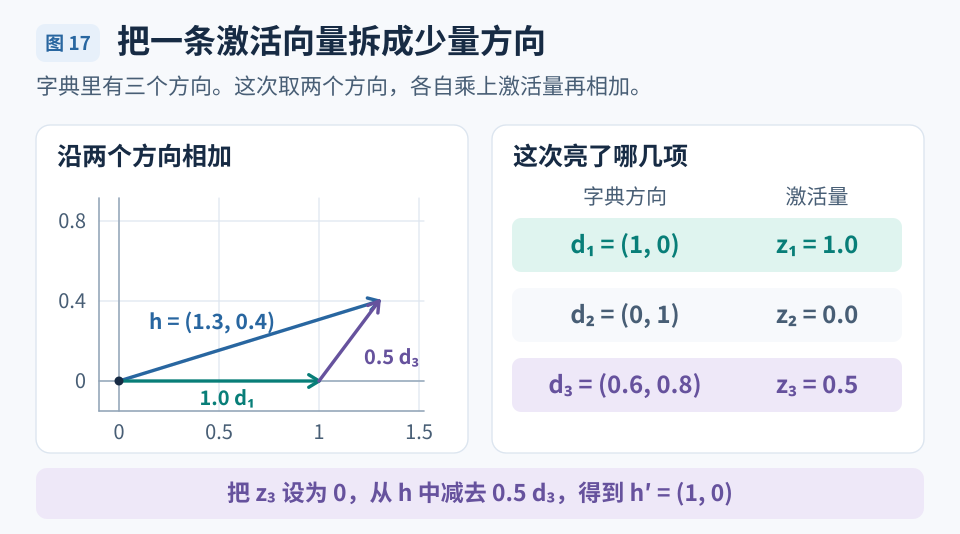

*图 17。二维算例取偏置 $\mathbf b=\mathbf 0$。这次的激活量是 $(1,0,0.5)$，所以 $\mathbf h=1\cdot(1,0)+0.5\cdot(0.6,0.8)=(1.3,0.4)$。去掉第三项后，向量变成 $(1,0)$。*

读一个真实的 SAE 特征时，先收集最容易让它亮起来的 token 和上下文，再找几类相似例子做对照。如果一个特征常在「递给某人」附近亮起，可以试试同义表达，以及只出现姓名却没有交接动作的句子。接着到原模型里把这项贡献 $z_j\mathbf d_j$ 从原向量减掉，保留其他项和重构误差，让后续层继续算。比较 B 与 A 的分数差，看看这个方向在当前任务里改变了什么。

> 想看真实的字典，可以从 Gemma 2 的公开 SAE 资源入手。再往前一步，有研究用稀疏替代模型近似原模型的部分计算，画出连接各层特征和输出的归因图。图里挑出的路径可以回到原模型做干预来验证。[Gemma Scope](https://arxiv.org/abs/2408.05147) · [归因图方法论文](https://transformer-circuits.pub/2025/attribution-graphs/methods.html)

### 10.5 把模型写出来的推理也当成实验对象

模型先写出步骤再给答案时，可以检查两件事。第一件是步骤本身是否算对、引用的事实是否成立。第二件是这些文字怎样影响后续答案。

要检查第二件，可以固定题目和前面几步，做三个版本。一个保留原来的关键步骤，一个把它换成明显错误的步骤，一个只换措辞。分别让模型从这一步之后续写，比较三次结果，并在一批题上重复。如果改错一步经常会让答案跟着变，就找到了文字步骤影响后续生成的一种证据。[Lanham 等人的推理步骤干预实验](https://arxiv.org/abs/2307.13702)

也可以从题目一侧做对照。例如把正确选项从 A 挪到 C，保持选项内容，记录模型选中的内容和它写出的理由。有研究用选项顺序给模型施加偏置，再分别检查答案改变了多少、理由有没有提到这个线索。这两项可以分开统计。[Turpin 等人的推理解释实验](https://arxiv.org/abs/2305.04388)

## 附录 A · 术语速查

| 术语 | 读到它时先问 |
| --- | --- |
| Baseline / reference，参照 | 我从什么输入或什么平均输出出发？ |
| Global / local，全局 / 局部 | 结果在说整批数据，还是某个样本附近？ |
| Attribution，归因 | 预测与参照之间的差分给了谁？ |
| Surrogate，代理模型 | 简单模型在哪些输入上能复现原模型？ |
| Faithfulness，保真度 | 按解释修改输入或内部量，原模型会怎样变？ |
| Stability，稳定性 | 换数据、参照或随机种子时，结果变化多大？ |
| Counterfactual，反事实解释 | 哪些输入改动能让模型输出达到目标？ |
| Proxy，代理变量 | 这列数跟随的实际条件是什么？ |
| Logit，原始分数 | 在哪个输出位置、比较的是哪两个候选？ |
| Activation patching，激活替换 | 从哪次运行取值，换到了哪一层和哪个位置？ |
| SAE，稀疏自编码器 | 这一格激活用到了字典里的哪些方向？ |

## 附录 B · 手算和推导

### B.1 多个特征时，SHAP 的权重从哪来

设 $F$ 有 $m$ 个特征。固定要算的特征 $j$，设它前面已经加入的特征集合是 $S$。排在它前面的特征有 $\lvert S\rvert!$ 种排法，后面的有 $(m-\lvert S\rvert-1)!$ 种。总共有 $m!$ 种顺序，所以

$$
\phi_j(x)=\sum_{S\subseteq F\setminus\{j\}}
\frac{\lvert S\rvert!(m-\lvert S\rvert-1)!}{m!}
\big[v_x(S\cup\{j\})-v_x(S)\big].
$$

两特征时，每一种顺序的权重都是 $1/2$，正好回到图 7 的算法。

### B.2 置换重复多次时，波动怎么看

固定模型和测试集，每次重新打乱一列并计算误差增量 $\mathrm{PI}^{(r)}_j=L^{(r)}_j-L_0$。用多次结果的均值描述常见的增量，用经验分位数描述**打乱顺序**带来的波动。若关心换一批 wafer 后重要性会怎样变，可以另外按 wafer 重采样，再对重采样数据计算重要性。

图 13 里，打乱前后的 $t$ 都取 $\pm1$，每个位置有一半机会被换成另一个值，所以 $\mathbb E[(t_{\mathrm{perm}}-t)^2]=\tfrac12\times 0+\tfrac12\times4=2$。模型 A 的增量为 $3^2\times 2=18$。B 只打乱一列时，增量为 $1.5^2\times2=4.5$。用同一顺序打乱两列时，两个误差项同方向，系数先合成 $3$，再平方。

### B.3 采样位置怎样影响 nMU

用线性模型从少量 site 拟合一张残差图时，还可以问，量测噪声会在预测里被放大多少？归一化模型不确定度（normalized model uncertainty，nMU）就是把**拟合曲面在某个位置的标准差**除以单次量测噪声的标准差。

把 $C$ 的每一行写成一个 site 的基函数，例如 $[1,x,y]$。若设计矩阵满列秩，各点量测噪声相互独立且方差同为 $\sigma_{\mathrm{meas}}^2$，普通最小二乘给出

$$
\operatorname{Cov}(\hat\beta)=\sigma_{\mathrm{meas}}^2(C^\mathsf{T}C)^{-1}.
$$

第 $k$ 个系数在单位量测噪声下的标准差为 $K_k=\sqrt{[(C^\mathsf{T}C)^{-1}]_{kk}}$。对新位置的基函数列向量 $c$，拟合值是 $c^\mathsf{T}\hat\beta$，所以

$$
\mathrm{nMU}(c)=\sqrt{c^\mathsf{T}(C^\mathsf{T}C)^{-1}c}.
$$

用同一种直线模型拟合两组量测，各组测三点。一组测 $x=-1,0,1$，另一组测 $x=-0.2,0,0.2$。两组在中心 $x=0$ 的 nMU 都约为 $0.58$。在 $x=1$ 处，第一组约为 $0.91$，第二组约为 $3.58$。测点挤在中心时，斜率更容易被噪声带偏，把拟合线延伸到边缘，波动也跟着变大。

如果同一套采样布局独立重复 $N$ 次，并把所有记录一起拟合同一组系数，$C^\mathsf{T}C$ 放大为原来的 $N$ 倍，nMU 就缩小为原来的 $1/\sqrt{N}$。应用到按场或按片拟合的模型时，先按实际训练单位列出设计矩阵和噪声假设。

## 延伸阅读

- 比较更多用于表格数据的解释方法。[Christoph Molnar 的 Interpretable Machine Learning](https://christophm.github.io/interpretable-ml-book/)
- 看一个可以逐项检查预测的模型怎样用于实际任务。[Caruana 等人的可加模型案例](https://www.microsoft.com/en-us/research/publication/intelligible-models-healthcare-predicting-pneumonia-risk-hospital-30-day-readmission/)
- 系统了解观察、干预和因果图。[Peters、Janzing 与 Schölkopf 的 Elements of Causal Inference](https://mitpress.mit.edu/9780262037310/elements-of-causal-inference/)
