# 强化学习：从序贯决策到大模型后训练

这份讲义面向已经了解监督学习、神经网络和梯度下降，但尚未系统学习强化学习的理工科研究生。需要的数学工具是条件概率、期望、矩阵运算与多元微积分。涉及的新概念都会从问题本身引入，不要求事先掌握马尔可夫决策过程、动态规划或控制理论。

贯穿全文的问题是：**当我们不能为每一步提供标准答案，只能观察行动的后果时，怎样调整一个决策规则，使长期结果变好？**

对于机器人，行动可能是施加力矩；对于实验流程，行动可能是选择下一次测量；对于语言模型，行动可以是生成一个 token，或发起一次工具调用。动作的形式虽然不同，核心困难却相通：结果可能很晚才出现，动作会改变之后遇到的情境，而且我们只能看到实际尝试过的那条路径。

全文按“问题 → 数学对象 → 可计算的更新 → 算法为何演进”的顺序展开。首次阅读建议依次读到第 14 节，再进入大模型训练。附录给出额外推导、带答案练习和不依赖深度学习框架的可运行实验。几个小例子会反复出现：前半部分用“现在提交，还是继续完善”串起价值学习，后半部分用同一道方程题比较不同的训练信号。

## 阅读路线

| 阶段 | 章节 | 需要建立的理解 |
|---|---|---|
| 定义问题 | 1—3 | 为什么需要 RL；状态、策略、奖励和长期回报分别是什么 |
| 学习价值 | 4—8 | Bellman 递推怎样连接动态规划、MC、TD、Q-learning 与 DQN |
| 直接改策略 | 9—13 | 策略梯度怎样成立，Actor–Critic、GAE、TRPO/PPO 怎样控制噪声与更新幅度 |
| 连接大模型 | 14—19 | token 决策、SFT、奖励模型、RLHF、DPO、RLVR、GRPO 与工程实现 |
| 检查理解 | 20 与附录 | 怎样设计实验、辨别改进来源，并亲手验证关键公式 |

先记住两条路线即可：**价值学习**先估计“这样做，未来能得到多少”，再据此选择；**策略学习**直接调整“下次这样做的概率”。Actor–Critic 会把两条路线接起来。到了大模型部分，行动变成生成 token，但这两条思路仍然适用。

## 1. 先有决策问题，再有强化学习算法

### 1.1 预测一个答案，与选择一个行动

在监督学习里，数据集已经给出输入与目标。例如，一张图像对应一个类别；一组工艺特征对应一个测量值。模型预测得不好，可以直接比较预测与标签，计算损失并更新参数。

现在考虑一个逐步求解任务：系统手里有一份粗略方案。它可以立即提交，也可以花时间继续完善。完善可能成功，也可能白费力气；如果成功，之后提交的收益更高。如果失败，系统还需要决定是继续尝试，还是接受当前结果。

我们很难提前给每个可能状态写出“正确下一步”。但可以在实际执行后观察耗时、成功率和最终质量，并给出一个评价。强化学习关心的就是：从这样的反馈中学习**策略（policy）**，即在不同情境下怎样选择行动。

这里的监督信号是**奖励（reward）**：它告诉我们做完以后得了多少分。至于怎样调整行动，才能在以后拿到更高的分，需要学习算法自己从经历中找出规律。小问题可以用表格记录经验；遇到图像、语言这样的复杂输入时，再让神经网络承担表示与预测的工作。

### 1.2 三个困难一起出现

**第一，结果很晚才出现，功劳该记在哪里？** 一段程序通过测试，可能是因为最开始选对了算法，也可能是最后检查时修好了错误。最终分数只给出整体评价，我们还要用它改进中间的选择。这叫**信用分配（credit assignment）**。

**第二，先做目前最有把握的，还是尝试一种新办法？** 一直选择熟悉的动作，可以获得眼前收益；试一试其他动作，则可能发现更好的方案。这就是**探索与利用（exploration and exploitation）**的取舍。

**第三，策略会改变自己看到的数据。** 经常继续完善的系统会积累修改方案的经验；经常立即提交的系统则主要看到提交结果。策略生成经验，经验又用来更新策略，在线强化学习形成了这样一个闭环。

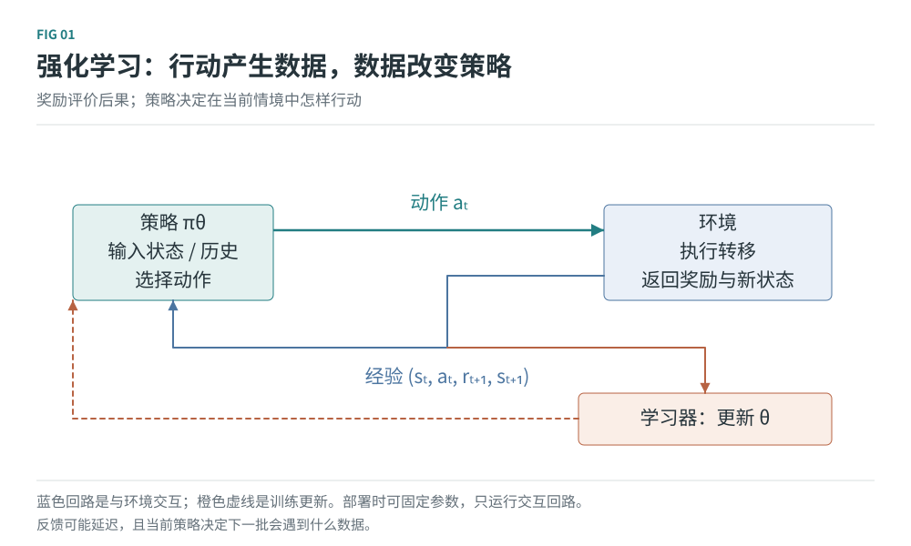

*图 1：执行策略得到经验，再用经验更新策略。训练时，这个闭环反复运行；部署时，可以固定学好的策略，用它持续选择行动。*

### 1.3 先从只做一次选择的 bandit 开始

先把“行动会影响下一步”拿掉。假设我们反复选择 A、B 两种方案，每次成功得 1 分、失败得 0 分。每个方案的成功率固定，但我们事先不知道。这就是一个**多臂老虎机（multi-armed bandit）**问题：每个“臂”代表一种可尝试的动作。

当前记录如下：

| 方案 | 已尝试次数 | 成功次数 | 估计成功率 |
|---|---:|---:|---:|
| A | 10 | 6 | 0.6 |
| B | 2 | 1 | 0.5 |

按眼前估计，我们会选 A。但 B 只试过两次，下一次成功或失败都会明显改变对它的判断。多试一次 B，既是在争取本次奖励，也是在购买以后做选择所需的信息。

对某个方案，已经观察到 $n$ 个奖励 $R_1,\ldots,R_n$，样本均值记为

$$
Q_n=\frac{1}{n}\sum_{i=1}^{n}R_i.
$$

拿到新奖励 $R_{n+1}$ 后，均值可以直接更新：

$$
\begin{aligned}
Q_{n+1}
&=\frac{nQ_n+R_{n+1}}{n+1}\\
&=Q_n+\frac{1}{n+1}(R_{n+1}-Q_n).
\end{aligned}
$$

例如 B 的下一次尝试成功了，新的估计就是 $0.5+\frac13(1-0.5)=\frac23$。我们只需保留当前均值和计数，就能不断吸收新经验。

请记住这个形状：**新估计 = 旧估计 + 步长 ×（新目标 − 旧估计）**。后面学习长期价值时，还会反复使用它。变化的是“新目标”：在 bandit 中它就是刚拿到的奖励，在序贯问题中还要算上之后的收益。

处理探索的一种简单办法是 **$\epsilon$-greedy**：以 $1-\epsilon$ 的概率选择当前估计最好的动作，以 $\epsilon$ 的概率随机尝试。比如 $\epsilon=0.1$，就为尝试其他方案保留了一部分机会。它让我们在当前收益与继续了解环境之间作出一个直接的折中。

### 1.4 从一次选择走向一串选择

如果先看到一个输入，再选择一次动作，例如针对一个问题选择一整段回答，称为**上下文 bandit（contextual bandit）**。输入提供情境，奖励评价整次选择。

如果把回答展开成连续生成的 token，或者允许查询工具、检查结果、继续行动，就进入了序贯决策：当前动作会改变下一步看到的情境。

完整回答可以作为一个宏观动作，也可以拆成许多微观动作。前一种描述方便讨论“哪份回答更好”，后一种描述方便讨论“生成到这里以后，下一步该怎么做”。大模型强化学习会同时用到这两种视角。

## 2. 用一个能手算的环境建立数学语言

### 2.1 一个两状态“方案完善”任务

设任务有两个非终止状态：$s_0$ 表示粗稿，$s_1$ 表示完善后的方案。完成提交后进入终止状态 $\bot$。

| 当前状态 | 动作 | 立即奖励 | 下一状态 |
|---|---|---:|---|
| $s_0$ | 提交 | $+2$ | 终止 |
| $s_0$ | 完善 | $-1$ | 以 $0.8$ 概率进入 $s_1$，以 $0.2$ 概率留在 $s_0$ |
| $s_1$ | 提交 | $+8$ | 终止 |
| $s_1$ | 完善 | $-1$ | 留在 $s_1$ |

这里用 $-1$ 表示多花一步的成本，用 $2$ 和 $8$ 表示不同质量方案的提交收益。我们先把规则全部写出来，学会计算一项策略的长期结果；之后再考虑更实际的情形：只看到经历过的转移，靠这些样本学习。

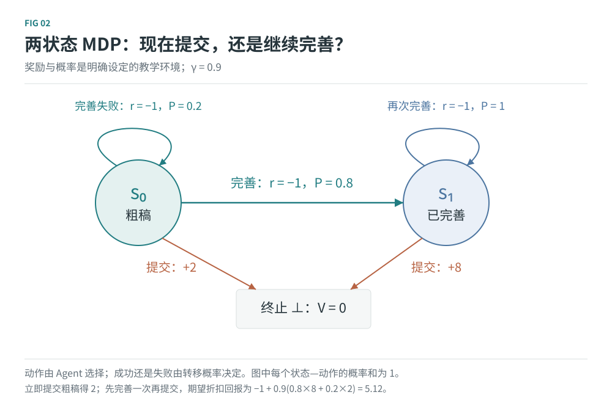

*图 2：同一个动作既带来当前收益，也改变未来的选择机会。这个小环境将贯穿 Bellman 方程、策略评估与价值迭代。*

### 2.2 马尔可夫决策过程

把上述规则整理起来，得到**马尔可夫决策过程（Markov decision process，MDP）**：

$$
\mathcal M=(\mathcal S,\mathcal A,P,R,\gamma,d_0).
$$

$\mathcal S$ 是状态空间，$\mathcal A$ 是动作空间；$P(s'\mid s,a)$ 给出采取动作后的转移概率；$R(s,a,s')$ 是该转移下立即奖励的条件期望；$\gamma$ 是折扣因子；$d_0$ 是初始状态分布。若奖励本身随机，可以把下一状态和奖励一并写进联合转移核 $p(s',r\mid s,a)$。

“马尔可夫”的意思是：**当前状态已经保留了预测下一步所需的信息。** 给定当前状态与动作，更早的历史就可以交给这个状态表示来概括。

例如，预测机器人下一步的位置，通常既要知道当前位置，也要知道速度。如果只记录位置，两次看似相同的状态可能一个正在向左移动，一个正在向右移动，下一步结果自然不同。把速度补进状态，模型才更好用。同样，判断设备是否在漂移，可能需要最近几次测量形成的趋势。

当 Agent 只能接收一部分信息时，我们用**部分可观测 MDP（POMDP）**描述：它看到的是观测 $o_t$，完整状态藏在环境中。此时可以利用历史 $h_t=(o_0,a_0,\ldots,o_t)$、循环网络的内部状态，或对隐状态的概率估计来决策。这些办法都在回答同一个问题：怎样把过去的信息压缩成对下一步有用的状态。

### 2.3 策略、轨迹与时间下标

随机策略写成

$$
\pi_\theta(a\mid s)=\Pr(a_t=a\mid s_t=s),
$$

其中 $\theta$ 是可训练参数。确定性策略则直接输出动作 $a=\mu_\theta(s)$。

全文统一约定：在 $s_t$ 选择 $a_t$，环境随后返回 $r_{t+1}$ 和 $s_{t+1}$。一条轨迹写为

$$
\tau=(s_0,a_0,r_1,s_1,a_1,r_2,\ldots,s_T).
$$

一条轨迹是一次实际经历；策略则是面对各种情境时的行动规则。同一项策略可以产生很多条轨迹：动作可能随机，环境转移也可能随机。

## 3. 目标：优化期望长期回报

### 3.1 Reward、return、value 分别在说什么

单步奖励 $r_{t+1}$ 评价刚刚发生的转移。从时刻 $t$ 开始的**回报（return）**则把后面的奖励加起来：

$$
G_t=\sum_{k=0}^{T-t-1}\gamma^k r_{t+k+1}
=r_{t+1}+\gamma G_{t+1}.
$$

例如，“完善成功，然后提交”这条轨迹拿到的奖励依次是 $-1$、$8$。若 $\gamma=0.9$，从第一步看，它的回报是 $-1+0.9\times8=6.2$。第一步虽然花了成本，却换来了更好的后续结果。

行动之前，未来走哪条路还不确定，所以回报 $G_t$ 是随机变量。**价值（value）**就是在给定状态、策略等条件下，对回报取期望。三者的关系可以记成：奖励是一笔收入或支出，回报是一次经历的总账，价值是反复经历后的平均总账。

有限长度的回合可以取 $\gamma=1$，直接累加奖励。对于一直运行的任务，奖励有界且 $0\leq\gamma<1$ 时，折扣和保持有限。持续任务也可以研究单位时间的平均奖励；本讲义先沿着折扣回报这条路线展开。

### 3.2 折扣表达了我们怎样看待未来

在方案完善任务中，立即提交获得 $2$。先完善一次，然后无论成功与否都提交，若取 $\gamma=0.9$，期望回报是

$$
-1+0.9\,[0.8\times8+0.2\times2]=5.12.
$$

它比立即提交更好。但如果我们把未来看得很轻，完善的当前成本就可能压过未来收益。例如 $\gamma=0.1$ 时，同一项策略的期望回报变成 $-1+0.1\times6.8=-0.32$，立即提交反而更合算。**改变折扣因子，就是在改变任务的取舍。**

折扣还给出了一个粗略的时间尺度：$1+\gamma+\gamma^2+\cdots=1/(1-\gamma)$，因此 $\gamma=0.9$ 对应约 10 步的有效视野，$\gamma=0.99$ 对应约 100 步。越重视遥远的未来，价值估计就要整合越长时间里的后果。

时间成本也可以像本例一样直接写进奖励。实际设计任务时，可以先问清楚：等待本身要付出什么成本，延迟获得同样收益又会损失多少价值，再据此设置每步奖励和折扣。

### 3.3 从哪些情境出发，平均做得有多好

常用的优化目标是

$$
J(\theta)=\mathbb E_{s_0\sim d_0,\,\tau\sim\pi_\theta}
\left[\sum_{t=0}^{T-1}\gamma^t r_{t+1}\right].
$$

先按 $d_0$ 抽一个起始情境，再让策略与环境交互，最后计算整条轨迹的折扣回报。$J$ 就是反复做这件事得到的平均成绩；我们希望调整 $\theta$，让它越来越大。

初始分布决定了任务的侧重点。训练语言模型时，如果 $d_0$ 主要是数学题，优化就会更多围绕数学题展开；想兼顾代码、写作和工具使用，就要把相应的问题带入训练。

平均成绩也只是评价目标的一种。若我们还关心失败率，可以把失败概率单独列出来；若某类错误代价特别高，可以加入风险约束。这样，任务的数学目标就能更贴近我们真正希望系统做到的事情。

## 4. 价值函数与 Bellman 方程：把未来压缩成一个数

### 4.1 $V$、$Q$ 与 advantage

固定策略 $\pi$，定义状态价值和动作价值：

$$
V^\pi(s)=\mathbb E_\pi[G_t\mid s_t=s],
\qquad
Q^\pi(s,a)=\mathbb E_\pi[G_t\mid s_t=s,a_t=a].
$$

$V^\pi$ 问的是：**从这里出发，之后照当前策略行动，平均还能得到多少？** $Q^\pi$ 则多指定一步：**现在先做动作 $a$，此后再照当前策略行动，平均能得到多少？** 因此，把每个动作的 $Q$ 按策略概率加权，就回到了状态价值：

$$
V^\pi(s)=\sum_a\pi(a\mid s)Q^\pi(s,a).
$$

右上角的 $\pi$ 很重要。同样一份粗稿，交给“立即提交”和“反复完善直到成功”两项策略，长期结果会不同。价值描述的是“这个情境交给这项策略以后会怎样”。

**优势函数（advantage）**进一步比较某个动作与当前策略的平均水平：

$$
A^\pi(s,a)=Q^\pi(s,a)-V^\pi(s),
\qquad
\sum_a\pi(a\mid s)A^\pi(s,a)=0.
$$

用一个单步小任务看这个差别。假设两个动作分别得到 $2$ 分和 $8$ 分，当前策略各选一半，那么 $V=0.5\times2+0.5\times8=5$。两个动作的优势分别为 $-3$ 和 $+3$。拿到 $2$ 分当然是正收益，但与当前平均的 $5$ 分相比，它仍然少了 $3$ 分。

所以，改进策略时真正有用的问题是：**这个动作比我们通常的做法好多少？** 后面的策略梯度会用这个相对分数来决定概率该往哪个方向调整。

### 4.2 Bellman 期望方程的推导

回报看起来要累加很远的未来，但它可以拆成两部分：刚走这一步得到的奖励，以及从下一状态开始的回报，即 $G_t=r_{t+1}+\gamma G_{t+1}$。把它代入价值定义，再对下一步可能发生的情况取平均：

$$
\begin{aligned}
V^\pi(s)
&=\mathbb E_\pi[r_{t+1}+\gamma G_{t+1}\mid s_t=s]\\
&=\sum_a\pi(a\mid s)\sum_{s'}P(s'\mid s,a)
\left[R(s,a,s')+\gamma V^\pi(s')\right].
\end{aligned}
$$

外层按策略平均各种动作，内层按环境转移概率平均各种结果。到了 $s'$ 以后，后面的平均回报正是 $V^\pi(s')$；这一步用到了状态已经概括过去所需信息的马尔可夫性质。

这就是 **Bellman 期望方程**。它把“未来全部奖励”压缩成“下一状态的价值”，而下一状态价值又满足同样的关系。于是，一长串未来可以通过相邻状态之间的递推来计算。

对应的动作价值方程是

$$
Q^\pi(s,a)=\sum_{s'}P(s'\mid s,a)
\left[R(s,a,s')+\gamma\sum_{a'}\pi(a'\mid s')Q^\pi(s',a')\right].
$$

这里已经指定第一步做 $a$，所以最外层只需平均环境转移；到达下一状态后，再按策略选择后续动作。

若任务有固定截止时间，同一个情境在“还剩十步”和“只剩一步”时会有不同价值。此时可以写 $V_t^\pi(s)$，也可以把剩余时间放进状态。下文统一用 $V^\pi(s)$，把决策所需的时间信息也理解为状态的一部分。

### 4.3 手算一项策略

考虑策略：在粗稿 $s_0$ 一直完善，直到进入 $s_1$ 后提交。取 $\gamma=0.9$，终止状态价值为零：

$$
V^\pi(s_1)=8,
\qquad
V^\pi(s_0)=-1+0.9\,[0.8\times8+0.2V^\pi(s_0)].
$$

第二个式子可以直接读出来：先付出 $1$ 分成本；接着，八成概率进入值 $8$ 分的完善状态，两成概率回到粗稿，继续面对同一个问题。

移项得到

$$
V^\pi(s_0)=\frac{-1+0.9\times0.8\times8}{1-0.9\times0.2}
=\frac{4.76}{0.82}\approx5.804878.
$$

分母中的 $0.18$ 处理了“失败后可能再次完善、再次失败……”的全部未来。一条简短的递推关系，就装下了这些长短不一的路径。

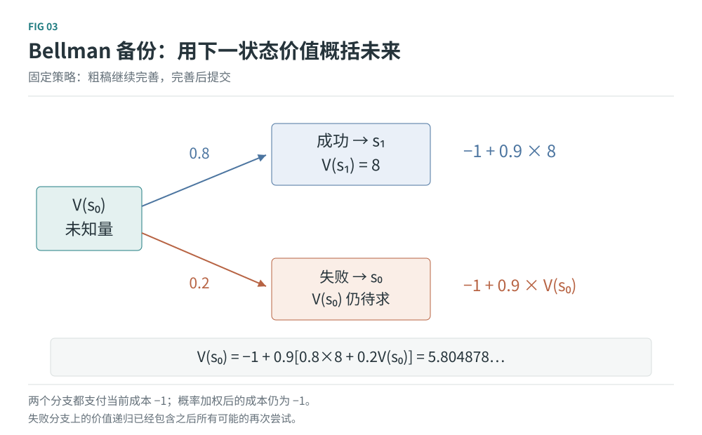

*图 3：固定策略后，用后继状态的价值替代未来整条轨迹，再按转移概率加权。本例可以直接求解，也可以通过反复更新逐渐算出同一个结果。*

### 4.4 最优方程为什么出现 max

前面是在问“照这项策略走会怎样”。现在进一步问“第一步怎么选最好”。如果当前状态选择最好的第一步，以后也采取最优行为，那么

$$
V^*(s)=\max_a\sum_{s'}P(s'\mid s,a)
\left[R(s,a,s')+\gamma V^*(s')\right].
$$

对动作取最大值，是因为动作由 Agent 选择；对下一状态仍取期望，是因为结果由环境按转移概率产生。两层运算分别对应我们能决定的部分和需要接受的随机性。

最优动作价值满足

$$
Q^*(s,a)=\sum_{s'}P(s'\mid s,a)
\left[R(s,a,s')+\gamma\max_{a'}Q^*(s',a')\right].
$$

在本例中，$s_1$ 提交优于继续付费完善；$s_0$ 的长期完善价值约 $5.805$，优于立即提交的 $2$。如果完善成本提高、成功率下降，或者未来收益被更强地折扣，最优行动也会随之改变。价值计算正是用来把这些因素放在一起比较的。

### 4.5 为什么有了 $V$，还要学习 $Q$

知道一个状态有多好，还需要知道每个动作会把我们带向哪里，才能据此选动作。只有 $V$ 时，我们要借助环境模型计算

$$
Q^\pi(s,a)=\sum_{s'}P(s'\mid s,a)
\left[R(s,a,s')+\gamma V^\pi(s')\right],
$$

再比较各个动作。$Q$ 则已经把“先做这个动作，之后会怎样”打包进一个数，决策时直接比较这些数就可以了。

这给后面的方法指出了一条路：即使不知道完整的转移概率，也可以从经历中直接学习 $Q(s,a)$，再让它指导行动。Q-learning 就沿着这条路发展而来。

## 5. 环境已知时：动态规划与广义策略迭代

### 5.1 策略评估

Bellman 方程说明价值应该满足什么关系。要把它变成算法，一个自然的办法是：先给价值一个初值，再不断用右边重新计算左边。

已知 $P$ 和 $R$ 时，可以直接迭代 Bellman 期望更新：

$$
V_{k+1}(s)=\sum_a\pi(a\mid s)\sum_{s'}P(s'\mid s,a)
\left[R(s,a,s')+\gamma V_k(s')\right].
$$

右边读取旧估计，左边写新估计。对有限状态、$\gamma<1$ 的折扣问题，Bellman 算子 $T^\pi$ 是无穷范数下的压缩映射：

$$
\|T^\pi V-T^\pi W\|_\infty
\leq\gamma\|V-W\|_\infty.
$$

它说的是：两份价值估计经过同一次 Bellman 更新后，最大差距会缩小到原来的 $\gamma$ 倍以内。原因也很直观，转移概率先做加权平均，再乘上小于 1 的折扣。因此固定点唯一，重复更新就收敛到 $V^\pi$。附录 A 给出完整证明。

### 5.2 策略改进与价值迭代

拿到 $V^\pi$ 后，把每个状态的动作改成使“当前奖励 + 后继价值”最大的动作，就是策略改进。反复进行“评估当前策略 → 改进策略”，得到**策略迭代**。评估和改进交替互相推动的思想，通常称为**广义策略迭代（GPI）**。

还可以让两件事交替得更频繁：每更新一轮价值，就直接选当前最好的动作。**价值迭代**使用的正是 Bellman 最优算子：

$$
V_{k+1}(s)=\max_a\sum_{s'}P(s'\mid s,a)
\left[R(s,a,s')+\gamma V_k(s')\right].
$$

本例从 $V_0=(0,0)$ 开始，同步更新依次得到：

| 更新次数 $k$ | $V_k(s_0)$ | $V_k(s_1)$ |
|---:|---:|---:|
| 0 | 0 | 0 |
| 1 | 2 | 8 |
| 2 | 5.12 | 8 |
| 3 | 5.6816 | 8 |
| 4 | 5.782688 | 8 |
| 收敛 | 5.804878… | 8 |

第一次看不到未来价值，只能比较立即收益；第二次已经知道 $s_1$ 很有价值，便把完善成功后到达 $s_1$ 的收益算进来。后续更新继续处理失败后重试的收益，逐渐接近精确解。这就是价值“备份（backup）”的具体过程：用后继状态的信息更新当前状态。

### 5.3 接下来需要解决三个实际困难

到这里，我们拥有了一个完整思路：评估行动的长期结果，再据此改善选择。接下来算法的变化，主要来自三个实际困难。

**规则不知道，就用经历来估计。** 没有完整的 $P$ 和 $R$，仍然可以执行动作，观察奖励与下一状态，用采样替代对所有结果的求和。这会带来 MC、TD 和 Q-learning。

**状态多得存不下，就用函数来预测。** 一张图像、一段文字都可能构成不同状态，为每个状态单独建表很快就会失效。神经网络能让相似经历共享学到的信息，这会带来 DQN 等深度强化学习方法。

**动作难以逐一比较，就直接学习怎样选择。** 对连续控制量，枚举所有动作本身就是难题。我们还可以让模型直接输出动作或动作概率，再根据结果调整它。这会通向策略梯度。

先看第一步：怎样从有限的经历中学到长期价值。

## 6. 从完整回报到一步误差：Monte Carlo、TD 与多步估计

### 6.1 Monte Carlo：等事情结束，再更新

运行一条完整轨迹后，可以算出真实采样回报 $G_t$，再更新

$$
V(s_t)\leftarrow V(s_t)+\alpha\,[G_t-V(s_t)].
$$

这称为 **Monte Carlo（MC）估计**。它沿用了 bandit 的“旧估计 + 步长 × 误差”，只不过新目标换成了整段未来的实际回报。

在固定策略、能够完整观察回合的条件下，$G_t$ 的期望就是 $V^\pi(s_t)$，因此它是一个无偏目标。我们把同一状态下多次经历的回报平均起来，就可以逐渐估计价值。但一次回报包含后面每一步的随机性，样本之间可能相差很大；而且通常要等到回合结束，才能把这笔总账算完。

### 6.2 TD(0)：走完一步，就用新消息修正预期

Bellman 方程已经告诉我们，“一步奖励 + 下一状态的价值”也可以用来估计当前价值。**时序差分（temporal-difference，TD）**于是采用一步目标：

$$
y_t^{\mathrm{TD}}=r_{t+1}+\gamma V(s_{t+1}),
\qquad
\delta_t=r_{t+1}+\gamma V(s_{t+1})-V(s_t),
$$

并更新 $V(s_t)\leftarrow V(s_t)+\alpha\delta_t$。用当前估计补上尚未经历的未来，称为**自举（bootstrapping）**；新目标与原来预测的差，就是 **TD 误差** $\delta_t$。

例如，当前估计 $V(s_0)=3,V(s_1)=6$，一次完善成功，得到 $r=-1,s'=s_1$。一步目标为 $-1+0.9\times6=4.4$，TD 误差为 $1.4$。若学习率 $\alpha=0.2$，更新后 $V(s_0)=3.28$。

这次更新可以这样理解：原先以为从粗稿出发值 3 分；现在花了 1 分成本，到了预计值 6 分的状态，新的经历让我们把原来的判断向上修正。此时还没提交，也已经可以学习。

TD 每次只采样 Bellman 右边的一种结果，再用小步更新把它吸收进估计。反复遇到这个状态，就会逐渐平均不同的转移结果。它把对完整模型的计算，变成了从经历中学习。

### 6.3 最后的奖励怎样传回前面的状态

用一条独立的三步轨迹看得更清楚：

$$
a\xrightarrow{\;0\;}b\xrightarrow{\;0\;}c
\xrightarrow{\;1\;}\bot.
$$

这里的 $a,b,c$ 是三个状态的名字。设这条轨迹是确定的，$\gamma=0.9$，三个状态的初始价值都是 0。为了让传播过程容易看，取学习率 $\alpha=1$，并在每次重复轨迹时按 $a,b,c$ 的时间顺序执行一次 TD(0) 更新。

| 已完整经历的次数 | MC 的 $(V(a),V(b),V(c))$ | 按时间顺序更新的 TD(0) |
|---:|---|---|
| 0 | $(0,0,0)$ | $(0,0,0)$ |
| 1 | $(0.81,0.9,1)$ | $(0,0,1)$ |
| 2 | $(0.81,0.9,1)$ | $(0,0.9,1)$ |
| 3 | $(0.81,0.9,1)$ | $(0.81,0.9,1)$ |

第一遍走到 $a$ 和 $b$ 时，TD 还没有学到后继状态的价值；直到最后拿到 1 分，才先更新 $c$。下一遍经过 $b$，这个信息就能往前传一格。MC 则等整条轨迹结束，一次算出三个位置的实际回报。

这说明两者利用未来的方式不同：MC 使用已经发生的完整结果，TD 借助后继状态的当前估计。若改变经验回放顺序，TD 的传播速度也会改变。实际任务还会有随机性，因此常用小于 1 的步长，把多次经历逐渐平均起来。

### 6.4 n-step return 与 $\lambda$

MC 与一步 TD 之间，还有一整片可以选择的空间：先观察 $n$ 步真实奖励，再用价值估计补上后面：

$$
G_t^{(n)}=\sum_{k=0}^{n-1}\gamma^k r_{t+k+1}
+\gamma^n V(s_{t+n}).
$$

若期间已经终止，就累加到终止为止，并把后续价值置零。$n=1$ 是一步 TD；一直观察到回合结束，就得到 MC 回报。

观察得更远，会减少对当前价值估计的依赖，同时也把更远处的随机结果带进更新。**TD($\lambda$)** 把不同长度的目标作几何加权，让我们用一个参数调节这项取舍；后面的 GAE 会把同一思想用于估计 advantage。

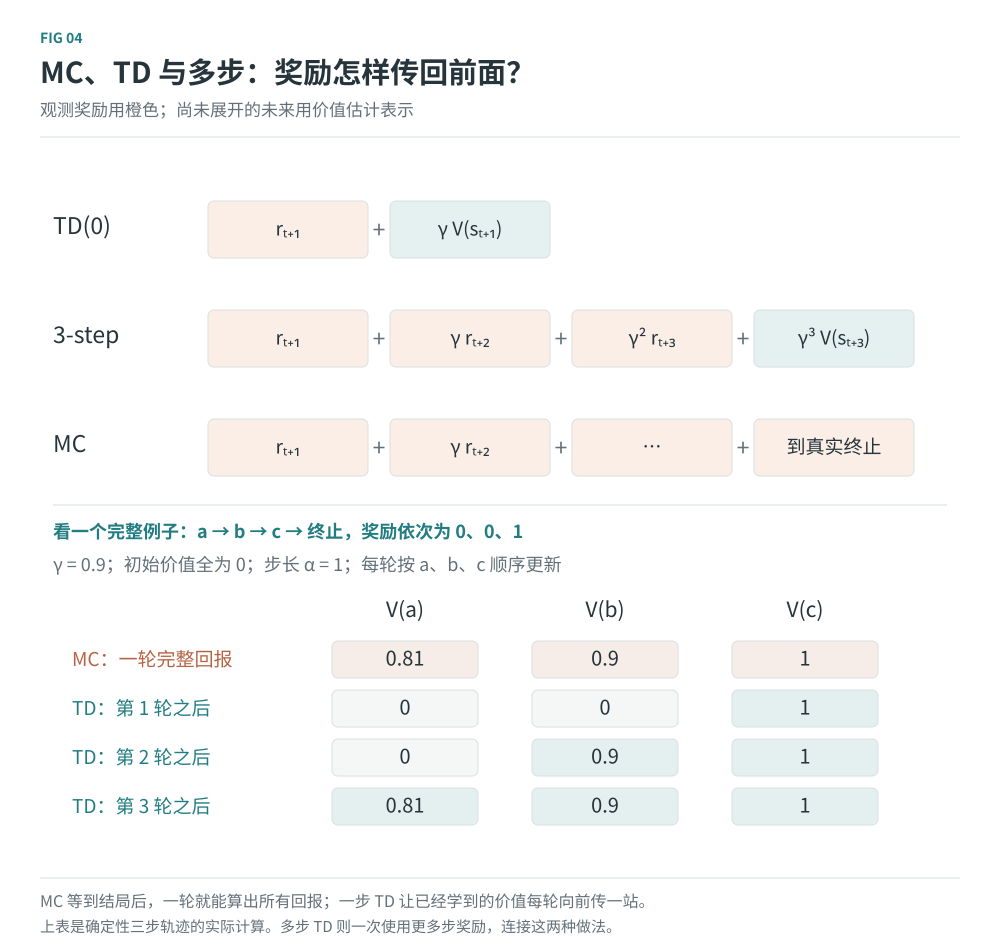

*图 4：橙色来自已经观测到的奖励，青色来自价值估计。三步轨迹展示了末端奖励怎样通过 TD 逐轮传回前面；多步目标则让一次更新能够利用更长的一段实际经历。*

### 6.5 任务结束了，还是这次采样暂时停了

机器人到达目标，任务真的结束，剩余价值为零。若只是采集满了 128 步，机器人还会继续工作，截断位置后面仍有收益要计算，此时就用下一状态的价值补上。

实现时常写

$$
y_t=r_{t+1}+\gamma(1-d_t^{\mathrm{terminal}})V(s_{t+1}).
$$

$d_t^{\mathrm{terminal}}=1$ 表示任务终止，未来项被置零；普通采样截断则保留未来项。如果任务本身规定了固定期限，到达期限就是终止，剩余时间也应体现在状态中。这个区分决定了我们怎样计算“还有多少未来”。

## 7. 用经验学习选择：SARSA、Q-learning 与探索

### 7.1 让经验直接更新动作价值

前面用 TD 学状态价值，现在把同一个思路用到 $Q$ 上。学习 $Q$ 后，决策时可以直接比较各个动作。

从实际经历的 $(s_t,a_t,r_{t+1},s_{t+1},a_{t+1})$，**SARSA** 更新为

$$
Q(s_t,a_t)\leftarrow Q(s_t,a_t)+\alpha
\left[r_{t+1}+\gamma Q(s_{t+1},a_{t+1})-Q(s_t,a_t)\right].
$$

它的名字就来自这五项经历的首字母。目标中的 $a_{t+1}$ 是当前策略实际选出的下一动作，所以未来价值也包含这项策略继续探索的后果。

**Q-learning** 则使用

$$
Q(s_t,a_t)\leftarrow Q(s_t,a_t)+\alpha
\left[r_{t+1}+\gamma\max_{a'}Q(s_{t+1},a')-Q(s_t,a_t)\right].
$$

它同样使用实际观察到的奖励和下一状态，但到达下一状态以后，目标按当前估计最好的动作计算。于是，收集数据时可以探索，学习目标则朝着后续贪心选择的价值靠近。

### 7.2 同一条经历，两种更新目标

回到方案完善任务。假设当前的 $Q$ 估计为

$$
Q(s_0,\text{完善})=3,\qquad
Q(s_1,\text{提交})=6,\qquad
Q(s_1,\text{完善})=2.
$$

这次在 $s_0$ 选择完善，花费 1 分，成功到达 $s_1$；到了 $s_1$，行为策略出于探索，又选择了一次“完善”。取 $\gamma=0.9,\alpha=0.2$，两种方法对刚才那一步的更新为：

| 方法 | 下一步用哪个动作计算目标 | 更新目标 | 新的 $Q(s_0,\text{完善})$ |
|---|---|---:|---:|
| SARSA | 实际选到的“完善” | $-1+0.9\times2=0.8$ | $3+0.2(0.8-3)=2.56$ |
| Q-learning | 当前估计最好的“提交” | $-1+0.9\times6=4.4$ | $3+0.2(4.4-3)=3.28$ |

SARSA 考虑的是：到达完善状态以后，我们仍可能继续探索，因而把这次选择也算进预期。Q-learning 考虑的是：如果到达后选择当前最好的动作，这次完善会有多大价值。**两者使用相同的转移样本，差别在于怎样计算后续行动。**

### 7.3 On-policy 与 off-policy

**行为策略（behavior policy）**是生成数据的策略，常记为 $\mu$；**目标策略（target policy）**是我们正在评估或改进的策略，记为 $\pi$。两者一致时称为 **on-policy**；算法允许用一种策略的数据来学习另一种策略时，称为 **off-policy**。

SARSA 是典型 on-policy 方法：跟着正在执行的策略，学习它的长期结果。Q-learning 是典型 off-policy 方法：用带探索的动作收集经验，同时学习朝贪心策略改进所需的动作价值。

经典的“悬崖行走”可以帮助理解这项差别。最短路线紧贴悬崖，但若行动时还会偶尔随机探索，就有掉下去的风险。SARSA 会把这种探索风险计入价值，往往选择离悬崖更远的路线；Q-learning 的目标按后续贪心行动计算，更容易学到紧贴悬崖的短路线。因此，评价策略时要想清楚，它实际执行时会怎样选择动作。

Off-policy 可以一边与环境交互，一边复用旧数据；**offline RL** 则使用已经收集好的固定日志训练。前者区分“谁产生数据、学谁的策略”，后者区分“训练期间是否继续获取经验”。

直接用 $\mu$ 的轨迹估计 $\pi$ 的期望时，我们会在后面用重要性采样进行校正。表格 Q-learning 则通过采样 Bellman 最优更新学习：对于有限折扣 MDP，只要各状态动作对持续获得足够访问，且学习率满足相应递减条件，价值就能收敛到 $Q^*$。下一章会看到，换成神经网络后，状态之间共享参数，训练也会出现新的问题。

### 7.4 探索要帮助我们发现有用的路径

在我们的任务中，如果从未尝试“完善”，系统就只知道提交能拿到 $2$，也就无从发现约 $5.805$ 的长期收益。第 1 节的 $\epsilon$-greedy 为这些动作保留了尝试机会。

长任务更难：一个发现可能需要连续完成好几步，例如先找到工具，再查询信息，最后据此修改方案。逐步独立随机，往往很难凑出这样一条有意义的路径。因此，人们还会利用不确定性、对新状态的好奇心、环境模型和可复用的技能来组织探索。

这些办法的共同目的，是让有限的尝试带来更有用的信息。如果添加探索奖励，就要把它与原任务奖励一起看：它会鼓励什么行为，哪些行为能帮助最终完成任务。这也为后面讨论奖励设计留下了一个问题。

## 8. 从表格到深度网络：DQN 怎样学习动作价值

### 8.1 用共享参数把相似经历联系起来

图像和文字会产生巨大的状态空间。使用神经网络 $Q_\theta(s,a)$ 后，相似状态可以共享特征，一次经验就可能改善很多状态的预测。这提供了泛化能力，也带来了新的相互影响：修改某个状态的估计时，其他状态的估计也会一起变化。

**DQN（Deep Q-Network）** 的基本目标仍来自 Q-learning：

$$
y=r+\gamma(1-d)\max_{a'}Q_{\bar\theta}(s',a'),
\qquad
L_Q(\theta)=\mathbb E_{\mathcal D}
\left[(Q_\theta(s,a)-\operatorname{stopgrad}(y))^2\right].
$$

$\mathcal D$ 是经验回放池，$\bar\theta$ 是较慢更新的目标网络参数，$d$ 标记真正终止的转移。优化时把算好的 $y$ 当作本次训练的目标，只对预测项 $Q_\theta(s,a)$ 反向传播；这种处理通常称为半梯度式更新。实际实现还可用 Huber 损失减轻极端误差的影响。

为什么要多一个回放池和一份目标网络？可以把它们看成分别解决“样本怎么取”和“目标怎么定”。

**经验回放**把历史转移存起来，再随机抽取小批量训练。这样既能反复利用一条宝贵经历，也能打散同一段轨迹中高度相关的样本。

**目标网络**则暂时稳住未来价值的估计。如果预测值和训练目标每更新一次都同时改变，网络就一直在追逐移动的目标。让目标网络较慢地跟随当前网络，就给优化留出了一段相对稳定的时间。[DQN 原始论文](https://www.nature.com/articles/nature14236)

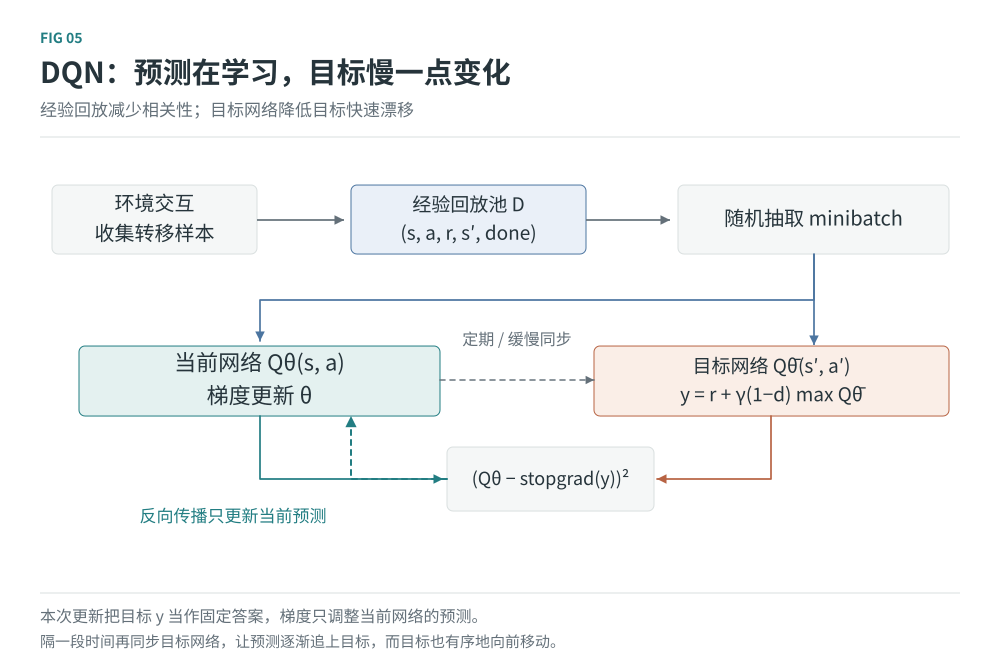

*图 5：当前网络负责被优化的预测，目标网络提供暂时固定的未来估计。环境收集新经验，回放池组织训练样本，目标网络按较慢的节奏同步。*

### 8.2 max 为什么容易放大估计噪声

假设两个动作的真实价值都为 5，一次估计却分别得到 4 和 6。取最大值会选中那个被高估的 6；把它放进训练目标，又会把高估传给前面的状态。动作越多，这种“挑中偏高误差”的机会也越多。

**Double DQN** 将选择动作和评价动作分开：

$$
a^*=\arg\max_{a'}Q_\theta(s',a'),
\qquad
y=r+\gamma(1-d)Q_{\bar\theta}(s',a^*).
$$

当前网络负责选动作，目标网络负责为选中的动作估值。两份估计的误差有所不同，就能减轻同一份高估同时左右“选谁”和“值多少”的问题。[Double DQN](https://arxiv.org/abs/1509.06461)

### 8.3 三个因素怎样互相放大误差

函数逼近、自举和 off-policy 学习结合时，价值估计可能不稳定，甚至发散，这个组合常称为 **deadly triad（致命三角）**。理解它，关键在于看误差怎样绕一圈回来：

函数逼近让多个状态共享参数，一个位置的更新会影响其他位置；自举又把这些预测放进下一次的训练目标；off-policy 数据则可能让某些被目标策略重视的状态动作缺少足够经验。结果是，预测误差可能在反复更新中被放大。回放池和目标网络正是在这个过程中帮助稳定学习。

离线数据会进一步突出覆盖问题。假如日志中几乎没有某种动作，网络可能给它一个偏高的价值；策略一旦追逐这个估计，又没有新的真实经历来纠正。保守地估计少见动作的价值、让策略优先留在数据覆盖较好的区域，都是为解决这个问题而发展的思路。[Offline RL 综述](https://arxiv.org/abs/2005.01643)

价值方法至此形成了一条完整路线：先从经验预测每种行动的长期结果，再选择价值高的行动。当动作是连续向量，或者我们希望直接控制一整套动作概率时，还可以换一种做法：**把策略本身参数化，让最终结果直接告诉我们怎样调整它。** 下一章就从这里开始。

## 9. 策略梯度：为什么一个最终分数能训练整条决策序列

到这里，我们一直在学“哪个动作价值更高”，再据此选择动作。还有一条更直接的路：让网络输出动作概率，然后调整这些概率，让高回报的行为更常出现。

困难在于，采样、下棋、运行程序这些过程往往没法直接求导。我们可以对神经网络求导，却没法对“这局棋赢了”求导。策略梯度绕过了这个困难：**虽然结果本身没有导数，产生这个结果的概率却有导数。**

### 9.1 对动作的概率求导

设策略 $\pi_\theta$ 可微，而环境转移和初始状态分布不直接依赖 $\theta$。为简化记号，先把奖励视为由轨迹决定的函数。有限轨迹的概率可分解为

$$
p_\theta(\tau)=d_0(s_0)
\prod_{t=0}^{T-1}\pi_\theta(a_t\mid s_t)P(s_{t+1}\mid s_t,a_t).
$$

先看一个小恒等式：$\nabla\log p=(\nabla p)/p$，所以 $\nabla p=p\nabla\log p$。把它代入期望回报的导数，就能把“对所有轨迹求和”改写成“从当前策略采样后求平均”：

$$
\begin{aligned}
\nabla_\theta J
&=\nabla_\theta\sum_\tau p_\theta(\tau)G_0(\tau)\\
&=\mathbb E_{\tau\sim\pi_\theta}
\left[G_0\nabla_\theta\log p_\theta(\tau)\right]\\
&=\mathbb E
\left[G_0\sum_{t=0}^{T-1}\nabla_\theta\log\pi_\theta(a_t\mid s_t)\right].
\end{aligned}
$$

环境转移项仍影响采到什么轨迹，但它对参数的直接导数为零，因此不需要一个可微环境。奖励可以来自胜负、程序测试或人工评分；只要能评价采样结果，就可以构造这个梯度估计。

可以把更新理解为：先尝试一条路径，看到结果后，再回头调整这条路径上各个选择的概率。$\nabla\log\pi$ 给出提高该动作概率的参数方向，回报则决定沿这个方向走多大一步。

### 9.2 过去的奖励不该增加本步梯度的噪声

动作 $a_t$ 不可能改变已发生的 $r_1,\ldots,r_t$。在期望中，可以去掉这些过去奖励对该步 score function 的贡献，得到 reward-to-go 形式：

$$
\nabla_\theta J
=\mathbb E\left[
\sum_{t=0}^{T-1}\gamma^t G_t
\nabla_\theta\log\pi_\theta(a_t\mid s_t)
\right].
$$

这里有两层时间折扣：$G_t$ 从第 $t$ 步向后计算，外面的 $\gamma^t$ 再把它折算回任务起点。例如第二步之后的一份奖励，既要相对第二步折扣，也要计入第二步距离起点有多远。后面的语言模型回合取 $\gamma=1$，式子就简化为各步 $G_t\nabla\log\pi$ 的和。

使用实际采样回报的策略梯度通常称为 **REINFORCE**。它让高回报轨迹上的动作更可能再次出现，但一次幸运成功也会提升其中并无帮助的动作。只有跨许多轨迹比较，才能逐步分离系统性贡献和偶然性。

### 9.3 一个可直接求导的两动作例子

设动作 A 的奖励为 $1$，B 的奖励为 $0$；$p=\pi_\theta(A)=\sigma(\theta)$。则

$$
J(\theta)=p,
\qquad
\frac{\mathrm dJ}{\mathrm d\theta}=p(1-p).
$$

若 $p=0.3$，真实梯度为 $0.21$。REINFORCE 的单样本估计为：采到 A 时，$1\times\partial_\theta\log p=0.7$；采到 B 时为零。其期望是 $0.3\times0.7+0.7\times0=0.21$，恰好等于直接求导结果。

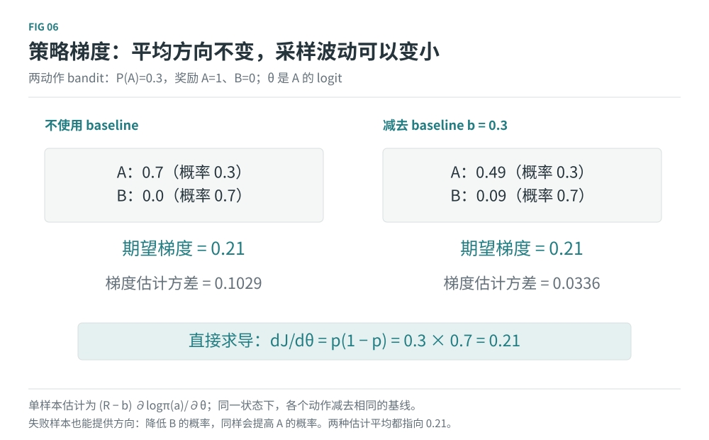

*图 6：两种采样估计的平均梯度都是 0.21；减去基线后，单次更新围绕这个平均值的波动更小。*

### 9.4 Baseline 为什么不改变期望梯度

对任何只依赖状态、不依赖当前动作的 $b(s)$，有

$$
\begin{aligned}
\mathbb E_{a\sim\pi_\theta(\cdot\mid s)}
[b(s)\nabla_\theta\log\pi_\theta(a\mid s)]
&=b(s)\sum_a\nabla_\theta\pi_\theta(a\mid s)\\
&=b(s)\nabla_\theta1=0.
\end{aligned}
$$

因此可以用 $G_t-b(s_t)$ 代替 $G_t$。如果基线接近当前情境的平均回报，就能把“题目本来就容易”与“这个动作比平均更好”分开。令 $b=V^\pi$，便接近 advantage 视角。

在两动作例子里，取 $b=p=0.3$。采到 A 时梯度估计为 $(1-0.3)(1-0.3)=0.49$；采到 B 时为 $(0-0.3)(-0.3)=0.09$。期望仍是 $0.21$，方差从 $0.1029$ 降到 $0.0336$。这里可以看见基线的作用：原先失败样本给出零更新；减去平均表现以后，失败也提供了学习信号——降低失败动作 B 的概率，同样会提高 A 的概率。状态价值 $V$ 是常用基线；具体能减少多少波动，还取决于动作概率及其梯度。

实现 actor 损失时，把 advantage 当作固定权重，例如

$$
L_{\mathrm{actor}}=-\frac1N\sum_{i,t}\gamma^t
\log\pi_\theta(a_{i,t}\mid s_{i,t})
\operatorname{stopgrad}(\widehat A_{i,t}).
$$

这里 $N$ 为轨迹数，语言模型部分取 $\gamma=1$。$\operatorname{stopgrad}$ 表示把优势当作本次更新已经算好的权重：Actor 负责改变动作概率，基线则由另一个预测回报的目标训练。这样，代码就对应了刚才推导的梯度。

## 10. Actor–Critic 与 GAE：把“好多少”估计得更稳

REINFORCE 已经能学习，但每次都等完整结局，更新又容易受运气影响。第 6 节的 TD 提供了一个现成办法：让一个模型预测未来，用“新观察到的信息比原先预期好多少”来指导策略。这就把价值学习和策略学习接到了一起。

### 10.1 一个负责行动，一个负责估计

**Actor** 表示策略 $\pi_\theta(a\mid s)$，决定动作概率；**Critic** 估计 $V_\phi(s)$ 或 $Q_\phi(s,a)$，帮助判断动作相对当前情境的好坏。它们可以共享部分特征，也可以是独立网络。

如果 $V_\phi=V^\pi$，则

$$
\mathbb E[\delta_t\mid s_t=s,a_t=a]
=Q^\pi(s,a)-V^\pi(s)=A^\pi(s,a).
$$

所以一步 TD 误差可以用作 advantage 样本。例如原先预计能拿 3 分，走了一步后，“本步奖励 + 下一步预计价值”变成了 4.4 分，这次行动就带来 1.4 分的正向消息。Critic 用它修正预测，Actor 用它提高这个动作的概率。实际 Critic 也在学习，因此我们会用多步信息让这个判断更稳。

Critic 可以拟合 MC 回报、多步回报或其他一致定义的目标：

$$
L_V(\phi)=\frac12\mathbb E[(V_\phi(s_t)-\widehat V_t^{\mathrm{target}})^2].
$$

### 10.2 从多步 advantage 到 GAE

把一步 TD 误差展开相加：

$$
\sum_{l=0}^{n-1}\gamma^l\delta_{t+l}
=\sum_{l=0}^{n-1}\gamma^l r_{t+l+1}
+\gamma^nV(s_{t+n})-V(s_t)
=G_t^{(n)}-V(s_t).
$$

中间价值项会相互消去。这说明：一串 TD 误差本身就是多步 advantage 估计。**广义优势估计（generalized advantage estimation，GAE）**对不同时间长度作几何加权，得到

$$
\widehat A_t^{\mathrm{GAE}(\gamma,\lambda)}
=\sum_{l=0}^{T-t-1}(\gamma\lambda)^l\delta_{t+l}.
$$

$\lambda=0$ 只使用一步 TD；$\lambda=1$ 且轨迹完整终止时，望远镜求和给出 $G_t-V(s_t)$。中间取值把未来误差逐渐衰减。$\gamma$ 决定未来奖励在目标中值多少；$\lambda$ 决定估计优势时，要把多远以后的 TD 误差传回来。[GAE 论文](https://arxiv.org/abs/1506.02438)

### 10.3 一次完整数值计算

设一条三步轨迹的奖励为 $[0,0,1]$，$\gamma=1$，当前价值估计为 $[0.4,0.5,0.6,0]$，最后一个零是终止状态价值。则

$$
\delta=[0.1,0.1,0.4].
$$

若 $\lambda=0.9$，从后往前递推：

$$
\widehat A_2=0.4,\qquad
\widehat A_1=0.1+0.9\times0.4=0.46,\qquad
\widehat A_0=0.1+0.9\times0.46=0.514.
$$

若 $\lambda=1$，得到 $[0.6,0.5,0.4]$，正好等于终局回报 $1$ 减去各位置价值。最后的成功由此为每个早期动作都提供了学习信号。

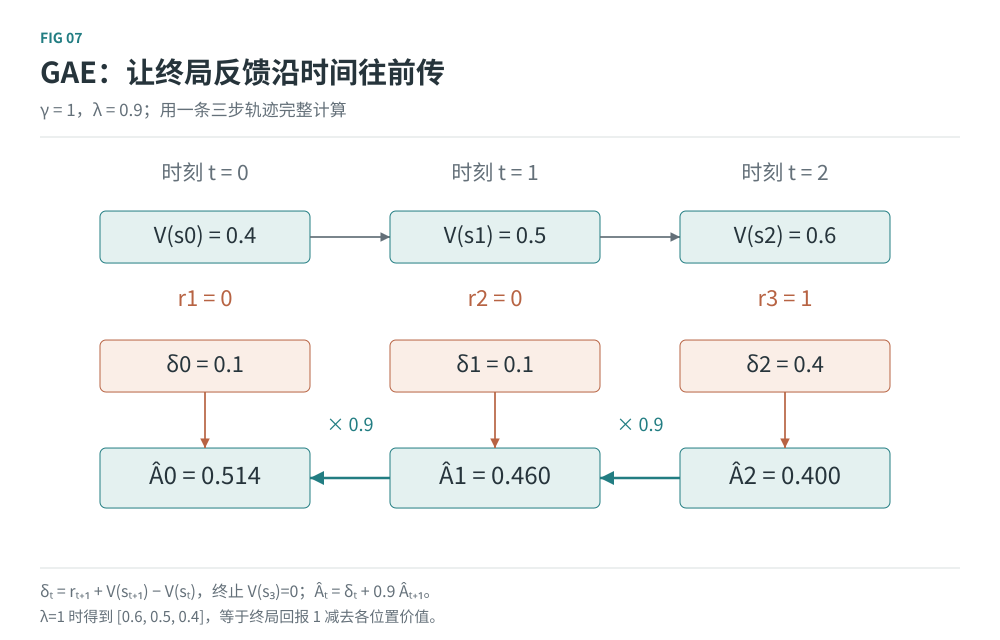

*图 7：最后一步的 TD 误差是 0.4；往前每传一步乘 0.9，再加上当地的 TD 误差，依次得到 0.46 和 0.514。*

计算时，每条轨迹分别从后往前递推。真正终止时，终止状态的价值取零；采样器提前停下时，则用最后一个状态的价值补上后续回报。这里正好用到了第 6.5 节对终止和截断的区分。

## 11. 为什么策略更新要“别走太远”：从重要性比到 PPO

### 11.1 一批数据来自旧策略

收集轨迹很贵，我们希望一批数据能做几次小批量更新。但数据来自 $\pi_{\mathrm{old}}$，优化过程中当前策略 $\pi_\theta$ 已经变化。

假设在同一个状态，旧策略选择动作 A 的概率是 0.25，新策略是 0.40。旧数据里 A 出现得偏少，就给每个 A 样本乘上 $0.40/0.25=1.6$ 的权重。这就是**重要性采样**：通过重新加权，用一个分布下的样本计算另一个分布下的平均值。

在固定状态 $s$ 下，只要新策略可能选到的动作在旧策略中也有非零概率，就有

$$
\mathbb E_{a\sim\pi_\theta}[f(a)]
=\mathbb E_{a\sim\pi_{\mathrm{old}}}
\left[\frac{\pi_\theta(a\mid s)}{\pi_{\mathrm{old}}(a\mid s)}f(a)\right].
$$

定义动作概率比

$$
\rho_t(\theta)=\exp\left[
\log\pi_\theta(a_t\mid s_t)-\log\pi_{\mathrm{old}}(a_t\mid s_t)
\right].
$$

重新加权解决了“同一状态下动作出现得多还是少”的差别。序贯决策还多一层变化：新策略可能把自己带到不同的状态。PPO 的做法是先沿用这一批旧数据中的状态，建立一个便于优化的**代理目标（surrogate objective）**，做几次小更新后再收集新数据。更新幅度越大，旧数据就越难代表新策略接下来会遇到的情境。

### 11.2 TRPO：把策略变化作为约束

TRPO 的实际优化思想是，在提高旧数据上的代理目标时，限制新旧策略的平均 KL 距离：

$$
\max_\theta\ \mathbb E_{\mathrm{old}}[\rho_t(\theta)\widehat A_t],
\qquad
\mathbb E_{s\sim d_{\mathrm{old}}}
[D_{\mathrm{KL}}(\pi_{\mathrm{old}}(\cdot\mid s)\|\pi_\theta(\cdot\mid s))]
\leq\delta.
$$

这就是信赖域的想法：一边争取更高回报，一边给这次策略变化设一个范围。实际计算用采样状态上的平均 KL 衡量变化，更新后再用新轨迹检查效果。[TRPO](https://arxiv.org/abs/1502.05477)

### 11.3 PPO-Clip：改到一定程度，就不再追加鼓励

TRPO 需要处理一个带 KL 约束的优化问题。PPO-Clip 换了一种更容易实现的办法：直接修改目标函数，让一次更新在“已经改得够多”的方向上变平。它最大化

$$
L^{\mathrm{clip}}(\theta)=\mathbb E_t
\left[\min\left(
\rho_t\widehat A_t,
\operatorname{clip}(\rho_t,1-\epsilon,1+\epsilon)\widehat A_t
\right)\right].
$$

先看 $\widehat A>0$：我们想提高该动作概率。当 $\rho>1+\epsilon$，代理收益变平，不再鼓励沿这个样本继续放大概率。

再看 $\widehat A<0$：我们想降低该动作概率。当 $\rho<1-\epsilon$，代理收益变平，不再鼓励沿这个样本继续压低概率。反方向的恶化仍会受到惩罚，因此必须看清公式中的 **min** 与 advantage 的符号。

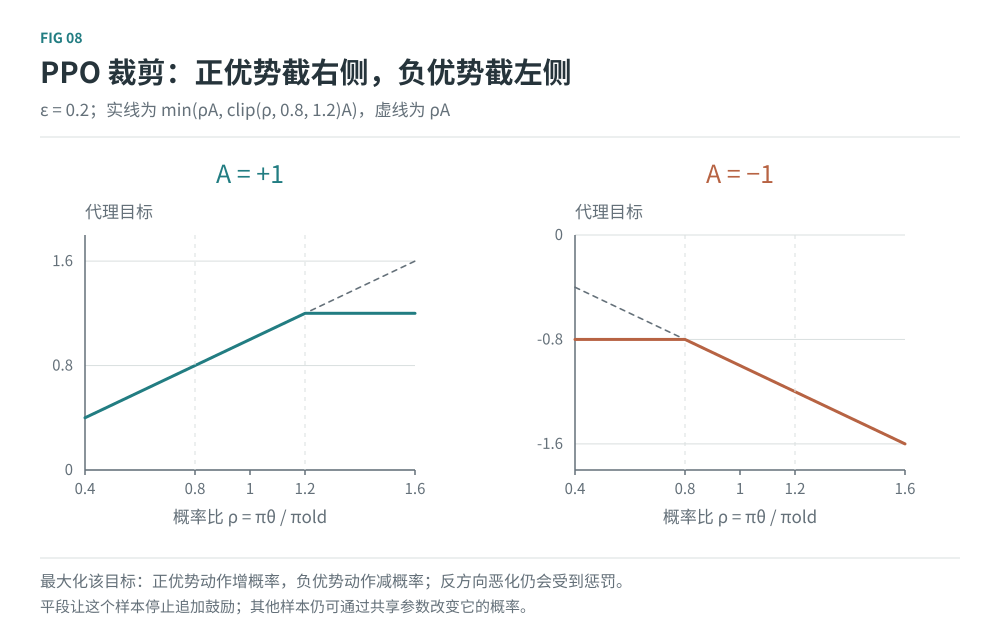

*图 8：沿着提高代理目标的方向看，正优势动作向右走，负优势动作向左走；两者都会在已经得到足够改善的一侧进入平段。*

例如 $\epsilon=0.2$：$A=2,\rho=1.5$ 时取 $\min(3,2.4)=2.4$；$A=-2,\rho=0.5$ 时取 $\min(-1,-1.6)=-1.6$；$A=-2,\rho=1.5$ 时则取 $-3$，仍惩罚概率增加。

**裁剪作用于目标函数的斜率。** 进入平段后，这个样本停止推动概率继续朝同一方向变化；共享参数仍可能被其他样本更新，所以最终概率比可以越过区间。实际训练会同时观察 KL 和裁剪比例，变化过大时提前结束这一批更新。[PPO 原始论文](https://arxiv.org/abs/1707.06347)

### 11.4 一次 PPO 迭代究竟冻结什么

```text
复制当前策略，得到本轮 pi_old
用 pi_old 收集 rollout，保存动作、奖励、终止信息与 old_logprob
用 rollout 和价值估计计算 advantage、value_target，并将这些目标固定
重复少量 epoch：
    用当前 pi_theta 重算 new_logprob
    ratio = exp(new_logprob - old_logprob)
    更新 actor：最大化 clipped surrogate（可加熵等项）
    更新 critic：拟合固定的 value_target
用更新后的策略收集下一轮 rollout，刷新 pi_old
```

每次反向传播只通过当前策略重新计算的 log-probability；采样动作、旧 log-probability 和 advantage 都保持固定。这样一批 rollout 可以短暂复用，随后再由新策略采下一批。PPO 因此通常归为主要使用新鲜 on-policy 数据的方法。

## 12. 熵、奖励尺度与目标设计

### 12.1 为什么鼓励一定的随机性

策略熵为

$$
\mathcal H(\pi(\cdot\mid s))=-\sum_a\pi(a\mid s)\log\pi(a\mid s).
$$

在目标中加入 $+c_H\mathcal H$，可以对抗策略过早集中到少数动作，使其他行为仍有机会被尝试。这给尚未被充分尝试的动作保留了机会。至于哪些尝试值得继续，还要由后续回报来判断。

熵与参考策略 KL 也不同：熵鼓励分散，KL 惩罚鼓励接近某个具体分布。若参考分布是均匀分布，二者只差常数与符号；若参考分布是一个训练好的语言模型，它携带了语言、任务与行为结构，就远不止“保持随机”。

### 12.2 奖励缩放会影响正则项的相对强度

如果目标只有期望回报，乘一个正常数不改变最优策略，但会改变梯度尺度。如果目标还有 KL、熵或其他成本项，只缩放任务奖励而不相应缩放这些系数，会改变优化问题本身。

给奖励加常数，还会产生一个容易观察到的效果。在固定长度回合中，对每一步加同一常数只改变常量；但在可变长度回合中，它会奖励或惩罚“多活几步”，可能改变终止倾向。

一种有理论依据的奖励塑形是加上势函数差

$$
F(s,a,s')=\gamma\Phi(s')-\Phi(s).
$$

把它沿轨迹折扣求和，中间项会两两抵消，只留下 $-\Phi(s_0)+\gamma^T\Phi(s_T)$。在终止状态令 $\Phi=0$，就只剩一个由起点决定的常数，原来动作之间的优劣关系得以保留。例如可以用势函数表示“离目标有多近”，让智能体更早收到进展反馈；最终要优化的任务仍由原奖励决定。[势函数奖励塑形](https://people.eecs.berkeley.edu/~russell/papers/icml99-shaping.pdf)

### 12.3 奖励是代理指标，优化会放大它的缺陷

如果只奖励“测试通过”，模型可能利用测试遗漏；如果奖励“评审认为专业”，模型可能堆叠术语；如果奖励“回答更长”，就会产出冗长而无增益的内容。

这类现象叫 **reward hacking**：模型找到了拿高分的办法，却偏离了我们设分数时的本意。因此，奖励设计也是任务设计的一部分。比如代码任务可以补充边界输入的测试；解释任务可以把准确、清楚和完整分别评价，并实际阅读高分回答。

## 13. 算法演进是一组设计取舍

回看前面的路线，每个新方法都接住了上一个方法留下的困难：

- 环境规则已知，就用 Bellman 递推计算价值；规则未知，就从实际经历中估计。
- 状态太多，表格存不下，就用神经网络共享经验；于是又需要回放池和目标网络稳定训练。
- 希望直接调整动作概率，就用策略梯度；回报波动太大，就引入 Critic 和多步优势估计。
- 希望复用一批昂贵的采样，又担心策略变化过大，就用概率比和 PPO 裁剪控制这几步更新。

价值、策略和更新幅度，是这些算法反复处理的三个问题。到了不同任务上，还会发展出下面这些分支。

| 方向 | 主要改变 | 适用动机与代价 |
|---|---|---|
| DQN / Double DQN | 学动作价值，用 replay 与目标网络 | 适合可枚举离散动作；价值误差与分布外动作需控制 |
| REINFORCE / Actor–Critic | 直接训练策略，使用回报或价值基线 | 适合随机策略；方差、偏差与数据效率之间需权衡 |
| TRPO / PPO | 控制新旧策略变化 | 通过代理目标控制更新；通常持续收集新鲜 rollout |
| DDPG / TD3 | 连续动作 actor，配合 off-policy critic | 方便直接输出连续动作；对 Q 误差与探索较敏感 |
| SAC | 最大熵目标下的 off-policy actor–critic | 联合考虑回报与熵；需要处理温度系数和 critic 稳定性 |
| Model-based RL | 学或使用环境模型，进行规划或生成训练经验 | 可能提高样本效率；多步模型误差会累积 |
| Offline RL | 从固定数据学习，约束分布外行为 | 适合交互昂贵场景；受数据覆盖与行为偏差限制 |

[TD3](https://arxiv.org/abs/1802.09477) 与 [SAC](https://arxiv.org/abs/1801.01290) 是连续控制的重要分支。它们把前面的 Actor–Critic 思路用于连续动作，并通过回放经验提高数据利用率。首次阅读时，可以先抓住这条联系，再继续进入语言模型部分。

Model-based 方法中，模型预测“动作后环境怎样变化”，价值函数预测“之后大概能拿多少回报”，二者承担不同职责。例如 [AlphaZero](https://arxiv.org/abs/1712.01815) 使用已知棋盘规则进行搜索，结合策略与价值网络；搜索负责比较当前局面下的候选走法，策略与价值网络则把多次搜索和对局中学到的经验保存下来。

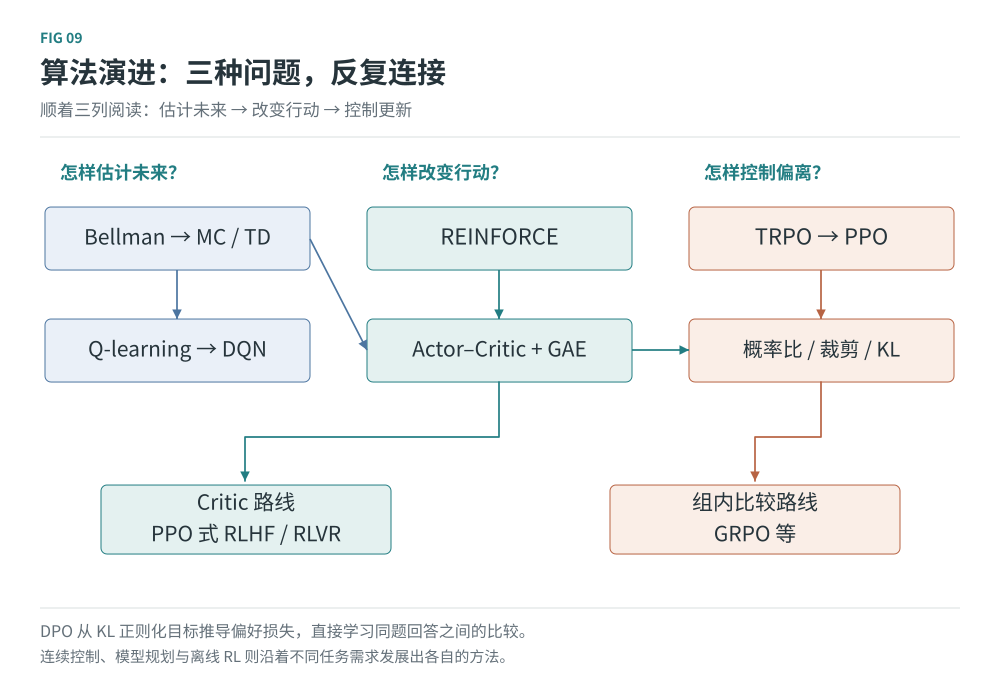

*图 9：沿三列阅读，分别是估计未来、调整动作概率、控制策略变化。Actor–Critic、PPO 和 GRPO 把其中几种思路组合起来。*

## 14. 把语言模型展开为一个决策过程

### 14.1 Token 是动作，前缀是状态

从这一节开始，我们把前面的强化学习语言用到一个熟悉的模型上：自回归语言模型。假设问题是“解方程 $2z+3=7$，并写出必要步骤”。模型可能直接回答“$z=2$”，也可能先移项、再除以 2，还可能算到一半重新检查。每一种生成过程都是一条决策轨迹。

给定 prompt $x$，回答为 $y=(y_1,\ldots,y_L)$。在第 $t$ 个环境时刻，令

$$
s_t=(x,y_{1:t}),\qquad a_t=y_{t+1},\qquad t=0,\ldots,L-1.
$$

状态是“问题加上已经写出的内容”，动作是“接下来选哪个 token”。策略正是语言模型的下一个 token 分布：

$$
\pi_\theta(y\mid x)=\prod_{i=1}^{L}\pi_\theta(y_i\mid x,y_{<i}),
\qquad
\log\pi_\theta(y\mid x)=\sum_{i=1}^{L}\log\pi_\theta(y_i\mid x,y_{<i}).
$$

正常结束时，EOS 也是一次生成动作。如果等回答结束后才打分，就把前面的奖励设为零，把 $r_L=R(x,y)$ 放在最后。语言模型的这类回合常取 $\gamma=1$，于是从任意生成位置向后看，都会包含同一个终局分数。

假设用一个只依赖问题的基线 $b(x)$，策略梯度的一次样本估计就是

$$
\big[R(x,y)-b(x)\big]
\sum_{i=1}^{L}\nabla_\theta\log\pi_\theta(y_i\mid x,y_{<i}).
$$

这解释了一个看似奇怪的现象：**整段回答只拿到一个分数，为什么每个 token 都能学到东西？** 因为整段回答的对数概率就是各个位置对数概率的和。回报高于预期时，这条生成路径得到正向学习信号；低于预期时则得到负向信号。使用 Critic 后，还可以根据不同前缀的预期，让各位置获得不同的优势估计。

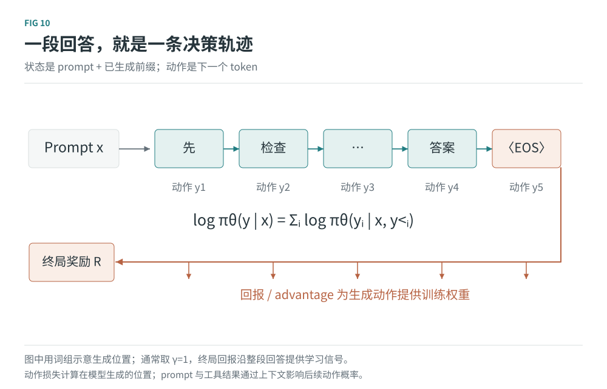

*图 10：检查器在回答结束后给出分数，策略梯度把这个学习信号传到整条 token 轨迹。前缀价值进一步帮助判断“从这里继续，结果比预期好多少”。*

### 14.2 文本生成的环境是什么

纯文本生成时，状态转移很简单：选定一个 token，把它接到当前文本后面，就得到下一状态。真正困难的是，在庞大的文本组合空间里找到能解决问题的生成路径。

加入工具后，环境也会做出自己的反应。例如模型发起一次 Python 调用，程序返回计算结果，模型根据结果继续回答。这时轨迹里有两种内容：模型选择的动作，以及工具返回的观测。训练时让模型为自己选择的调用和回答负责；工具返回的文本作为后续决策的上下文。

### 14.3 同一道题，SFT 和 RL 怎样学习

对“解方程 $2z+3=7$”，先给出一份示范：“两边减去 3，得到 $2z=4$；两边除以 2，得到 $z=2$。”SFT 把这份示范当作目标，逐 token 提高它的概率：

$$
L_{\mathrm{SFT}}=-\mathbb E_{(x,y^*)\sim\mathcal D}
\sum_i\log\pi_\theta(y_i^*\mid x,y_{<i}^*).
$$

训练时每个位置都能看到示范前缀和下一个目标 token。这相当于让模型学习“一种好解法怎样写出来”。

RL 则先让当前模型自己作答。它可能写出正确解法，也可能在移项时出错。答案检查器给出分数，再用回报或优势加权这次生成的 log-probability 梯度。学习信号变成了“你刚才这样做，结果比预期好多少”。两种训练都通过反向传播更新同一个语言模型，区别在于**谁提供路径，以及怎样给路径分配权重**。

还有一种很实用的办法：先生成多份回答，把正确且清楚的留下，再用它们做 SFT，称为**拒绝采样微调**。它把模型生成的好答案变成了新的示范。这样得到的训练集只保留被选中的回答；RL 则可以同时利用成功和失败相对预期的差异。

### 14.4 哪些 token 参与损失

计算 actor loss 时，通常只选取模型生成动作对应的位置。Prompt 提供上下文，padding 只是为了把长短不同的序列排成一个 batch，二者都不作为本轮生成的动作打分。

Prompt 仍会参与模型计算：回答的概率依赖问题，梯度可以沿这些上下文计算回到共享参数。实际写代码时，还要把“前一位置的 logits”与“下一位置的目标 token”对齐。

最后记录回答怎样结束：模型生成 EOS 表示它选择结束；达到长度上限表示采样被截断。把结束原因、有效 token 位置和旧策略 log-probability 一起保存，后面的价值目标与概率比才有对应的数据。

## 15. RLHF：把偏好变成可优化的奖励

### 15.1 为什么有示范，还需要比较

SFT 告诉模型“一份好回答长什么样”。但一个问题往往有多种合理答法。还是前面的方程题，一份回答只写“$z=2$”，另一份把移项和除法讲清楚。若用户要求写必要步骤，人类通常更喜欢后一份。对于摘要、解释和建议，比较两份现成回答，也常常比从头编写一份完美示范容易。

一条偏好数据写成 $(x,y_w,y_l)$：同一道问题 $x$，被选中的回答 $y_w$，以及落选的回答 $y_l$。标注规则决定了我们在教模型什么：有时看正确性，有时看完整性、清晰程度或是否遵从要求。

### 15.2 用比较训练 reward model

设奖励模型给每份完整回答输出一个分数 $r_\psi(x,y)$。Bradley–Terry 模型把分数差转换成比较概率：

$$
\Pr(y_w\succ y_l\mid x)
=\sigma\left(r_\psi(x,y_w)-r_\psi(x,y_l)\right).
$$

两份回答分数相同时，模型认为各有一半机会被选中；胜者分数高出越多，预测的偏好越明显。最大化偏好数据的似然，就得到

$$
L_{\mathrm{RM}}(\psi)
=-\mathbb E_{\mathcal D_{\mathrm{pref}}}
\log\sigma\left(r_\psi(x,y_w)-r_\psi(x,y_l)\right).
$$

奖励模型学到的是一个可用于比较的刻度。例如分数 3 比分数 1 高两分，与分数 8 比分数 6 高两分，对上式的影响相同；真正起作用的是差值。我们训练好这个“评分员”以后，就能让它评价新生成的回答。

### 15.3 为什么还要保留一个参考模型

模型会努力寻找高分回答。若评分员偏爱篇幅很长的回答，模型可能逐渐学会凑字数；若评分员对某些措辞过于宽容，模型也可能反复使用这些措辞。一个常用办法是：提高奖励的同时，为偏离原有生成分布付出代价。

$$
J_{\mathrm{RLHF}}(\theta)
=\mathbb E_{x\sim\mathcal D,\,y\sim\pi_\theta(\cdot\mid x)}
[r_\psi(x,y)]
-\beta\,\mathbb E_x
D_{\mathrm{KL}}(\pi_\theta(\cdot\mid x)\|\pi_{\mathrm{ref}}(\cdot\mid x)).
$$

$\pi_{\mathrm{ref}}$ 通常取一份固定的初始模型或 SFT 模型，作为这一训练阶段的参照。$\beta>0$ 控制偏离代价有多大。这样，新的行为要带来足够的奖励收益，才值得用更大的分布变化去换。

这里比较的是**完整回答的概率分布**。把整段回答的概率展开，可以写成逐 token 的和：

$$
D_{\mathrm{KL}}(\pi_\theta(y\mid x)\|\pi_{\mathrm{ref}}(y\mid x))
=\mathbb E_{y\sim\pi_\theta}
\sum_{i=1}^{L}
\log\frac{\pi_\theta(y_i\mid x,y_{<i})}
{\pi_{\mathrm{ref}}(y_i\mid x,y_{<i})}.
$$

在当前策略生成的回答上，这些 log-ratio 的平均给出 KL。单个 token 的 log-ratio 可以正也可以负：它表达的是这个 token 相对参考模型变得更常见还是更少见；完整期望才是非负的 KL。

实现时，可以把相对参考的惩罚分配到各 token 的奖励中，末尾再加任务分数；也可以在损失中单独计算 KL 项。选择后一种写法时，应配套使用相应的采样与梯度计算方式。

### 15.4 评分员、价值估计与两份策略快照

RLHF 里经常同时出现几个模型。只要问清各自回答的问题，就容易分开：

| 对象 | 回答什么问题 | 典型更新方式 |
|---|---|---|
| Actor $\pi_\theta$ | 下一个 token 怎么选 | 用策略优化更新 |
| Critic $V_\phi$ | 从当前前缀继续生成，预计总回报是多少 | 拟合当前策略下的回报目标 |
| Reward model $r_\psi$ | 已完成回答被评价得有多好 | 从偏好数据训练；一段 RL 内常固定 |
| Reference $\pi_{\mathrm{ref}}$ | 这一阶段以哪套生成行为为参照 | 通常固定 |

对于方程题，reward model 看的是已写完的解答；Critic 可能只看到了“移项得到 $2z=4$”，就要估计接下来能得到多少回报。前者负责评分，后者负责预测。

PPO 还保存一份 $\pi_{\mathrm{old}}$，也就是**生成当前这批回答的策略**。更新后把新旧概率相除，才能知道这批样本的概率改变了多少。下一轮重新采样时，old 随之刷新；reference 则继续作为整个阶段的参照。前者管“这一轮改了多少”，后者管“相对起点走了多远”。

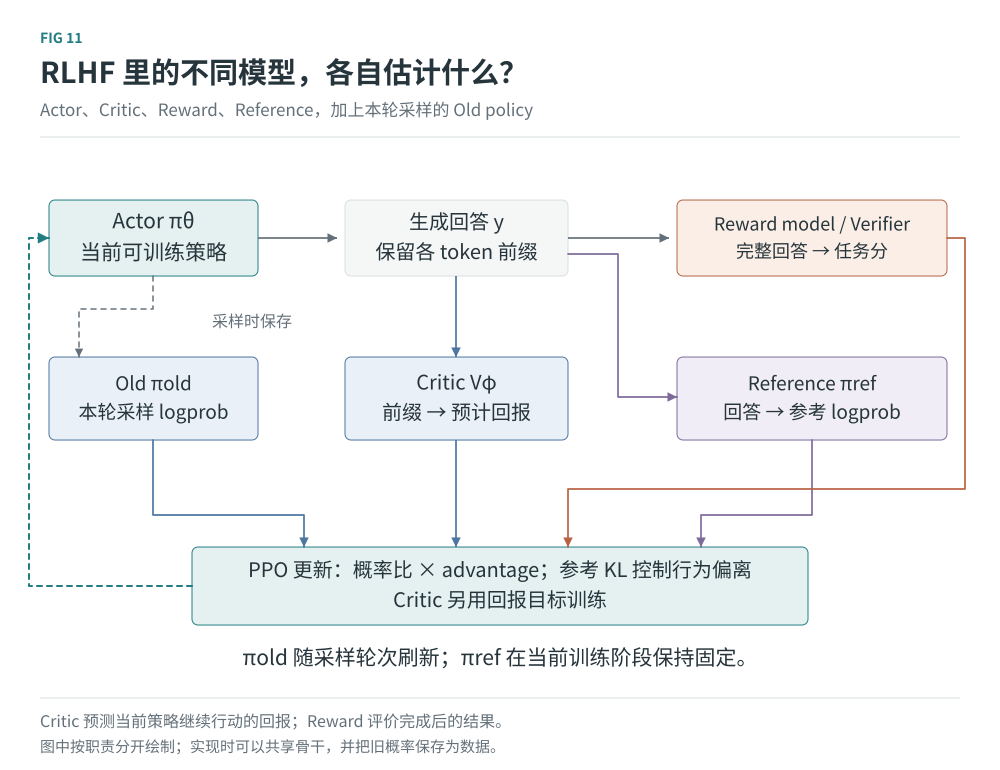

*图 11：reward model 评价完整回答，Critic 预测前缀的未来回报；old 用于本轮概率比，reference 用于长期参照。这些是功能角色，实现时可以共享骨干或缓存所需数值。*

于是常见的 RLHF 流程就串起来了：先做 SFT，收集回答比较并训练 reward model；再让当前策略生成回答，结合奖励与参考 KL 构造回报；Critic 给出基线和 GAE；最后用 PPO 更新 Actor。[InstructGPT](https://arxiv.org/abs/2203.02155) 是这条路线的一个代表案例。

## 16. DPO：把偏好比较直接写成策略损失

RLHF 先学评分员，再用评分员训练策略。DPO 走了一条更短的路：直接拿成对偏好更新语言模型。要理解它为什么成立，我们先看奖励与最优策略之间的关系，再利用“同题比较”消掉一个难算的量。

### 16.1 奖励怎样改变最优回答分布

固定问题 $x$，暂时把奖励 $r(x,y)$ 当成已知，并允许直接调整每份回答的概率。参考策略在这些回答上都有正概率。考虑

$$
\max_\pi\ \sum_y\pi(y\mid x)r(x,y)
-\beta\sum_y\pi(y\mid x)
\log\frac{\pi(y\mid x)}{\pi_{\mathrm{ref}}(y\mid x)},
\quad\sum_y\pi(y\mid x)=1.
$$

为概率和为 1 的约束引入拉格朗日乘子，令导数为零：

$$
r(x,y)-\beta\left[\log\frac{\pi(y\mid x)}{\pi_{\mathrm{ref}}(y\mid x)}+1\right]
+\lambda_x=0.
$$

整理得到

$$
\pi^*(y\mid x)=\frac{1}{Z(x)}\pi_{\mathrm{ref}}(y\mid x)
\exp\left(\frac{r(x,y)}{\beta}\right).
$$

含义很直接：在参考分布的基础上，按奖励的指数重新加权，再用 $Z(x)$ 归一化。对固定的奖励，$\beta$ 大时重新加权较温和，$\beta$ 小时更偏向高奖励回答。这是我们接下来构造训练损失的出发点；实际训练仍由神经网络去拟合相应的偏好关系。

### 16.2 同题比较让归一化常数消失

把上式反过来写，奖励等于

$$
r(x,y)=\beta\log\frac{\pi^*(y\mid x)}{\pi_{\mathrm{ref}}(y\mid x)}
+\beta\log Z(x).
$$

直接计算 $Z(x)$ 要把所有可能回答都加起来，几乎做不到。但偏好数据只要求比较同一道题的两个回答。计算 $r(x,y_w)-r(x,y_l)$ 时，两个相同的 $\beta\log Z(x)$ 正好抵消。

再用待训练的 $\pi_\theta$ 表示这个策略，把奖励差代入 Bradley–Terry 模型，就得到 **DPO（Direct Preference Optimization）** 损失：

$$
L_{\mathrm{DPO}}(\theta)
=-\mathbb E_{(x,y_w,y_l)}
\log\sigma\left\{\beta\left[
\log\frac{\pi_\theta(y_w\mid x)}{\pi_{\mathrm{ref}}(y_w\mid x)}
-\log\frac{\pi_\theta(y_l\mid x)}{\pi_{\mathrm{ref}}(y_l\mid x)}
\right]\right\}.
$$

训练所需的量都能由语言模型计算：胜者和败者在当前模型、参考模型下的 log-probability。独立奖励网络被这组概率比替代，训练变成了偏好对上的分类问题。[DPO](https://arxiv.org/abs/2305.18290)

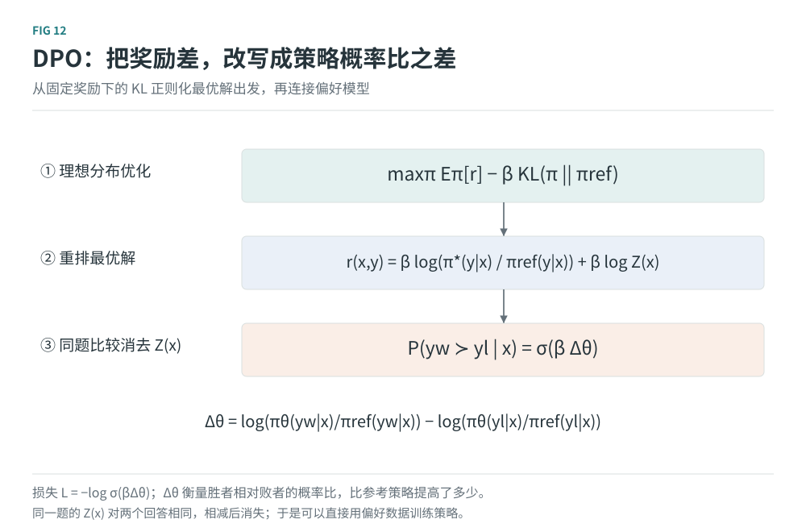

*图 12：先把奖励写成策略的概率比，再比较同题回答，归一化常数自然抵消。最后留下一个可以直接反向传播的损失。*

### 16.3 用一对具体回答读懂概率比

继续看方程题。令 $y_w$ 是“$2z=4$，因此 $z=2$”，$y_l$ 是“$2z=7+3=10$，因此 $z=5$”。偏好数据告诉模型应该选择前者。

把 DPO 括号里的量记为

$$
\Delta_\theta=
\log\frac{\pi_\theta(y_w\mid x)}{\pi_{\mathrm{ref}}(y_w\mid x)}
-\log\frac{\pi_\theta(y_l\mid x)}{\pi_{\mathrm{ref}}(y_l\mid x)}.
$$

它表示：胜者相对败者的对数概率比，比参考策略提高了多少。假设参考模型给这两个完整回答的概率分别为 $0.02$ 和 $0.01$，胜负比是 2；当前模型给出的概率分别为 $0.03$ 和 $0.01$，胜负比是 3。那么 $\Delta=\log(3/2)\approx0.405$。其余概率留给其他可能回答。

单个偏好对的梯度为

$$
\nabla_\theta L
=-\beta\sigma(-\beta\Delta_\theta)
\left[\nabla_\theta\log\pi_\theta(y_w\mid x)
-\nabla_\theta\log\pi_\theta(y_l\mid x)\right].
$$

梯度下降沿着“提高胜者 log-probability、降低败者 log-probability”的差值方向更新。前面的系数会自动调整力度：偏好还没学好时信号较强，已经明显偏向胜者时信号减弱。由于所有回答共享模型参数，观察训练效果时应看这一对回答的相对变化。

取便于复核的 $\Delta=0.4,\beta=0.5$，偏好预测概率为 $\sigma(0.2)\approx0.549834$，损失约为 $0.598139$。配套脚本会计算这两个数。

### 16.4 DPO 的训练数据从哪里来

标准 offline DPO 使用已经收集好的偏好对。每一步读取问题、胜者和败者，计算概率与损失，然后更新模型。PPO 式 RL 则持续执行“当前策略作答 → 得到新奖励 → 更新策略”的循环。这是两种方法在训练流程上的主要差别。

DPO 可以直接利用现成的比较数据，训练过程也较简洁；新一轮偏好数据则能把当前模型新出现的好坏回答带回训练。例如模型后来开始生成一种冗长但常被误判为详细的解法，就需要让比较数据覆盖这种回答。

实现标准 DPO 时，完整回答的 log-probability 取各 token log-probability 的**和**。改成平均会让长短回答获得不同的相对权重，相当于改变了这里推导出的目标。

## 17. RLVR 与 GRPO：从可验证结果中学习

### 17.1 同一道题，可以提供几种训练信号

方程题有一个方便之处：把模型给出的数代回原方程，就能检查答案。代码题也可以运行测试，形式证明可以交给证明检查器。这类由明确标准产生奖励的训练称为 **RLVR（reinforcement learning with verifiable rewards）**。RLVR 说明奖励从哪里来；PPO、GRPO 等方法负责把奖励变成参数更新。

现在可以把几种后训练办法放到同一道题上比较：

| 办法 | 准备什么数据 | 这一轮模型学什么 |
|---|---|---|
| SFT | 问题与一份完整的正确解法 | 逐 token 学习示范解法 |
| DPO | 同题的正确解法与错误解法，标明偏好 | 提高胜者相对败者、相对参考的概率比 |
| RLHF | 用比较数据训练评分员，再让模型产生新回答 | 根据评分员与参考约束优化生成策略 |
| RLVR + PPO | 当前模型的回答、验算分数、Critic 估计 | 用 GAE 等优势估计更新策略 |
| RLVR + GRPO | 当前模型对同题生成的一组回答及验算分数 | 用组内相对分数更新策略 |

这些办法可以接在一起使用。例如先用少量解题示范做 SFT，让模型学会基本格式，再通过验算奖励改进成功率。

验证器也需要按任务设计。若题目只要求一个数，代回方程已经很有用；若要求论证，就还需要评价推导。代码测试则要覆盖正常输入和边界情况。评价得越贴近任务，模型追求高分时就越容易朝我们想要的方向改进。

### 17.2 GRPO 用同题回答形成参照

PPO 的 Critic 要学习“这个前缀通常能拿多少回报”。另一种办法是直接让模型对同一道题做几次，再把本次结果与这组回答的平均水平比较。这就是 **GRPO（Group Relative Policy Optimization）** 的核心想法。

对同一个 prompt $x$，用旧策略采样 $G$ 条回答 $y_1,\ldots,y_G$，分别得到奖励 $R_1,\ldots,R_G$。这里的 $G$ 表示组大小。一种常见的终局奖励 GRPO 定义为

$$
\bar R=\frac1G\sum_{i=1}^G R_i,
\qquad
s_R=\sqrt{\frac1G\sum_{i=1}^G(R_i-\bar R)^2},
\qquad
\widehat A_i=\frac{R_i-\bar R}{s_R+\varepsilon_{\mathrm{num}}}.
$$

这里采用总体标准差，分母为 $G$；$\varepsilon_{\mathrm{num}}$ 是防止除零的小量。

假设四份方程解答分别得到 $z=2,5,2,1$，验算分数为 $[1,0,1,0]$。均值为 $0.5$，标准差为 $0.5$，忽略数值小量后，优势就是 $[1,-1,1,-1]$。正确回答高于这组平均水平，错误回答低于平均水平。

为什么要按同一道题分组？一份回报为 1 的答案，在简单题上可能只是正常表现，在很难的题上却可能是难得的成功。组内比较先把题目的共同背景固定下来，再衡量这次回答表现如何。

在只有终局奖励的基本形式中，一条回答的所有生成 token 共用该回答的 $\widehat A_i$。于是我们用额外的同题采样，替代了一个单独训练的价值网络。[DeepSeekMath 中的 GRPO](https://arxiv.org/html/2402.03300v3#S4.SS1)

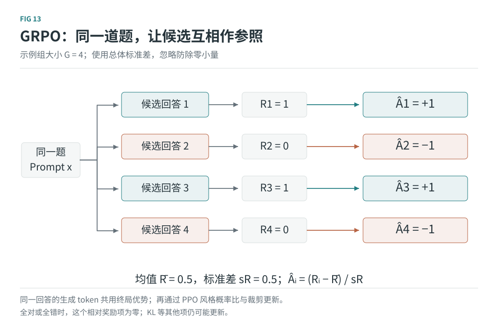

*图 13：先让同一道题产生多条回答，再把分数变成组内优势。这里的两条正确回答得到 $+1$，两条错误回答得到 $-1$。*

### 17.3 从优势到 token 概率的更新

有了 $\widehat A_i$，其余步骤就能接回 PPO。对第 $i$ 条回答的第 $t$ 个 token，定义新旧策略概率比

$$
\rho_{i,t}=\frac{\pi_\theta(y_{i,t}\mid x,y_{i,<t})}
{\pi_{\mathrm{old}}(y_{i,t}\mid x,y_{i,<t})}.
$$

一种常见的 GRPO 目标按回答平均，并加入参考 KL：

$$
L_{\mathrm{GRPO}}=
\mathbb E_{x,\{y_i\}\sim\pi_{\mathrm{old}}}
\left[\frac1G\sum_{i=1}^{G}\frac1{L_i}\sum_{t=1}^{L_i}
\left\{
\min\left(\rho_{i,t}\widehat A_i,
\operatorname{clip}(\rho_{i,t},1-\epsilon,1+\epsilon)\widehat A_i\right)
-\beta\widehat K_{i,t}
\right\}\right].
$$

读这个式子时可以分三层：最里面用“概率比乘优势”更新每个 token，并用 PPO 裁剪控制继续推动它的力度；$1/L_i$ 对一条回答内部取平均；$1/G$ 再对同题回答取平均。$\widehat K_{i,t}$ 表示所采用的参考 KL 项或估计。

刚开始更新时，新旧策略相同，所有 $\rho=1$。对优势为 $+1$ 的正确解法，奖励项推动这条路径上的 token 概率上升；对优势为 $-1$ 的错误解法，方向相反。当某个正确 token 的比率已经超过 $1+\epsilon$，该样本就停止提供继续增大的裁剪项梯度。共享参数仍会受到其他 token 的影响，因此训练中还要观察整体 KL 与裁剪比例。

这个目标使用采样到的前缀来计算更新。具体实现可以调整长度平均和 KL 的写法，第 19 节会解释这些选择怎样改变训练。

> **选读：一个始终非负的 KL 样本项。** 令 $u=\pi_{\mathrm{ref}}(a\mid s)/\pi_\theta(a\mid s)$，可构造 $k(u)=u-\log u-1\geq0$。在两分布具有共同支持、相关期望有限，且动作按当前策略 $a\sim\pi_\theta$ 采样时，$\mathbb E[k(u)]=D_{\mathrm{KL}}(\pi_\theta\|\pi_{\mathrm{ref}})$。实际一批回答来自 $\pi_{\mathrm{old}}$，经过多次更新后它与当前策略已有差异；此时要结合采样校正和梯度处理来使用该估计。首次阅读先记住：参考 KL 需要一套与采样方式配合的计算办法。

### 17.4 组内均值怎样影响更新

组内比较还带来一个细节：一条回答自己的分数也进入了组均值。只做减均值、暂不除标准差时，独立同分布采样下的期望梯度会缩为原来的 $(G-1)/G$。若用其余回答的均值作基线，即 leave-one-out，就可以消除这项自包含缩放。再除以组标准差，还会调整不同题组的相对权重。

这些关系在附录 C 中可以直接算出来。理解 GRPO 主线时，先把握它做的三件事：同题比较、形成相对优势、把优势送入策略更新。

### 17.5 为什么全对和全错的题组都难以提供比较

若四份回答全部正确，奖励是 $[1,1,1,1]$，大家都等于均值，优势全零；若四份全部错误，同样得到零优势。这一组的奖励项没有区分方向，KL 或熵等其他项仍按自己的目标更新。

因此，有些题目需要让模型看到更多成功示范，有些需要调整难度或增加探索机会。对每题多采几次，也能提高找到不同结果的机会，但会花费更多生成计算。训练时同时观察“多少组有分数差异”和“生成了多少 token”，就能看出这笔采样开销有没有带来有用的学习信号。

## 18. 后训练怎样改变解题过程

### 18.1 终局奖励怎样鼓励检查与重算

前面的方程题中，模型可能先写出“$z=5$”，然后代回原式，发现 $2\times5+3\ne7$，再修正为 $z=2$。只在最后打分的训练，也能鼓励这种“检查后再提交”的路径：它最终成功的机会更高，就更容易获得正优势。

经过许多类似经历，检查、重算、调用工具等有效行为可能更经常出现。我们可以把这理解成模型逐渐学会分配自己的解题计算：哪些题直接答，哪些题值得多算一步。具体会形成怎样的习惯，取决于基础模型已经会哪些行为、训练题目和采样方式，以及奖励怎样评价结果。

观察这种变化时，可以同时看解题成功率、错误类型和所用步骤。这样就能判断，多出来的推导是否确实帮助模型解决了问题。

### 18.2 R1-Zero、R1 与蒸馏分别做了什么

以 **DeepSeek-R1 2025 年原始报告**为例，R1-Zero 从已经完成预训练的基座模型出发，直接开展面向推理的 RL；R1 则先加入冷启动示范，随后结合推理 RL、筛选数据与 SFT、进一步 RL 等阶段。[原始报告 v1](https://arxiv.org/html/2501.12948v1)

这两条路线分别展示了两种安排：让奖励直接引导基座已有的生成能力，或者先用示范给出较好的起点，再用奖励继续改进。预训练提供语言、知识和多种生成模式，后训练进一步调整在任务中如何使用它们。

同一报告还用教师模型生成的数据训练较小的学生模型。这就是蒸馏：把较强模型产生的解题示范变成学生可学习的数据。教师的 RL 与学生的监督训练，处在这条数据链的不同位置。

### 18.3 结果奖励与过程奖励

**结果奖励**问“最后做对了吗”。例如把 $z=2$ 代回方程，检查等式是否成立。它直接对应任务结果，但一整段解法只能拿到一个总分。

**过程奖励**问“这一步做得怎么样”。例如检查从 $2z+3=7$ 到 $2z=4$ 是否成立，在错误发生的地方就给出反馈。学习信号更密集，也需要一个能可靠判断中间步骤的评价器。

两者可以配合使用：过程评价帮助定位错误，最终检查确认是否解决了题目。遇到多种合法解法时，评价标准应容许不同路径，例如移项与等式两边同时做运算都可能得到正确结果。

### 18.4 训练时多算，与回答时多算

训练时增加 rollout 和参数更新，是为了让模型以后更会选择解题步骤。推理时增加候选、搜索、自检和工具调用，则是在参数保持固定时，为当前问题投入更多计算。

二者可以互相配合：训练让检查和搜索更有效，推理预算让这些能力有机会发挥。比较方案时，把单次作答和允许多次尝试分开看，再一起记录总生成 token、工具调用和耗时，就能看清收益来自哪里。

## 19. 把公式放进一轮真实训练

### 19.1 按回答平均，还是按 token 平均

设一个 batch 有长短不同的回答。以下两种平均方式很常见：

$$
L_{\mathrm{sequence}}=\frac1G\sum_i\frac1{L_i}\sum_t\ell_{i,t},
\qquad
L_{\mathrm{token}}=\frac{\sum_i\sum_t\ell_{i,t}}{\sum_i L_i}.
$$

前者让每条回答占同样的总权重，后者让每个 token 占同样的权重。例如一条回答有 10 个 token，另一条有 100 个。按回答平均，两条各占一半，每个短回答 token 的系数是长回答 token 的 10 倍；按 token 平均，110 个 token 等权，长回答占据更多总权重。

所以，“除以哪个数”实际决定了训练更重视哪些样本。组标准差、长度惩罚、格式奖励和截断处理也会改变这些权重。把想要的训练目标想清楚，再选择平均方式，代码就容易理解了。

### 19.2 新方法常从这些具体选择开始

读后续方法时，可以先找它改了目标中的哪一项。下面几个例子都能用已有知识理解：

| 工作 | 重点查看的变化 | 为什么与前文有关 |
|---|---|---|
| [Dr. GRPO](https://arxiv.org/abs/2503.20783) | 分析长度归一化、奖励标准化带来的优化偏差，并修改目标 | “怎样平均”会改变梯度权重 |
| [DAPO](https://arxiv.org/abs/2503.14476) | 非对称裁剪、动态采样、token 级损失及过长回答处理 | 探索、有效组比例、归一化和截断相互作用 |
| [GSPO](https://arxiv.org/abs/2507.18071) | 使用基于序列似然的长度归一化比率，在序列层面裁剪 | 终局奖励可以配合不同粒度的概率比与裁剪 |

看懂这些改动之后，再去看它们在哪些模型、题目和计算预算上有效，就能把实验结果与方法本身联系起来。

### 19.3 生成回答与更新参数是两种计算节奏

语言模型逐 token 生成回答，生成长推理往往花费很多时间。训练系统因而常把采样、打分和参数更新放在不同设备或进程上，甚至让它们同时进行。

这时要记录每批回答由哪一版策略产生。采样器可能还在使用旧参数，训练端已经更新；概率比的分母就应对应真正生成这批数据的策略。温度、top-p 和受限解码也会改变采样分布，应连同采样设置一起保存和处理。

例如 top-p 过滤掉的 token 在这轮采样中根本不会出现。重要性加权能重新分配已有样本的权重，获取这些被排除动作的信息则需要新的采样机会。这也说明了数据刷新为什么是策略训练的一部分。

### 19.4 从四份回答走完一次更新

把第 17 节的方程题再完整走一遍，就能把公式与训练过程接上：

1. **采样。** 保存本轮 old 策略，用它生成四份回答，并记录各生成 token 的旧 log-probability、有效位置和结束原因。
2. **打分。** 验算得到 $[1,0,1,0]$。若还有格式分、过程分或长度成本，分别记录，再按任务定义组合。
3. **形成优势。** GRPO 得到 $[1,-1,1,-1]$，分配给各自回答的生成 token；若走 PPO 路线，则用 Critic 与 GAE 得到逐位置优势及价值训练目标。
4. **计算并更新。** 当前策略重新计算这些 token 的 log-probability，与保存的 old 值组成概率比；再计算裁剪项和参考正则，反向传播更新参数。
5. **观察变化。** 同时看奖励、KL、熵、裁剪比例、回答长度与有效组比例。必要时减少本批更新次数，让新策略重新采样。
6. **进入下一轮。** 同步更新后的权重，生成新的回答；定期在未参与训练的题目上检查解题效果。

一批数据可以做少量多次更新，但这期间 old 概率与优势保持为这批数据的记录。reference 继续提供本阶段的固定参照。这样，采样、评分、比较和概率变化就组成了一个完整闭环。

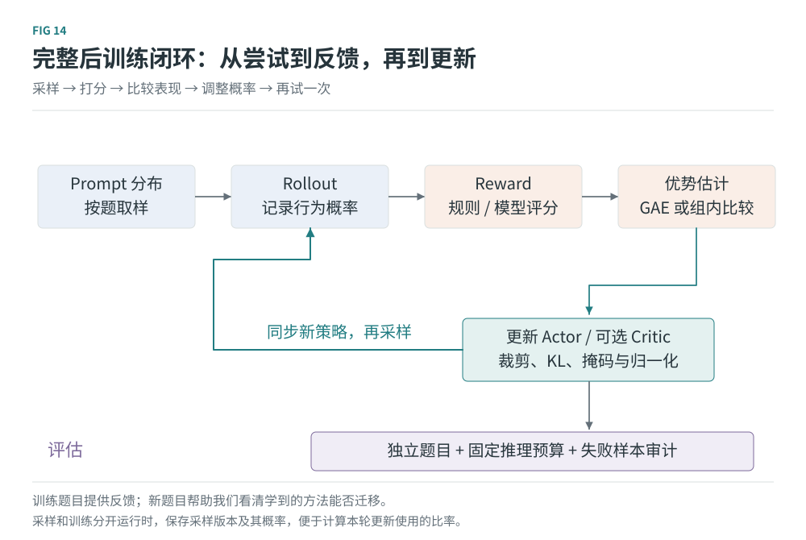

*图 14：当前模型产生回答，评价产生分数，优势把分数转换成更新信号；独立题目帮助观察学到的办法能否用于新的问题。*

## 20. 怎样看出模型学会了什么

### 20.1 把分数、行为和成本一起看

训练日志可以从几个角度阅读：

| 层面 | 观察什么 | 它帮我们看什么 |
|---|---|---|
| 目标与数据 | 题目类型、难度、奖励定义、训练与测试划分 | 模型正在练习哪些能力，新题是否覆盖相同任务 |
| 优化状态 | KL、熵、裁剪比例、梯度范数、value loss、优势方差 | 更新是否过猛，探索是否减少，价值估计是否跟上 |
| 行为变化 | 长度、重复、格式、工具使用与失败类型 | 模型采用了哪些解题习惯，错误发生在哪里 |
| 任务表现 | 独立正确率、偏好胜率、代码测试、分领域结果 | 哪些能力改善了，哪些题目仍然困难 |
| 成本与稳定性 | 总采样 token、时间、内存、重复实验的波动 | 改善需要多少计算，结果是否稳定 |

GRPO 尤其值得看有奖励差异的题组占比：有多少题组真正提供了比较信号。PPO 还可以观察 Critic 的预测与实际回报是否相符。使用奖励模型时，则抽查高分回答，看看高分是否对应我们希望的回答质量。

### 20.2 pass@1、pass@k 与挑选答案

假设在某一道题上，模型每次独立采样答对的概率都是 $p=0.3$。只生成一次，成功率就是 $30\%$。生成四次，四次全错的概率为 $0.7^4=0.2401$，所以至少一次正确的概率为

$$
\operatorname{pass@}k=1-(1-p)^k,
\qquad
\operatorname{pass@}4=1-0.7^4=0.7599.
$$

这组数字说明了多次尝试的价值：在这个独立、同成功率的例子中，候选池里有正确答案的概率由 $30\%$ 提高到约 $76\%$。评测数据集里的各题难度不同，通常需要逐题计算或估计，再汇总结果。

接下来还有一步：**从四份候选中选哪一份交给用户？** 如果只是随机挑一份，成功率仍为 $30\%$；若有一个能准确识别正确答案的检查器，就能利用候选池约 $76\%$ 的成功机会。现实中的验证器或重排序器有自己的错误率，它的选择能力也会影响最终交付效果。

因此，pass@1 帮助我们看单次生成能力，pass@k 帮助我们看多次采样能找到多少成功路径，最终选中答案的正确率则把生成与挑选两步连起来。

### 20.3 做一个能看懂收益来源的小实验

可以从代码函数补全开始。用同一个初始模型，分别做 SFT、筛选正确回答后微调、以及 RL。训练题和测试题按题目家族分开，防止同一道题的轻微改写同时出现在两边。

测试时给各模型同样的温度、候选数、最大 token 和工具预算。先看单次正确率，再看多次生成加选择的最终正确率；同时记下训练生成了多少 token、测试用了多少计算。

若 RL 的结果更好，可以继续换掉其中一项：保留生成数据但只做 SFT，或固定验证器只增加候选数。这样就能逐步看清，改善来自更好的训练数据、更多尝试、更准确的打分，还是奖励驱动的策略更新。

### 20.4 用五个问题读后续方法

1. **优化什么？** 任务奖励、参考 KL、熵和长度成本各在鼓励什么行为？
2. **数据从哪里来？** 当前策略、旧策略、人工示范、教师，还是固定日志？
3. **怎样判断好多少？** 用完整回报、Critic/GAE、同题比较，还是偏好对？
4. **怎样控制变化？** 学习率、裁剪、KL 和重新采样各负责哪一部分？
5. **怎样观察改善？** 新题表现、具体错误和所用计算发生了什么变化？

从 Bellman 方程到大模型后训练，反复出现的是同一组思想：用价值估计概括未来，用策略梯度把结果变成概率变化，用参照与更新控制保持学习稳定，再用恰当的反馈告诉模型什么值得追求。掌握这些联系，读到一个新的算法名字时，就可以先找到它在这条链上的位置。

## 附录 A：Bellman 压缩性与策略改进的依据

令 $D=V-W$。对任意状态，

$$
\begin{aligned}
|(T^\pi V)(s)-(T^\pi W)(s)|
&=\left|\gamma\sum_{a,s'}\pi(a\mid s)P(s'\mid s,a)D(s')\right|\\
&\leq\gamma\sum_{a,s'}\pi(a\mid s)P(s'\mid s,a)\|D\|_\infty\\
&=\gamma\|D\|_\infty.
\end{aligned}
$$

对所有状态取最大值，即得压缩性。最优算子也满足同样的界，因为

$$
|\max_a f(a)-\max_a g(a)|\leq\max_a|f(a)-g(a)|.
$$

策略改进则利用单调性。若新策略 $\pi'$ 在每个状态选择使 $Q^\pi(s,a)$ 最大的动作，那么

$$
T^{\pi'}V^\pi\geq V^\pi.
$$

反复应用保持不等式的 $T^{\pi'}$，再取收敛极限，得到 $V^{\pi'}\geq V^\pi$。这就给出了第 5 节策略改进的依据：准确评估旧策略后，在每个状态选取更好的动作，能够提高或保持各状态的价值。

矩阵形式也有帮助。令 $P^\pi$ 为策略诱导的状态转移矩阵，$r^\pi$ 为期望立即奖励向量，则

$$
V^\pi=r^\pi+\gamma P^\pi V^\pi,
\qquad
V^\pi=(I-\gamma P^\pi)^{-1}r^\pi.
$$

终止状态可以作为零奖励吸收态。对大状态空间直接求逆通常不现实，迭代与采样方法则避免显式构造这个逆。

## 附录 B：一页符号表

| 符号 | 含义 | 在哪里用到 |
|---|---|---|
| $r_{t+1}$ | 执行动作后得到的单步奖励 | 构造回报与 TD 目标 |
| $G_t$ | 从时刻 $t$ 开始的折扣回报 | MC、REINFORCE；GRPO 的 $G$ 则表示组大小 |
| $V^\pi,Q^\pi$ | 当前策略的状态价值、动作价值 | 预测未来回报与选择动作 |
| $A^\pi$ | 动作比当前策略平均表现好多少 | 给策略梯度提供相对权重 |
| $\gamma$ | 回报折扣因子 | 定义未来奖励的权重 |
| $\lambda$（GAE） | 多步估计的衰减参数 | 调节 TD 误差向前传播的范围 |
| $\alpha$ | 学习率 | 控制每次更新的步长 |
| $\epsilon$ | PPO 概率比裁剪宽度 | 决定代理目标在哪里进入平段 |
| $\varepsilon_{\mathrm{num}}$ | 数值稳定小量 | GRPO 标准化时防止除零 |
| $\rho$ | 当前策略与采样旧策略的动作概率比 | 在旧数据上构造代理目标 |
| $\beta$ | 参考 KL 强度、DPO 中对应的系数 | 连接奖励优化与参考策略 |
| $\pi_{\mathrm{old}}$ | 本轮采样策略 | 每轮刷新，用于概率比 |
| $\pi_{\mathrm{ref}}$ | 参考行为分布 | 通常在一个训练阶段保持固定，用于正则化 |
| $\theta,\phi,\psi$ | Actor、Critic、reward model 参数 | 分别学习行动、预测回报与评价结果 |

## 附录 C：组均值基线的一个细节

固定 prompt，独立采样 $G$ 个回答，令 $g_i=\nabla\log\pi(y_i)$，单个奖励为 $R_i$，真实梯度为 $g=\mathbb E[R_i g_i]$。因为 $\mathbb E[g_i]=0$，且 $j\neq i$ 时 $R_j$ 与 $g_i$ 独立，

$$
\mathbb E\left[\left(R_i-\frac1G\sum_jR_j\right)g_i\right]
=\left(1-\frac1G\right)g.
$$

如果改用 $b_{-i}=\frac1{G-1}\sum_{j\neq i}R_j$，则 $\mathbb E[(R_i-b_{-i})g_i]=g$。前一种做法把自己也放进均值，梯度期望缩小了 $1/G$；后一种只用其他回答作参照，恢复了原来的期望梯度。

这个结果帮助我们单独看清“减去组均值”的作用。进一步除以组标准差，会改变不同组的相对权重；裁剪与长度归一化则分别改变更新幅度和各条回答的贡献。分析完整的 GRPO 目标时，可以按这个顺序逐项理解。

## 附录 D：带答案的理解练习

**1. 折扣改变选择。** 在两状态例子中，粗稿坚持完善的价值何时高于立即提交的 $2$？

答案：$V(s_0)=(-1+6.4\gamma)/(1-0.2\gamma)$。对 $0\leq\gamma<1$，分母为正；比较得到 $\gamma>3/6.8\approx0.441176$。等号时两者相同。折扣较大时，继续完善带来的未来收益才值得当前这一步成本。

**2. 终止与截断。** 若一步奖励为 $1$，下一状态估计价值为 $10$，$\gamma=0.9$，真实终止和采样截断的 TD 目标分别是多少？

答案：真实终止为 $1$；底层任务继续但采样停止时为 $1+0.9\times10=10$。若时间上限本身就是任务终点，则应按真实终止处理。

**3. PPO 的负优势。** $A=-2,\epsilon=0.2,\rho=1.5$，代理项是多少？是否被截成 $-2.4$？

答案：$\min(-3,-2.4)=-3$。坏动作的概率反而提高，仍应惩罚；裁剪不是对所有方向都置平。

**4. GRPO 全错。** 一组四个回答都得零分，还会更新参数吗？

答案：基本组内终局 advantage 全零，奖励驱动项没有梯度；但 KL、熵或其他训练项仍可能更新。因此观察训练时，可以把任务奖励项和正则项分开看。

**5. 一个 token 的 log-ratio 为负，KL 公式错了吗？**

答案：没有。采样量 $\log\pi_\theta(a\mid s)-\log\pi_{\mathrm{ref}}(a\mid s)$ 可以为负；在 $a\sim\pi_\theta$ 下求完整期望才是非负 KL。

**6. 去掉 Critic 是否意味着 GRPO 不需要评价？**

答案：仍需奖励模型、规则验证器或其他评价。去掉的是一个拟合前缀未来回报的价值网络，不是评价回答好坏的机制。

**7. 用优质回答做 SFT 与 DPO 有何不同？**

答案：SFT 提高示范 log-probability；DPO 使用同题胜负回答及参考策略，优化相对概率比的差。只保留赢家再 SFT 会丢失比较信息，也不是 DPO 损失的等价实现。

## 附录 E：可运行的小实验

随讲义提供 [examples/rl_toy_lab.py](examples/rl_toy_lab.py)，只使用 Python 标准库。在本讲义目录运行：

```bash
python examples/rl_toy_lab.py
```

它会计算并校验：两状态 MDP 的价值迭代与解析解、TD 单步更新、策略梯度的有限差分、baseline 的期望与方差、GAE、PPO 正负 advantage、DPO 损失与导数、GRPO 组内标准化，以及 KL 正则化 bandit 的最优策略。

最后一个实验只含两种回答：A 奖励 $1$，B 奖励 $0$，参考策略各占 $0.5$。取 $\beta=0.5$，理想最优策略为

$$
\pi^*(A)=\frac{e^{1/\beta}}{e^{1/\beta}+1}
=\sigma(2)\approx0.880797.
$$

它没有把全部概率压到 A，因为 KL 正则为偏离参考策略收取代价。脚本在这个可完全求解的目标上执行梯度上升，并与解析最优解比较。这样可以把“KL 系数改变目标，梯度更新逐渐接近目标”直接画出来。

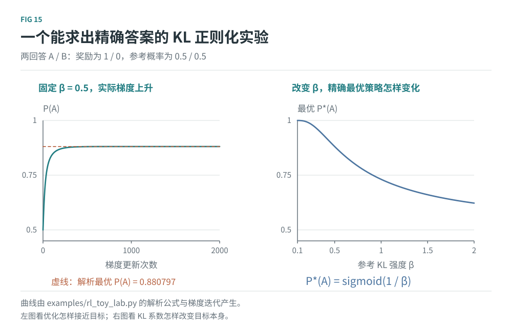

*图 15：曲线来自配套脚本的实际数值迭代。固定奖励下，增加正则强度使策略更接近参考分布；训练轨迹应向对应的解析最优值收敛。*

最简化的核心更新如下，其中 $\theta$ 是 A 相对 B 的 logit，$p=\sigma(\theta)$：

```python
from math import exp

theta, beta, learning_rate = 0.0, 0.5, 0.2
for _ in range(1000):
    p = 1.0 / (1.0 + exp(-theta))
    # J = p - beta * KL(Bernoulli(p) || Bernoulli(0.5))
    grad = p * (1.0 - p) * (1.0 - beta * theta)
    theta += learning_rate * grad
print(1.0 / (1.0 + exp(-theta)))  # 接近 0.880797
```

这段代码直接计算完整期望梯度，因此没有 Monte Carlo 采样噪声。把它与第 9 节的单样本梯度对比，可以清楚看到：优化目标、精确梯度与采样估计，是三个不同层次。

## 参考阅读与使用说明

基础部分的系统教材是 Sutton 与 Barto 的 [Reinforcement Learning: An Introduction, 2nd edition](http://incompleteideas.net/book/the-book-2nd.html)。本讲义的两状态任务、数值练习与可求解 bandit 为独立构造，用于把定义、推导和程序结果联系起来。

经典算法建议依次阅读 [DQN](https://www.nature.com/articles/nature14236)、[Double DQN](https://arxiv.org/abs/1509.06461)、[TRPO](https://arxiv.org/abs/1502.05477)、[GAE](https://arxiv.org/abs/1506.02438) 与 [PPO](https://arxiv.org/abs/1707.06347)。想理解直接优化策略的历史，可读 Williams 的 [REINFORCE](https://doi.org/10.1007/BF00992696) 与 Sutton 等人的 [Policy Gradient Methods for Reinforcement Learning with Function Approximation](https://proceedings.neurips.cc/paper/1999/hash/464d828b85b0bed98e80ade0a5c43b0f-Abstract.html)。

大模型后训练建议把 [InstructGPT](https://arxiv.org/abs/2203.02155)、[DPO](https://arxiv.org/abs/2305.18290)、[DeepSeekMath](https://arxiv.org/abs/2402.03300) 与 [DeepSeek-R1 原始报告](https://arxiv.org/abs/2501.12948v1) 连起来读：它们分别帮助理解反馈建模、偏好重参数化、组内优势与多阶段推理训练。读第 19 节的后续研究时，可以沿着估计器、归一化与系统设计这几条线继续追问。

全部配图是本地代码生成的独立 SVG，无远程图片或字体依赖。图片、生成源码与数值实验随文档一起交付；移动或分享时保留相对目录结构即可。可打开 [插图预览.html](插图预览.html) 逐张放大查看；生成与校验步骤见 [README.md](README.md)。
