# 大模型入门

## 7. Transformer 为什么成为大模型的重要基础？

上节课第六节介绍了几种适应不同数据结构的神经网络。Transformer 同样是一种网络架构，它在序列建模和大模型中应用广泛，因此这里单独展开。要理解它的设计，可以接着前面的 RNN，从机器翻译这个任务讲起——早期序列到序列模型（以及注意力机制）的主要进展，正是在机器翻译上逐步完成的*（当前 LLM 的核心架构起源于机器翻译领域的研究）*

假设要把“I love machine learning”翻译成“我喜欢机器学习”。输入和输出都是序列，长度和词序又可以不同。早期的[序列到序列（sequence-to-sequence，seq2seq）](https://arxiv.org/abs/1409.3215) 模型把这个过程交给两个部分完成：**编码器（encoder）** 用 RNN 或 LSTM 逐步读入原文，把信息汇总到固定维数的状态中；**解码器（decoder）** 以这些状态为起点，结合已经生成的内容，逐步输出译文。*问题：句子一长，前面的信息就被压缩丢了；而且必须按顺序计算，无法并行*

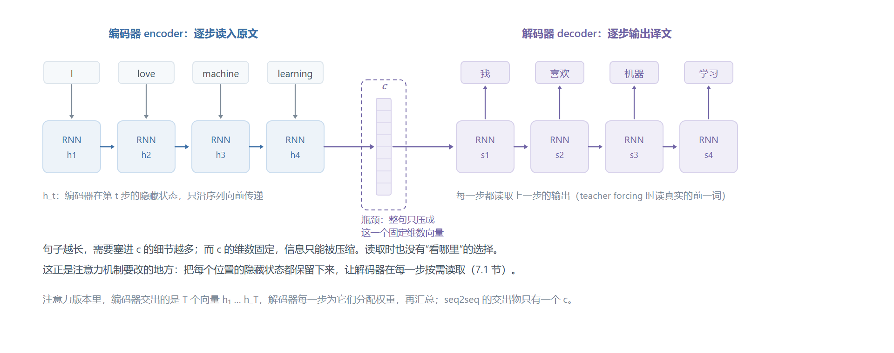

*描述：seq2seq 用编码器把整句压进一个固定维数的向量，再交给解码器逐步输出；中间这个向量就是瓶颈。*

在这种基本结构中，编码器需要把整句原文的信息集中到一份固定大小的“摘要”里。句子变长、细节增多时，这份摘要就需要同时保留更多内容。翻译不同部分时，解码器实际需要关注的原文位置也在变化：生成“喜欢”时，“love”更相关；生成“机器学习”时，“machine learning”更相关。

[注意力机制（attention）](https://arxiv.org/abs/1409.0473) 把读取原文的过程变得更灵活：编码器保留各个位置的表示，解码器在生成每一部分译文时，根据当前状态为这些位置分配权重，再把相关信息加权汇总。这样，每一步生成都能从原文中取得适合当前需要的上下文。这种由输出序列读取输入序列的注意力，称为**交叉注意力（cross-attention）**。

同样的读取方式也可以用在一条序列内部：更新一个词的表示时，让它读取同一句话中其他位置的信息，形成结合上下文的表示。例如，把“machine”的信息融入“learning”的表示，可以帮助模型理解它们组成的概念。读取者与被读取的信息都来自同一条序列时，这种机制称为**自注意力（self-attention）**。与 RNN 必须沿序列逐步传递状态不同，自注意力让任意两个位置在一层之内直接建立联系，也使同一层内各位置的计算可以并行。

2017 年的 [Attention Is All You Need](https://arxiv.org/abs/1706.03762) 把这个思路推到了极致：它证明了完全可以丢掉 RNN 和 CNN，只用注意力机制就能构建整个序列模型，由此提出了 **Transformer**。原始 Transformer 仍采用编码器—解码器结构，用自注意力处理各序列内部的信息，用交叉注意力让解码器读取编码器的输出，再配合前馈网络、残差连接和归一化，逐层构建表示。这一设计不仅显著提升了翻译效果，更重要的是实现了*高度并行*，为后续大规模预训练模型奠定了基础。

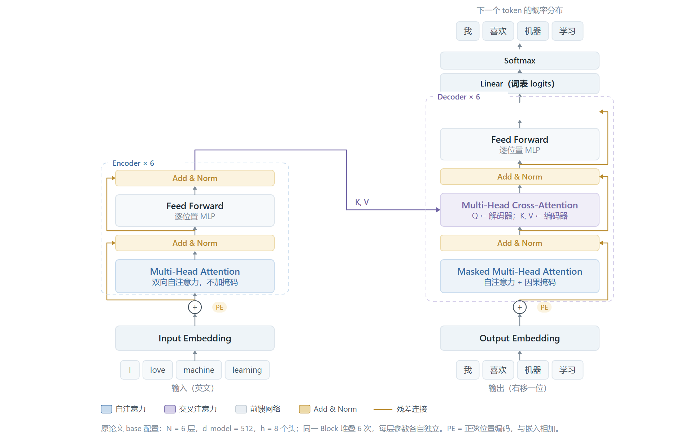

*描述：原始 Transformer 编码器—解码器架构。*

Transformer 的应用进一步扩展到了图像、音频和视频。这里的“序列”是一种组织输入的方式：图像可以拆成小块（patch），音频可以表示成声谱图块或音频特征序列，视频可以拆成带有时间与空间位置的片段。把这些元素转换成向量，就能用注意力机制学习不同区域、不同时刻之间的关系；时间序列、蛋白质残基等数据也能沿用这一思路。

这种通用性与第六节讲过的规模化能力相结合，使 **Transformer 及其变体成为大规模语言、视觉和多模态模型的主流骨干**。以[视觉 Transformer（ViT）](https://arxiv.org/abs/2010.11929) 为例，大规模预训练使它在多项图像识别基准上取得了超过当时领先 CNN 的表现；[音频](https://arxiv.org/abs/2104.01778)和[视频](https://arxiv.org/abs/2203.12602)领域也发展出了相应的 Transformer 模型。不同模态可以共享注意力、前馈网络和端到端训练这套基本框架，并进一步组合到同一个多模态模型中，这也是 Transformer 对现代大模型如此重要的原因。

下面先拆开一次注意力读取，看看这套通用架构怎样完成信息的匹配与汇总。

### 7.1 先用直觉认识 Query、Key、Value

继续看刚才的翻译过程：解码器准备生成下一部分译文时，需要根据当前状态，从原文各位置取出相关信息。可以把这次读取拆成三个角色：

- **Query**：当前位置希望获取哪类信息。
- **Key**：被读取的位置提供什么可供匹配的描述。
- **Value**：被读取的位置实际提供的向量信息。
把 Query 与各个 Key 比较，就得到一组匹配分数；把分数转换成权重，再对相应的 Value 加权求和，就得到了当前需要读取的上下文。训练会同时调整这三类向量的生成方式，让信息的匹配与汇总服务于最终任务。

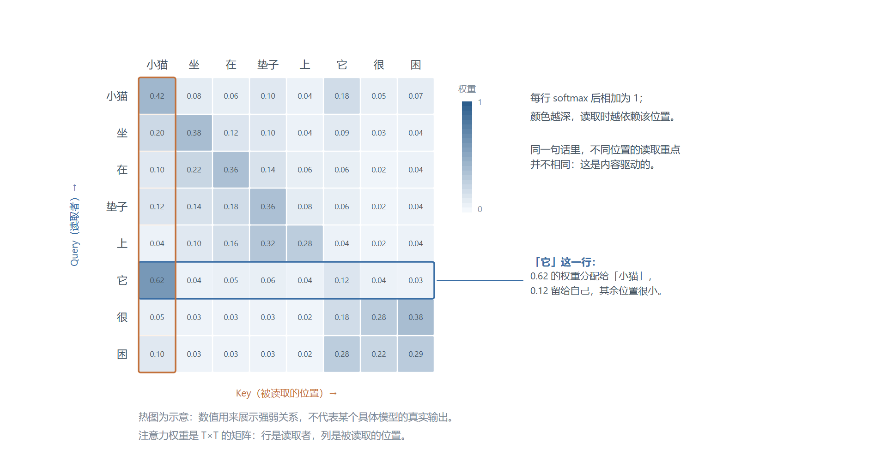

*描述：自注意力分数热图：高亮当前词与其他词的关联。*

在翻译中的交叉注意力里，Query 来自解码器，Key 和 Value 来自编码器。自注意力则从同一组序列表示中生成这三类向量。下面先写出自注意力的计算形式。

### 7.2 从一次加权求和到多头注意力

将长度为 $T$ 的序列整理成输入矩阵 $X\in\mathbb R^{T\times d}$，第 $t$ 行就是第 $t$ 个位置的 $d$ 维向量表示。文本先经过分词器转换为 **token**，它可以是一个字、一个词或词的一部分，再通过嵌入层（embedding）为每个 token 取得一个可学习的向量；图像 patch、音频片段等也可以通过相应的输入层转换成向量。自注意力用三组可学习的投影参数，从同一个 $X$ 生成 Query、Key、Value：

$$
Q=XW_Q,\quad K=XW_K,\quad V=XW_V.
$$

其中 $W_Q,W_K\in\mathbb R^{d\times d_k}$，$W_V\in\mathbb R^{d\times d_v}$。同一个头在各位置使用相同的投影参数。这些参数由训练学得；每次输入产生的 $Q,K,V$ 则随输入内容变化。

先看第 $t$ 个位置怎样读取信息。它用自己的 $q_t$ 与允许读取的各个 $k_s$ 做点积，通过 softmax 得到权重，再汇总相应的 $v_s$：

$$
\alpha_{ts}=\frac{\exp(q_t^\top k_s/\sqrt{d_k})}{\sum_{u\in\mathcal S_t}\exp(q_t^\top k_u/\sqrt{d_k})},\qquad o_t=\sum_{s\in\mathcal S_t}\alpha_{ts}v_s.
$$

这里 $\mathcal S_t$ 表示第 $t$ 个位置允许读取的位置集合，$q_t,k_s,v_s$ 是相应行向量转写成的列向量。例如，三个位置的权重为 $0.6,0.3,0.1$，读取结果就是 $0.6v_1+0.3v_2+0.1v_3$。注意力把“根据当前内容决定怎样汇总其他位置的信息”，变成了一次可学习的计算。

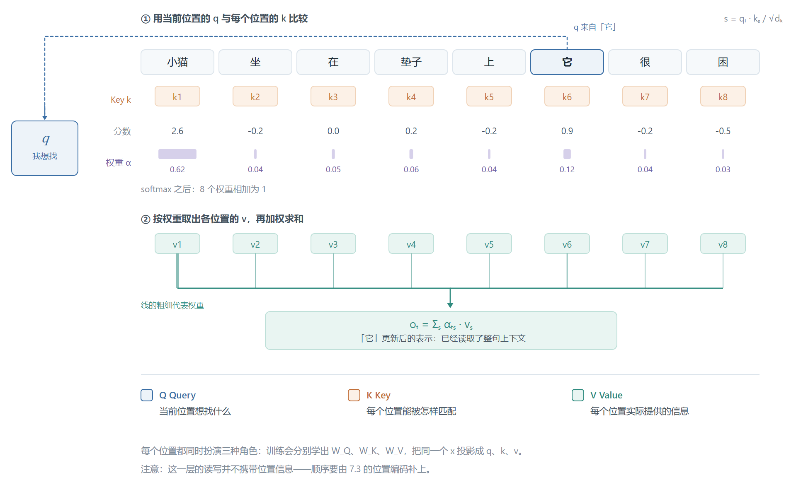

*描述：用 Query、Key、Value 直观理解自注意力的匹配与汇总。*

把所有位置的计算合在一起，就得到**缩放点积注意力（scaled dot-product attention）**：

$$
\operatorname{Attention}(Q,K,V)=\operatorname{softmax}\!\left(\frac{QK^\top}{\sqrt{d_k}}+M\right)V.
$$

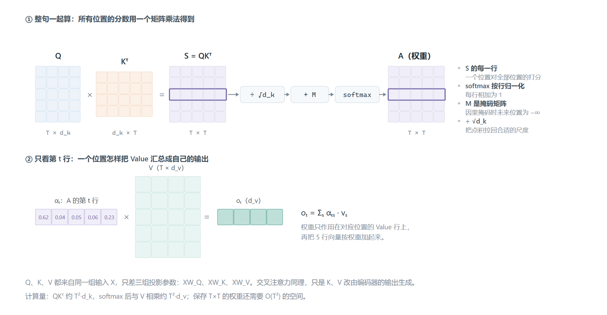

*描述：缩放点积注意力中的矩阵形状与计算。*

对单个注意力头，$Q,K\in\mathbb R^{T\times d_k}$，$V\in\mathbb R^{T\times d_v}$，所以 $QK^\top$ 是一个 $T\times T$ 的匹配分数矩阵：第 $t$ 行表示第 $t$ 个位置对各位置的打分。softmax 对每一行归一化，再用得到的权重对 Value 向量加权求和，输出形状为 $T\times d_v$。除以 $\sqrt{d_k}$ 是为了控制点积的尺度：维度增加时，点积的波动通常也会变大，缩放有助于让 softmax 保持合适的敏感程度。

矩阵 $M$ 控制哪些位置可以被读取。对输入做整体理解时，可以让各个有效位置相互读取；逐步生成文本时，则使用**因果掩码（causal mask）**：允许读取的位置取 0，未来位置取 $-\infty$，使其 softmax 权重为 0。这样，第 $t$ 个位置只能读取自身以及之前的位置，其输出用于预测第 $t+1$ 个 token。补齐序列长度时加入的 padding 位置，也可以通过掩码排除。

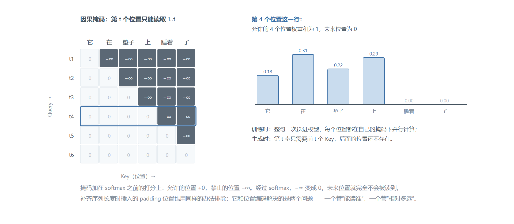

*描述：因果掩码把未来位置的打分设为 −∞，softmax 之后这些位置权重恰为 0；训练时整句并行，生成时逐步扩展。*

一次加权汇总给出一种信息组合。若同时用多组投影，就可以从不同角度学习位置之间的关系，这就是**多头注意力（multi-head attention）**。每个头都有自己的 $W_Q^{(i)},W_K^{(i)},W_V^{(i)}$，独立完成一次读取，再把结果拼接并投影回 $d$ 维：

$$
\operatorname{head}_i=\operatorname{Attention}(XW_Q^{(i)},XW_K^{(i)},XW_V^{(i)}),
$$

$$
\operatorname{MultiHead}(X)=\operatorname{Concat}(\operatorname{head}_1,\ldots,\operatorname{head}_h)W_O.
$$

这里 $h$ 是头数，拼接后的形状为 $T\times(hd_v)$，$W_O\in\mathbb R^{hd_v\times d}$。在常见的等宽设计中，$d_k=d_v=d/h$。各个头的投影方式随训练共同学得，可以捕捉不同的内容关联。

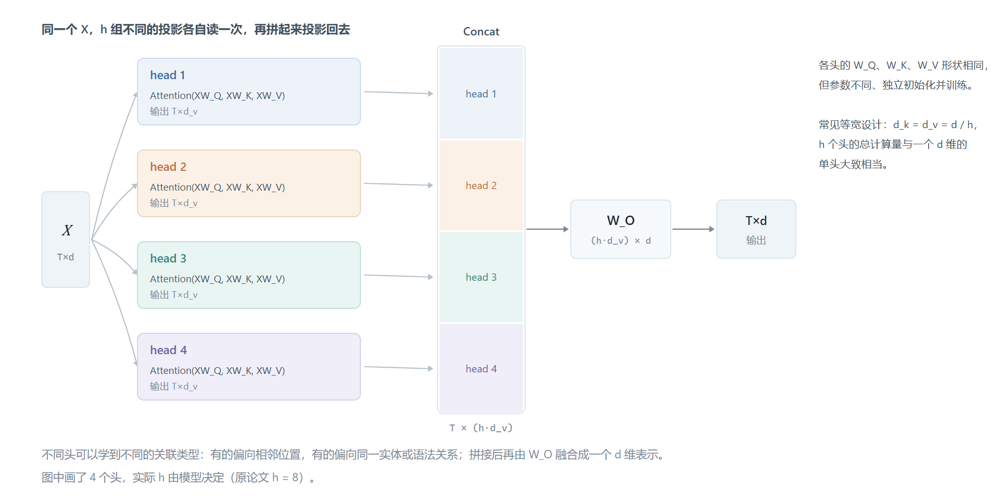

*描述：缩放点积注意力与多头注意力的组合方式。*

交叉注意力沿用同样的计算：由解码器表示生成 $Q$，由编码器表示生成 $K,V$。若输出侧有 $T$ 个位置、输入侧有 $S$ 个位置，匹配分数矩阵就是 $T\times S$，每个输出位置都可以从输入的 $S$ 个位置读取信息。

### 7.3 Positional Encoding：顺序从哪里来？

“人咬狗”和“狗咬人”包含相同的字，词序却改变了意思。

纯自注意力只根据内容向量做匹配和汇总，因此对位置排列是等变的：如果用置换矩阵 $\Pi$ 同时重排 $Q$、$K$、$V$ 的行，输出也会被同样重排，

$$
\operatorname{Attention}(\Pi Q,\Pi K,\Pi V)=\Pi\,\operatorname{Attention}(Q,K,V).
$$

这称为**排列等变性（permutation equivariance），**这意味着模型只关心“有哪些内容”，而不关心“它们的顺序”。但“人咬狗”和“狗咬人”包含相同的字，词序却完全改变了意思。如果没有位置信息，模型就无法区分这两种输入。因此需要把位置编码加进表示，让模型同时知道“这里是什么内容”以及“它位于哪里”，从而学习谁在谁之前、相隔多远，或图像中哪些 patch 在空间上相邻。

最直接的做法是把位置信息加到输入表示上：

$$
\tilde x_t=x_t+p_t.
$$

原始 Transformer 使用 **sinusoidal positional encoding**。设 $d$ 为偶数，对位置 $t$ 和维度对 $j=0,\dots,d/2-1$，令

$$
p_{t,2j}=\sin\left(\frac{t}{10000^{2j/d}}\right),\qquad p_{t,2j+1}=\cos\left(\frac{t}{10000^{2j/d}}\right).
$$

不同维度对应不同频率，有点像一组分辨率不同的时钟：低频维度随位置变化很慢，高频维度变化很快。这样每个位置得到一个确定的编码，而相邻位置的编码也比较接近。无需训练，也能外推到比训练时更长的序列（效果有限）。

另一种常见做法是 **learned positional embedding**：为预设范围内的每个位置设置一个可学习的 $p_t$，由训练确定其数值。处理更长输入时，可以通过扩展位置表、插值以及相应的训练，让位置表示适应新的长度。

很多任务还关心位置之间的相对距离，例如一个词与前面某个词相隔多少步。这时可以把相对位置 $t-s$ 的信息直接加入 attention score：

$$
\frac{q_t^\top k_s}{\sqrt{d_k}}+b_{t-s}.
$$

例如 $b_{t-s}$ 可以是按距离查表（和模型其他参数一起训练得到的）得到的 bias。

现代 LLM 中也很常用[旋转位置编码（Rotary Position Embedding，RoPE）](https://arxiv.org/abs/2104.09864)：把表示向量按相邻两维分成若干对，对序列中的第 $t$ 个 token，每一对按角度 $t\theta_j$ 做二维旋转，不同对使用不同频率 $\theta_j$。用 $R(t)$ 表示位置 $t$ 对应的整体旋转矩阵（一个分块对角矩阵），就可以写成

$$
q_t'=R(t)q_t,\qquad k_s'=R(s)k_s.
$$

由于旋转矩阵满足 $R(t)^\top R(s) = R(s-t)$，注意力分数变为

$$
q_t'^\top k_s'=q_t^\top R(t)^\top R(s)k_s=q_t^\top R(s-t)k_s,
$$

这样，点积就会依赖于相对位移 $s-t$，相对位置信息就被直接编码进了注意力打分中。

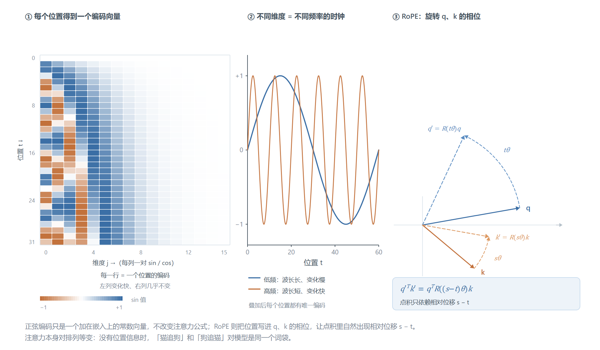

*描述：位置编码与 RoPE 如何把位置信息注入注意力。*

因果掩码规定**可以读取哪些位置**，位置编码提供**位置的坐标或相对距离**。在自回归模型中，两者一起使用：前者让预测遵守生成方向，后者帮助模型理解上下文中的位置关系。

位置表示也可以随数据结构变化：文本使用前后位置，图像 patch 带有二维空间坐标，视频还包含时间坐标。对采样间隔不均匀的时间序列，可以进一步加入真实时间戳或时间差，让模型同时了解元素的排列和实际的时间间隔。这些设计把不同模态的位置关系带入了同一套注意力框架。

### 7.4 从注意力到完整的 Transformer

经过注意力，一个位置已经汇集了上下文信息。接下来还要对这个位置的向量做进一步加工，提取和组合特征。这一步使用**逐位置前馈网络（position-wise FFN）**：对*每一行*应用同一个小型 MLP，通常先扩展特征维度，再通过激活函数和线性映射回到 $d$ 维。注意力负责位置之间的信息交互，FFN 负责各位置内部的非线性变换，两者交替进行。

把这两步与第六节的残差连接、归一化组合起来，就构成一个 **Transformer Block**。以常见的[归一化放在子层之前（Pre-Norm）](https://arxiv.org/abs/2002.04745)的写法为例（原始 Transformer采用post-Norm），设输入为 $H^{(\ell)}\in\mathbb R^{T\times d}$：

$$
U=H^{(\ell)}+\operatorname{MultiHead}\!\left(\operatorname{Norm}(H^{(\ell)})\right),
$$

$$
H^{(\ell+1)}=U+\operatorname{FFN}\!\left(\operatorname{Norm}(U)\right).
$$

两次 Norm 分别带有自己的可学习参数，可以采用 LayerNorm 或 RMSNorm。每个子层的输出都通过残差连接加回原来的表示，使上下文信息和非线性变换逐层累积。每个 Block 保持 $T\times d$ 的形状，因此可以连续堆叠；各层使用各自的参数，逐步形成更适合任务的表示。

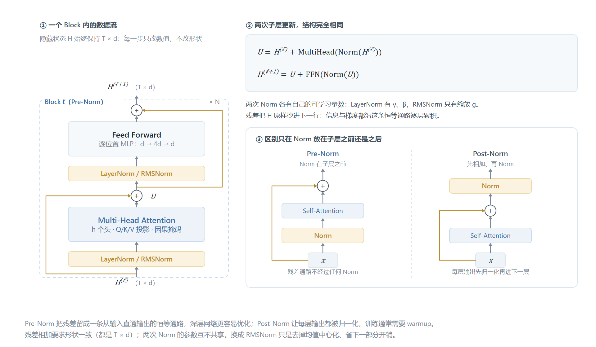

*描述：Transformer Block 中注意力、FFN、残差连接与 Norm 的更新流程。*

FFN 的激活和结构也在发展：原始 Transformer 使用 ReLU，一些模型采用 GELU，许多现代语言模型采用带门控的 [SwiGLU](https://arxiv.org/abs/2002.05202)。沿用行向量的写法，它可以表示为

$$
\operatorname{FFN}_{\mathrm{SwiGLU}}(x)=\left[\operatorname{SiLU}(xW_g)\odot(xW_u)\right]W_d.
$$

其中 $W_g,W_u\in\mathbb R^{d\times d_{ff}}$，$W_d\in\mathbb R^{d_{ff}\times d}$。一条分支产生经过 SiLU 的门控值，另一条分支产生待加工的特征；逐元素相乘，让不同特征的放大、抑制和符号变化随输入调整，再映射回 $d$ 维。这也把第六节的平滑激活与门控思想用到了 Transformer 中。

根据任务组织这些 Block，就形成三种常见结构：

- **Encoder-only**：输入各位置通过双向自注意力交换信息，得到整段输入的上下文表示。[BERT](https://arxiv.org/abs/1810.04805) 是典型例子；ViT 也沿用编码器结构处理图像 patch。它们适合文本分类、检索表示、图像识别等任务。
- **Encoder–decoder**：编码器先读取输入，解码器通过因果自注意力读取已生成的内容，再通过交叉注意力读取编码器输出。原始 Transformer 和 [T5](https://arxiv.org/abs/1910.10683) 采用这类结构，适合翻译、摘要等输入序列到输出序列的任务。
- **Decoder-only**：把提示内容与生成内容组织在同一条序列里，堆叠带因果自注意力的 Block，逐步预测后续 token。GPT 系列采用这一路线，许多大语言模型也沿用这种结构。
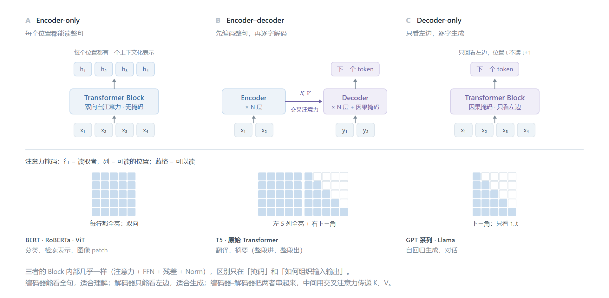

*描述：Encoder-only、Encoder-decoder 和 Decoder-only 三类架构。*

最后，把网络产生的表示接到相应的输出层：分类任务可以汇总序列表示后预测类别，回归任务可以输出数值；自回归语言模型则把各位置的表示映射为词表中各 token 的 logits，再用 softmax 得到下一个 token 的概率分布。至此，输入表示、网络结构和输出解释，就接回了第四节的函数拟合框架。

### 7.5 Transformer 的并行处理、生成与计算成本

因果掩码规定了信息的读取范围，同一层的各位置可以按照这个范围并行读取。处理一段已经给定的序列时，可以把它整体送入网络，在掩码约束下同时计算各位置的表示；这使得训练时能够*充分利用 GPU 的并行计算能力*，而不是像 RNN 那样必须按时间步逐个串行计算。生成新文本时，后续 token 则由模型逐步给出：先处理提示内容，得到下一个 token 的分布，选中一个 token 后把它加入上下文，继续下一步。这就形成了整段序列在训练时并行计算、生成时逐步延长序列的工作方式（**自回归 autoregressive**）。

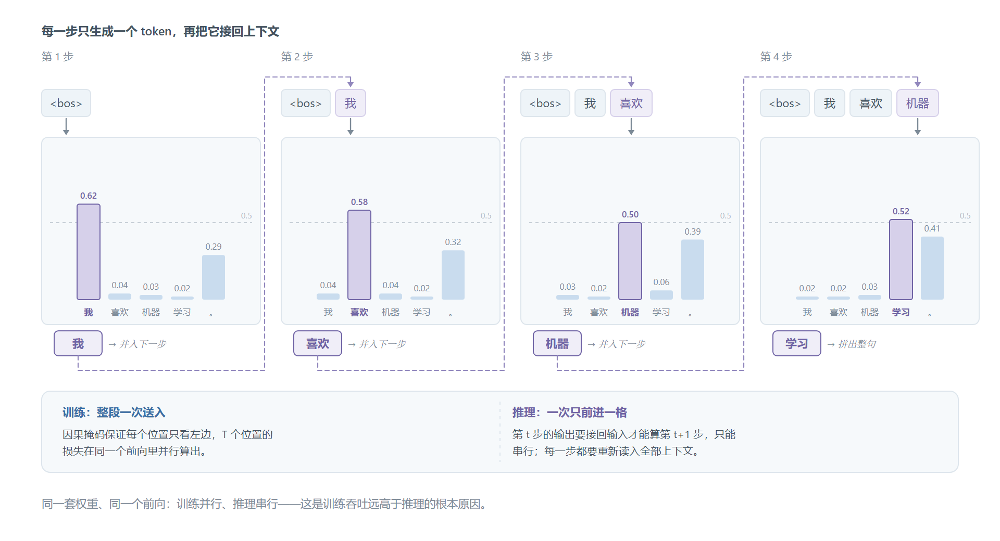

*描述：自回归生成：从起始标记逐步生成直到结束标记。*

标准全注意力中，每个位置都要与允许读取的其他位置匹配。长度为 $T$ 时，单层、单头的注意力打分与加权汇总约需 $O(T^2(d_k+d_v))$ 的计算；直接保存注意力权重还需要 $O(T^2)$ 的空间。因此，序列长度翻倍时，这部分计算量大约变为四倍。稀疏、滑动窗口和线性注意力等变体，可以进一步改变位置之间的交互范围或计算形式。

**拓展：对抗 memory wall**（计算速度提升得很快，但内存带宽和延迟提升得慢，导致很多时候算力在空等数据搬运）： [F](https://arxiv.org/abs/2205.14135)[lashAttention](https://arxiv.org/abs/2205.14135)把计算拆成小块，在 GPU 的高速SRAM中完成，避免把巨大的 $T\times T$ 中间矩阵完整写入显存(HBM)再读回。反向传播时，由于中间结果没有保存，它会重新计算一遍注意力分数。在当前硬件上，多做这些计算的代价远小于频繁搬运大矩阵的开销，因此用额外计算换来了显存访问的大幅减少。它优化的是计算与存储的组织方式，注意力本身的数学结果保持不变。

逐步生成时，还可以利用[键值缓存（KV cache）](https://huggingface.co/docs/transformers/main/cache_explanation)。在因果注意力中，前面位置的表示由当时已经出现的上下文决定；新增 token 后，历史位置的 Key 和 Value 可以继续使用。因此，每一步只需为新位置计算各层的 $Q,K,V$，把新 Key/Value 加入缓存，再用新 Query 读取包括当前位置在内的 Key/Value。通常把一次性处理提示内容的阶段称为 **prefill**（直接决定了首字延迟（Time To First Token，TTFT）），把随后逐个生成 token 的阶段称为 **decode**（决定Time Per Output Token（TPOT））。

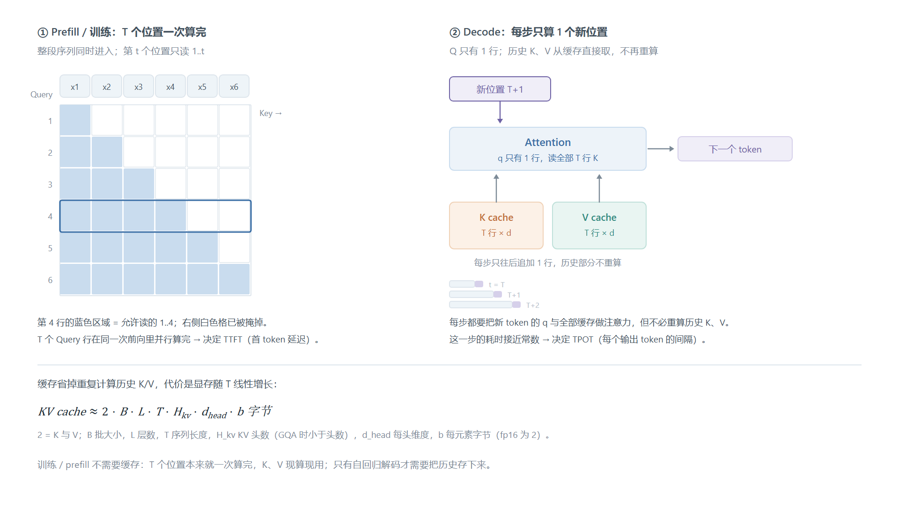

*描述：并行处理与 KV cache 的生成过程。*

缓存让生成省去反复计算历史位置的工作，同时也占用显存。对每条序列都缓存 $T$ 个 token、各层 KV 配置相同的模型，可以用下面的式子估算缓存大小：

$$
\text{KV cache bytes}\approx 2\,B\,L\,T\,H_{kv}\,d_{head}\,b,
$$

其中 2 对应 Key 和 Value，$B$ 是同时处理的序列数，$L$ 是层数，$H_{kv}$ 是 KV 头数，$d_{head}$ 是每头维度，$b$ 是每个元素的字节数。例如 $B=1,L=32,T=8192,H_{kv}=8,d_{head}=128$，每个元素占 2 字节时，仅这些 KV 张量就约占 **1 GiB**。上下文越长、同时处理的序列越多，缓存也越大。

减少 KV 头数也可以节省缓存：[分组查询注意力（Grouped-Query Attention，GQA）](https://arxiv.org/abs/2305.13245) 让一组 Query 头共享一组 Key/Value，**多查询注意力（Multi-Query Attention，MQA）** 则让所有 Query 头共享一组 Key/Value。生成每个新 token 时，仍要读取相应的历史缓存，所以长上下文也会增加每一步的计算与数据读取量。

#### 推理服务中的合批（Batching）

大模型推理的主要成本来自 GPU ***显存带宽***，而不是峰值算力。自回归生成时，GPU 大部分时间卡在内存带宽而不是算力上。每生成一个新 token，都要：

- 把巨大的权重从显存读一遍（虽然模型参数固定，但SRAM容量有限，每次计算都要把所需权重从显存重新搬运到计算单元）；
- 把这个序列已经生成的全部 KV cache 也读一遍；
- 做一次相对很小的矩阵-向量运算。
单条请求时，一次权重搬运只能服务一个序列，GPU 大部分时间在等待数据，利用率经常只有百分之十几。***Batching***把多条请求的 token 放在一起计算。权重仍然只需要从显存读一次，却可以同时和多个序列的激活做矩阵乘法，算术强度（每搬运 1 字节能完成的运算次数）显著上升。合批直接提高的是吞吐——单位时间内 GPU 能吐出的总 token 数，从而摊薄电费、折旧和显存占用，降低每个 token 的成本。代价是*单请求延迟上升*，原因有二：一是系统会让先到的请求稍等，以便把批次填得更满；二是更大的矩阵乘法让每一步的墙钟时间变长。因此服务商通常把同一块硬件的吞吐-延迟权衡切开，提供不同档位：

- 标准模式：尽量把批次做大，GPU 利用率最高，*单位 token 成本最低*，适合对延迟不敏感的任务。但bathing存在上限——当算力或显存带宽已被打满后，继续增大批次不再提升吞吐，成本也无法进一步下降；过大批次还会受到显存容量限制，并显著拉高延迟。
- Fast 模式：主动限制批次大小、提高调度优先级、减少排队等待，有时还会预留一部分算力。单请求的首字延迟和生成速度都更好，但权重搬运和固定开销被更少的 token 分摊，GPU 利用率下降，*所以单价更高*。
本质上，Fast 模式是用更高的单位成本换取更短的排队和更小的计算步长，让愿意为低延迟付费的用户优先获得更快的响应。

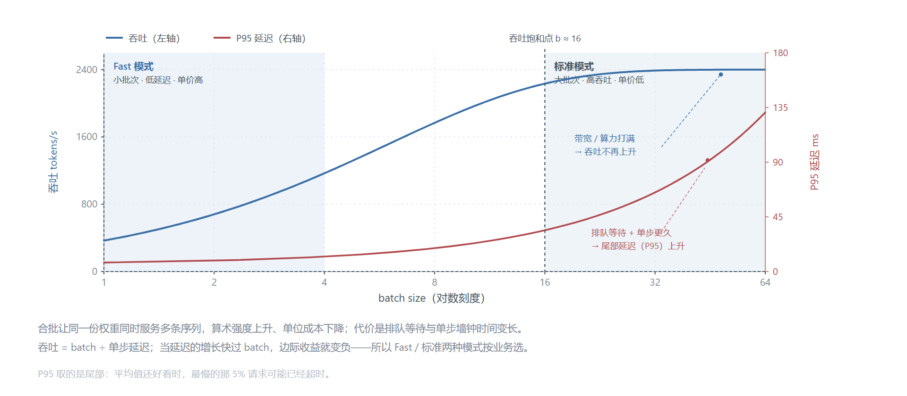

*描述：合批可提升吞吐，但会推高 P95 latency。*

从输入向量、位置编码，到注意力、FFN 和任务输出层，我们已经看到了 Transformer 怎样构成一个完整的函数。接下来换一个角度：为这样的网络安排什么任务、提供什么学习信号，才能让它学到有用的表示，产生新的数据，并在环境中选择行动？

## 8. 从重建数据，到生成与行动

前面的函数拟合例子大多属于**监督学习（supervised learning）**：每条输入 $x$ 都配有一个目标 $y$，例如图像的类别标签、回归任务中的测量值。模型预测一次，损失函数把它和目标比较一次，训练信号非常直接。

真实数据常常是另一种形式：海量文本没有逐字标注的“正确下一句”，大量图像也未必有类别标签；有些任务没有每一步的标准答案，只能在行动之后看到结果。于是，学习信号也可以来自其他地方：**自监督学习（self-supervised learning）** 从数据自身构造目标，例如给图像加噪后预测干净图像，或用前面的文字预测后面的文字；**无监督学习（unsupervised learning） **关注数据自身的结构与分布，例如学习紧凑表示、聚类或生成新样本；**强化学习（reinforcement learning） **则让 agent 在 environment 中选择 action，再根据得到的 reward 调整行为。

这样看，*网络结构*和*学习信号*是两个可以组合的角度：同一个 CNN 可以做带标签的图像分类，也可以做图像重建；同一个 Transformer 可以预测下一个 token，也可以在环境中学习选择高奖励的行动。本节先从重建任务学习表示，再走向生成模型，最后把生成的序列看作 action，引入 RL。

### 8.1 Autoencoder：通过重建学习表示

第六节把表示学习写成“先提取表示，再利用表示完成任务”。假设手中有许多手写数字图像，希望用一个较短的向量保存图像的主要信息，再从这个向量恢复原来的图像。这就给表示学习安排了一个具体任务：**把输入重建出来**。

完成这个任务的模型称为[自编码器（Autoencoder，AE）](https://www.deeplearningbook.org/contents/autoencoders.html)。它由两部分组成：**编码器（encoder）** 把输入 $x$ 转换为潜在表示 $z$ (**latent vector**)，**解码器（decoder）** 根据 $z$ 得到重建结果 $\hat x$：

$$
z=f_\phi(x),\qquad \hat x=g_\theta(z),\qquad L_{\mathrm{AE}}=\frac{1}{N}\sum_{i=1}^{N}\left\|x_i-g_\theta(f_\phi(x_i))\right\|^2.
$$

输入图像本身就提供了重建目标，体现了前面所说的无监督学习思路。这里用平方误差衡量重建质量，$\phi,\theta$ 分别是编码器和解码器的参数。例如，一张 $28\times28$ 的灰度图有 784 个像素值，可以先压缩为 16 维向量，再重建回 784 个像素值。这个低维中间层称为**瓶颈（bottleneck）**：有限的表示容量促使模型提取对重建有用的共同结构，例如笔画形状、位置和粗细。

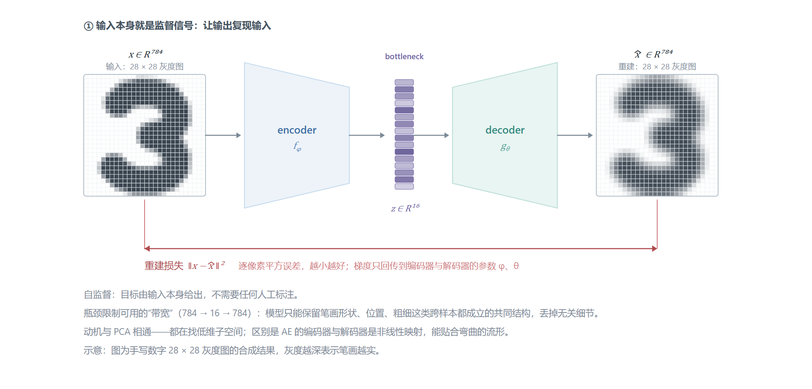

*描述：Autoencoder 通过重建学习紧凑表示。*

这与第五节 PCA 的动机相通：用较少的变量保留数据的主要结构。PCA 使用线性投影，自编码器则可以通过非线性编码和解码，学习更复杂的表示。编码器与解码器可以采用 MLP、CNN 等网络，训练目标把这些组件连接成了“压缩—重建”的整体。

还可以进一步安排**去噪自编码器（denoising autoencoder）** 的任务：给输入加入扰动，让网络根据受扰动的图像重建干净图像。这样，模型需要利用图像中稳定的结构来恢复内容。压缩、去噪和利用重建误差寻找异常线索，都是这类表示的常见用途。

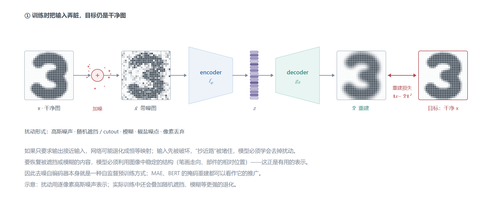

*描述：去噪自编码器从扰动输入重建干净图像。*

扰动也可以来自遮挡。**掩码自编码器（Masked Autoencoder，MAE）**把图像切成 patch，随机遮住其中很大一部分，常见比例可达 75%；编码器只处理可见 patch，解码器再根据这些表示重建被遮住的内容。由于原始图像是已知的，被遮住位置的像素就是训练目标，重建损失也主要在这些位置上计算。

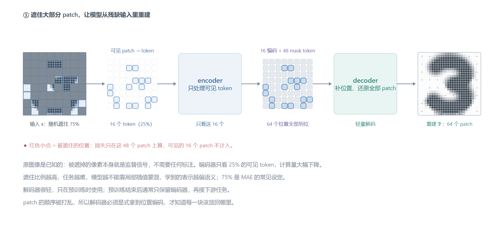

*描述：Masked Autoencoder 通过遮住大部分 patch 学表示。*

训练完成后，AE 主要有两种用法

- 第一种是使用 encoder：把新样本映射为低维表示 $z$，再用于可视化、聚类、检索，或作为下游分类、回归模型的特征；MAE 这类自监督预训练得到的 encoder，也常在具体任务上继续微调。
- 第二种是使用重建结果和重建误差：decoder 可以还原图像，用于去噪或补全缺失区域；如果模型主要在正常样本上训练，异常样本往往难以被准确重建，较大的 residual 就可以作为异常线索。
不过普通 AE 的 latent space 还没有一个明确的采样规则；想从 $z$ 生成新的样本，就需要继续改进它的结构。

### 8.2 VAE：让潜在表示成为可以采样的空间

重建任务从一张已有图像出发，编码后再恢复它。现在希望进一步产生新的数字图像，就需要回答：**怎样选择一个latent vector，让解码器能够生成合理的样本？** 生成建模关注的正是学习数据的分布，并据此产生样本。

[变分自编码器（Variational Autoencoder，VAE）](https://arxiv.org/abs/1312.6114) 为潜在空间增加了概率结构。编码器根据输入图像，输出一个潜在分布 $q_\phi(z\mid x)$；常见做法是给出高斯分布的均值 $\mu(x)$ 和标准差 $\sigma(x)$，再从中采样 $z$。解码器学习条件分布 $p_\theta(x\mid z)$，由潜在向量产生图像的分布。

训练同时考虑两件事：**从潜在表示中恢复输入信息，以及让编码分布与预设的潜在先验接近**。先验常选标准正态分布 $p(z)=\mathcal N(0,I)$。对一个输入，训练目标可以写成

$$
L_{\mathrm{VAE}}(x)=\mathbb E_{z\sim q_\phi(z\mid x)}[-\log p_\theta(x\mid z)]+D_{\mathrm{KL}}\!\left(q_\phi(z\mid x)\,\|\,p(z)\right).
$$

第一项衡量重建对应的概率损失：解码器给原始输入分配的概率越高，这项损失越小。第二项用 **KL 散度** 衡量两个分布的差异，鼓励编码分布与先验接近。

为了让采样也能接上反向传播，可以先抽取一份标准高斯噪声 $\epsilon\sim\mathcal N(0,I)$，再写成 $z=\mu+\sigma\odot\epsilon$，其中 $\odot$ 表示逐元素相乘。这样，随机性由 $\epsilon$ 提供，均值与标准差则沿后面的计算路径接收梯度。这称为**重参数化（reparameterization trick）**。

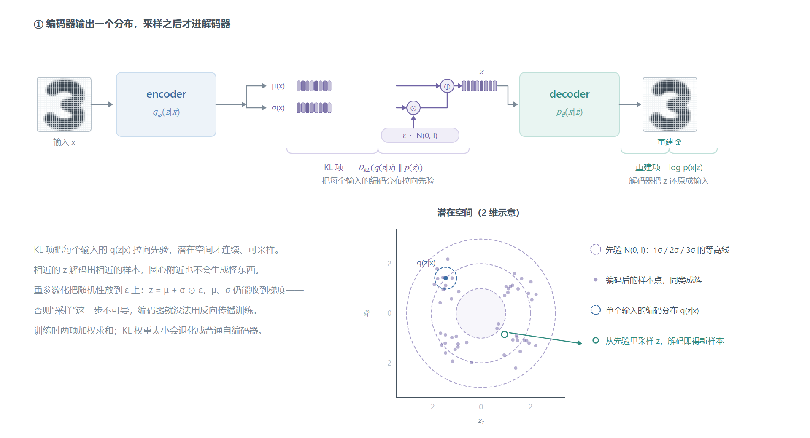

*描述：VAE 将潜在空间约束为可采样的概率分布。*

训练完成后，生成过程就很清楚了：**从 **$p(z)$** 采样一个新的 **$z$**，再通过解码器得到样本**。改变潜在向量，就可以产生不同的输出。AE 的压缩与重建思想，由此接到了一个具有采样规则的生成模型上。

### 8.3 GAN：通过样本之间的比较学习生成

还可以从另一个角度给生成模型提供反馈：让一个网络产生图像，再让另一个网络学习区分训练数据中的图像与生成图像。这就是[生成对抗网络（Generative Adversarial Network，GAN）](https://arxiv.org/abs/1406.2661) 的基本思路*（warning：出了名的难训练）*。

**生成器（generator）** 接收随机向量 $z$，输出生成样本 $\tilde x=G_\theta(z)$；**判别器（discriminator）** 接收图像，输出它来自真实数据的预测分数 $D_\psi(x)$。两个网络交替训练：

- 更新判别器时，用真实样本与生成样本训练它区分来源。“真实/生成”标签由样本的来源自动确定。
- 更新生成器时，保持判别器参数固定，让生成样本得到更高的“真实”预测分数。生成器的损失经过判别器传回生成图像，再继续传回生成器参数，指导生成器改进。
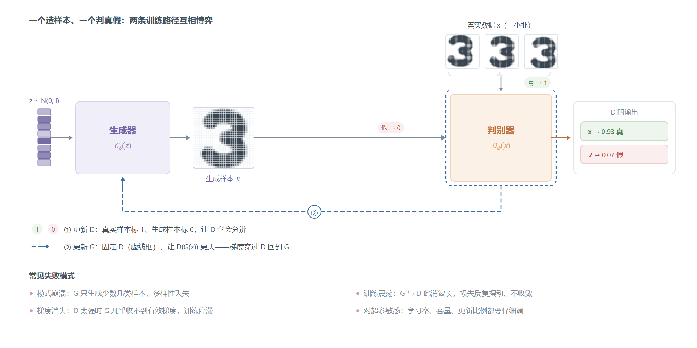

*描述：GAN 用判别器为生成器提供学习反馈。*

这里，某个随机向量对应的图像可以由生成器自己学出来，反馈来自判别器的评价。随着两者共同训练，生成器学习产生与训练数据具有相似结构的样本。生成时保留生成器，从随机向量出发即可得到新样本。

GAN 的特点也来自这种配合：判别器不断变化，生成器面对的学习信号随之变化。训练时既要关注样本的逼真程度，也要关注生成结果的多样性；常见failure mode：

- 模式崩溃（Mode Collapse）：生成器只产出少数几种容易骗过判别器的样本，丧失多样性。
- 梯度消失：判别器过强时，生成器几乎得不到有效梯度，无法继续学习。
- 训练震荡 / 不收敛：生成器与判别器互相拉锯，损失剧烈波动，难以稳定。
- 对超参极度敏感：学习率、网络容量、判别器与生成器的更新频率稍有不当，就容易陷入上述问题。
### 8.4 Diffusion&Flow Matching 从噪声中恢复图像

前面的去噪自编码器给了我们一个直觉：受扰动的图像可以成为输入，干净图像可以成为学习目标。如果进一步设置一系列由弱到强的噪声，让网络学会处理不同程度的扰动，就可以把生成组织成许多个小的恢复步骤。这是[扩散模型（diffusion model）](https://arxiv.org/abs/2006.11239) 的基本思路。

**训练时，先从已有样本构造带噪输入。** 以原始图像 $x_0$ 为起点，逐步增加高斯噪声；常见形式可以直接写出某个噪声等级 $t$ 的输入：

$$
x_t=\sqrt{\bar\alpha_t}\,x_0+\sqrt{1-\bar\alpha_t}\,\epsilon,\qquad \epsilon\sim\mathcal N(0,I).
$$

其中 $\bar\alpha_t$ 控制保留多少原始信号；经过足够多步（比如 $T=1000$）后，$x_T$ 几乎变成纯高斯噪声。这个过程不需要学习，是事先定好的。

真正要学的是反向过程：给定加噪后的 $x_t$，预测它是怎么从 $x_{t-1}$ 变过来的，或者说直接预测加入的噪声。模型（ 常见的有U-Net 等卷积架构，也可以采用 Transformer，例如 [DiT](https://arxiv.org/abs/2212.09748)）被训练来估计噪声 $\epsilon_\theta(x_t, t)$，训练目标就是让预测的噪声尽量接近真实加入的噪声，通常使用下面这个直观的平方误差目标：

$$
L_{\mathrm{diffusion}}=\mathbb E_{x_0,t,\epsilon}\left[\left\|\epsilon-\epsilon_\theta(x_t,t)\right\|^2\right].
$$

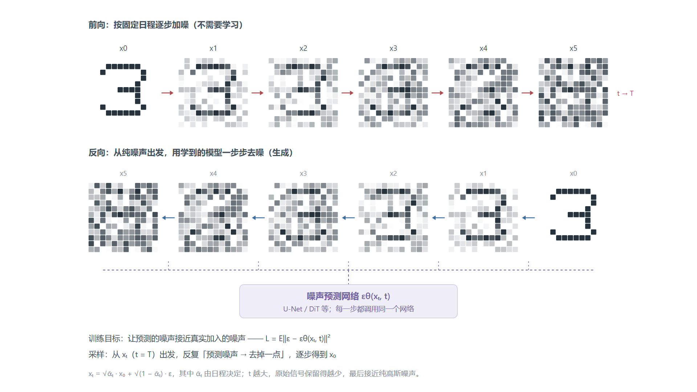

*描述：Diffusion 的前向加噪与反向去噪过程。*

**生成时，从一份新采样的噪声**$x_T\sim\mathcal{N}(0,I)$**开始**，用学好的模型反复执行“预测噪声 → 减掉噪声 → 得到更干净一点的 $x_{t-1}$”，一直做到 $t=0$，就得到一张新样本。因为每一步只需要预测一个相对简单的噪声，训练比直接建模复杂分布更稳定。同时，多步迭代也让模型能逐步细化细节。还可以把文字描述、类别等作为条件输入，引导生成内容。

前面的离散加噪过程，实际上是连续时间随机微分方程（SDE）的离散化。前向过程可以写成

$$
\mathrm{d}x = f(x,t)\,\mathrm{d}t + g(t)\,\mathrm{d}w,
$$

其中 $f$ 是漂移项，$g(t)$ 控制噪声强度，$\mathrm{d}w$ 是维纳过程的增量。逐步加噪的公式，就是用欧拉等方法把这条 SDE 切成许多小步后的结果。

同一条前向 SDE 还对应一条概率流常微分方程（probability flow ODE）。SDE 的单条轨迹因每一步的随机噪声而随机，但大量轨迹在任一时刻的整体分布（边缘分布）中，这些随机扰动的平均效果可以被一个确定性的漂移项完全吸收。概率流 ODE 正是去掉随机项、只保留这个调整后的漂移，从而在每个时刻诱导出与原来 SDE 完全相同的边缘分布。因此，去噪生成既可以沿着随机的反向 SDE 进行，也可以沿着这条确定性的 ODE 进行。

**Flow Matching** 就是直接学习这样的确定性向量场。它不再显式区分“加噪”和“去噪”，而是构造一条从噪声分布到数据分布的传输路径，训练网络去预测路径上每一点的速度（漂移）。生成时，从噪声出发，按照学到的向量场做数值积分，就能到达数据分布。和扩散模型相比，Flow Matching 把随机微分方程里的扩散过程收成了常微分方程的漂移，采样路径更直接，往往可以用更少的步数完成生成。

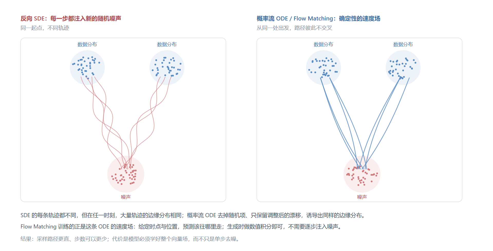

*描述：Flow Matching 与 Diffusion 的路径对比。*

**为什么生成图像要从噪声开始**

高斯噪声易于采样，且分布简单、已知。生成模型的目标是从复杂的数据分布中采样，而直接采样通常不可行。因此标准做法是：先选取一个易于采样的源分布（标准高斯噪声是最常见的选择），再学习一个从源分布到数据分布的变换（扩散模型的反向过程，或 Flow Matching 的向量场）。生成时只需从高斯分布中抽取噪声，再用训练好的模型将其变换为图像。

### 8.5 自回归：把一个样本拆成逐步预测

对于文字、声音或按顺序组织的图像元素，还有一种直接的生成思路：**根据已经产生的部分，预测接下来的一部分，再把它接回上下文。** 这就是前面已经接触过的自回归生成。

设一个样本组织成序列 $x_1,\ldots,x_T$，整段序列的概率可以分解为

$$
p_\theta(x_1,\ldots,x_T)=\prod_{t=1}^{T}p_\theta(x_t\mid x_{1:t-1}).
$$

其中 $x_{1:t-1}$ 表示当前位置之前的内容。训练时，完整样本提供每一步的预测目标；结合第七节因果掩码下的并行处理，可以把整段序列一次送入模型，同时计算各位置的预测和损失。生成时，把每一步选出的结果加入上下文，再继续下一步。例如，把“我喜欢学习”按字组织成 token 后，就可以得到这样的预测关系：

```
| 已有内容 | 下一个目标 |
| ---- | ----- |
| 起始标记 | 我     |
| 我    | 喜     |
| 我喜   | 欢     |
| 我喜欢  | 学     |
| 我喜欢学 | 习     |
```

第七节的因果掩码，让每个位置的预测依赖当前与之前的输入；Transformer 则提供了处理上下文的网络结构。RNN 也可以承担同样的逐步预测任务。自回归规定了怎样分解概率和组织生成，具体网络负责计算这些条件概率。

### 8.6 强化学习：当反馈来自行动

自回归生成每一步都会输出一个 token，但训练目标仍来自数据中的下一个 token。换一个场景：下围棋时，棋手每一步没有“标准答案”，只有这步棋会影响局面，最终胜负才给出反馈；机器人控制中，电机指令也没有逐时刻的正确标签，只有是否接近目标、是否碰撞等评价。这类任务引出**强化学习（reinforcement learning，RL）**。

RL 的基本循环是：**agent** 观察当前 **state** $s_t$，按照 **policy** $\pi_\theta(a_t\mid s_t)$ 选择一个 **action** $a_t$；**environment** 返回 **reward** $r_t$ 和下一个 state $s_{t+1}$。从起始 state 到结束的一串状态、动作和奖励称为 **trajectory**。

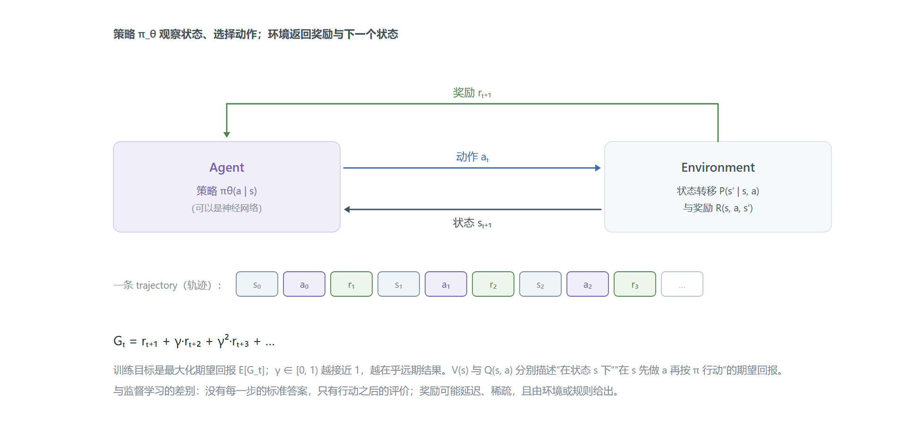

*描述：Agent 与 environment 交互的强化学习回路。*

在任意时刻 $t$，智能体处于**状态** $s_t$，按照**策略** $\pi(a|s)$ 选动作 $a_t$。**环境**随后给出**奖励** $r_{t+1}$ 并转移到 $s_{t+1}$，这个过程一直进行下去。从时刻 $t$ 开始，训练目标通常是最大化期望** ** **return，长期累积回报**，定义为：

$$
G_t = r_{t+1} + \gamma r_{t+2} + \gamma^2 r_{t+3} + \cdots = \sum_{k=0}^{\infty} \gamma^k r_{t+k+1}
$$

$\gamma \in [0,1)$ 是折扣因子。$\gamma$ 越接近 1，智能体越在乎远期结果；越接近 0，它越只看眼前。

智能体的目标是找到一个策略 $\pi$，使得**从任意状态出发**，期望 return 都尽可能大。这个目标可以写成：

$$
\max_\pi \mathbb{E}_{\tau \sim \pi}[G_t \mid s_t = s] \quad \text{对所有 } s
$$

注意这里优化的是**期望**，因为环境转移和策略本身通常都是随机的（$\mathbb{E}_{\tau \sim \pi}$ 表示对“按照策略 $\pi$ 产生的所有可能轨迹”求期望）。

因为 $G_t$ 是随机变量，直接优化它不方便，所以定义它的期望：

$$
V^\pi(s) \triangleq \mathbb{E}[G_t \mid s_t = s, \text{之后一直遵循 }\pi]
$$

$V^\pi(s)$ 叫做**状态价值函数**。它回答的问题是：如果我现在已经在状态 $s$，并且从此以后都按策略 $\pi$ 行动，我还能期望拿到多少总折扣奖励？

类似地，如果我想知道“在 $s$ 先强制走一步 $a$，之后再按 $\pi$ 行动”的价值，就定义**动作价值函数**：

$$
Q^\pi(s,a) \triangleq \mathbb{E}[G_t \mid s_t = s, a_t = a, \text{之后遵循 }\pi]
$$

两者的关系很直接：状态价值是动作价值按策略概率的加权平均

$$
V^\pi(s) = \sum_a \pi(a|s) \, Q^\pi(s,a)
$$

#### 三类常见RL方法

基于最大化期望 return 的目标，具体训练方法通常分成三类：

- **Value-based**：直接学 $Q(s,a)$（或 $V(s)$）。学好后，策略是从价值函数里推导出来的，最简单就是
$$
\pi(s) = \arg\max_a Q(s,a)
$$

训练过程中也会用这个（或加探索的版本）去和环境交互，并用贝尔曼方程构造的 TD 目标来更新价值函数。

- **Policy-based**：直接学一个参数化的策略 $\pi_\theta(a \mid s)$（通常是神经网络）。这个网络本身就是 agent，训练时它在环境里选动作、收奖励，然后更新参数（即直接对策略参数求导，目标函数仍然是 $\mathbb{E}[G_t]$），让高 return 的动作概率变大。训练完成后，这个 agent 直接按学到的 $\pi_\theta$ 行事。注意：纯 policy-based 方法（如 REINFORCE）直接使用完整轨迹的$G_t$，方差较大，现在单独使用较少。
- **Actor-Critic：**综合了 policy-based 与 value-based 的思路。Actor 直接参数化并优化策略 $\pi_\theta(a\mid s)$；Critic 则像 value-based 方法一样，用贝尔曼方程构造的 TD 目标学习价值函数，并据此给出更低方差的更新信号（通常是 advantage）。Actor 仍负责直接优化策略，Critic 负责提供稳定的评价。
把这个视角放回语言模型：将生成下一个 token 视为动作、将完整回答视为一条轨迹，就可以用上述框架在后训练阶段优化模型，使其输出更符合期望的奖励信号

```
| RL 概念      | 语言模型中的对应          |
| ---------- | ----------------- |
| state      | 当前上下文             |
| action     | 生成下一个 token       |
| policy     | language model    |
| trajectory | 一段完整回答或解题过程       |
| reward     | 人类偏好、答案正确性、程序测试结果 |
```

预训练中的语言模型从数据自身得到每个位置的 token 目标；RLHF、RLVR 则把完整回答作为 trajectory，用偏好或验证结果给出 reward，再调整模型生成高分行为的倾向。

把本节的方法放在一起，就能看到不同的训练信号与使用方式：

```
| 方法        | 训练信号怎样构造                               | 训练后怎样使用                |
| --------- | -------------------------------------- | ---------------------- |
| AE        | 比较输入与重建结果                              | 编码已有数据，或重建、去噪          |
| VAE       | 概率重建目标与潜在分布约束                          | 从潜在先验采样，再解码            |
| GAN       | 真实与生成样本的来源标签，以及判别器反馈                   | 从随机向量生成样本              |
| Diffusion | 在不同噪声等级下，预测已知加入的噪声                     | 从新噪声开始，逐步采样去噪          |
| 自回归       | 用前面的内容预测后面的内容                          | 逐步生成并扩展上下文             |
| RL        | agent 的 action 从 environment 得到 reward | 按 policy 选择行动，或生成高奖励回答 |
```

这些方法也接回了第四节的函数拟合：我们为网络组织输入、输出与学习信号，利用数据或交互反馈调整参数，再按相应的规则使用模型。接下来聚焦自回归语言模型，看看同一个 token 预测任务，怎样通过大规模数据形成基础能力，并在后训练中结合偏好与可验证奖励继续改进。

---

# 第三部分：大模型入门

前面已经介绍了 Transformer 的计算结构，也看到了自回归怎样通过逐步预测生成内容。接下来的问题是：一个预测 token 的网络，怎样变成能够对话、解释代码、阅读材料和解决问题的大模型？本部分从语言模型切入，先看它怎样生成内容，再看这些能力怎样训练出来，最后了解推理、多模态和计算效率等方向的发展。

## 9. 语言模型：把任务放进上下文

第八节已经说明自回归生成的基本形式：根据已有内容预测下一个 token，再把结果接回上下文。现在换到使用者的视角，看一个已经训练好的语言模型怎样接收任务、给出回答。这里有四个问题：文字怎样变成模型输入？任务怎样表达？概率分布怎样变成具体文字？几个例子为什么能让模型照着做？

### 9.1 Tokenization 与 embedding：把文字变成模型输入

一段 prompt 交给模型前，先要经过**分词器（tokenizer）**。它按照预先确定的词表，把文字切成 **token**：token 可以是一个字、一个词，也可以是词的一部分。例如，英文单词 `alignment` 可能被切成 `align` 和 `ment`；中文“温度”可能对应一个 token，也可能被拆成“温”和“度”，具体取决于词表。tokenizer 会把这些 token 映射为整数 **token id**，再加上对话角色、开始、结束等**特殊 token（special token)，**如开始：`<s>、<bos>、<|begin_of_text|>`

结束：`</s>、<eos>、<|end_of_text|>` 等。

为什么常用子词（subword）而不是纯词或纯字？纯词表会因为词形变化和组合爆炸而过大；纯字又丢掉词级的统计规律，压缩效率低。BPE、WordPiece 等子词方法是在两者之间的工程折中：既能控制词表大小，又能在一定程度上保留有意义的片段。

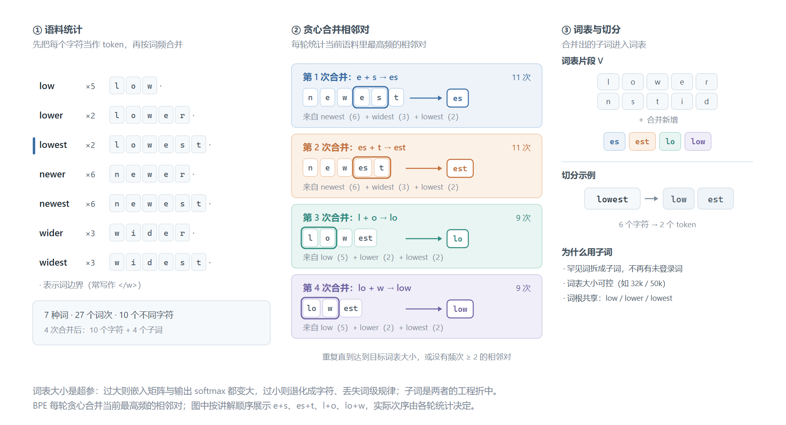

*描述：BPE 通过合并高频对构造子词词表。*

这些 id 还不能直接进入 Transformer。模型内部有一张*可学习*（和整个模型一起端到端训练的）的**嵌入矩阵（embedding matrix）**：第 $i$ 行对应词表中第 $i$ 个 token 的向量。查表后，长度为 $T$ 的 token 序列变成输入矩阵 $X\in\mathbb R^{T\times d}$（*d *一般是几千这个量级）；再加入位置信息，就得到第七节所说的上下文表示。Transformer 逐层更新这些向量，最后由输出层给出词表上的 logits。这一步常被称为**向量化（embedding / representation）**：把离散的 token id变成连续向量。

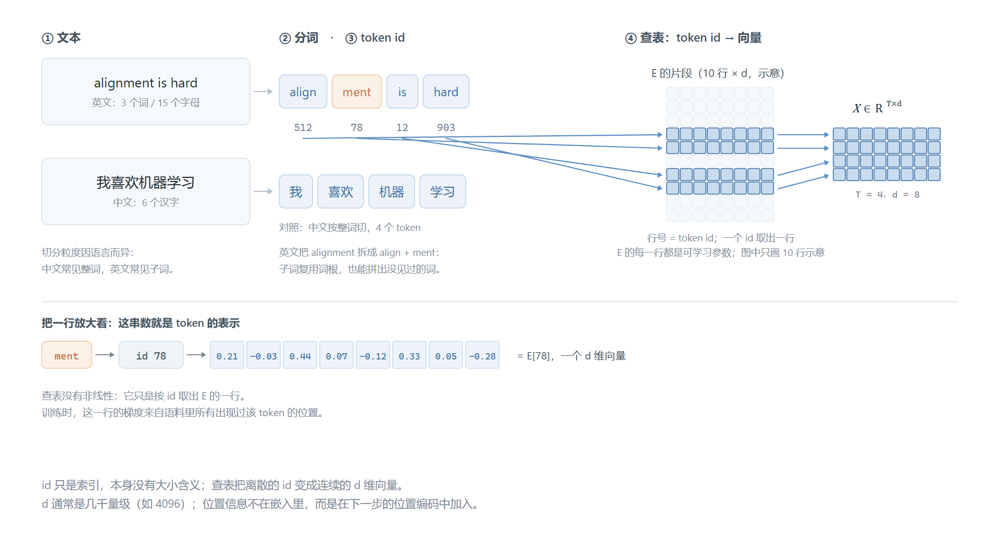

*描述：文本先分词，再查表得到 token id 和 embedding。*

Tokenizer 在训练前已经确定，训练和使用必须保持同一套规则。它也决定了*“长度”*的含义：上下文窗口、生成上限和计费常按 token 数计算。不同 tokenizer 对中文、英文、代码和空白字符的处理不同，因此比较模型时，不能只看字符数，还要看它们使用的分词方式。

到这里，输入侧的链路是：

**prompt → tokenization → token ids → embedding lookup → Transformer → logits。**

得到 logits 后，下一步就是把它变成一次具体回答。

### 9.2 从概率分布到一次具体回答

logits 先经过 softmax，得到下一个 token 的概率分布；接下来还需要一个规则选出具体的 token。例如，某一步的三个候选概率分别为 $0.7,0.2,0.1$：**贪心解码（greedy decoding）** 每次选择概率最大的候选；**采样（sampling）** 按概率抽取，概率较低的候选也有机会出现。

常见的采样设置包括 **temperature**、**top-k** 和 **top-p**。温度通过缩放 logits 调整分布的集中程度：

$$
p_\tau(i\mid c)
=\frac{\exp(z_i/\tau)}{\sum_j\exp(z_j/\tau)},
\qquad \tau>0.
$$

这里 $c$ 是当前上下文，$z_i$ 是候选 token 的 logit。较低的温度让高概率候选更突出，较高的温度让分布更平缓；top-k 只保留概率最高的 $k$ 个候选，top-p 则按概率从高到低累加，保留累计概率达到阈值的一组候选，再在其中采样。这些[生成策略](https://huggingface.co/docs/transformers/main/generation_strategies)帮助我们控制回答的集中程度和多样性。改变采样设置，会改变同一个模型怎样选择输出；

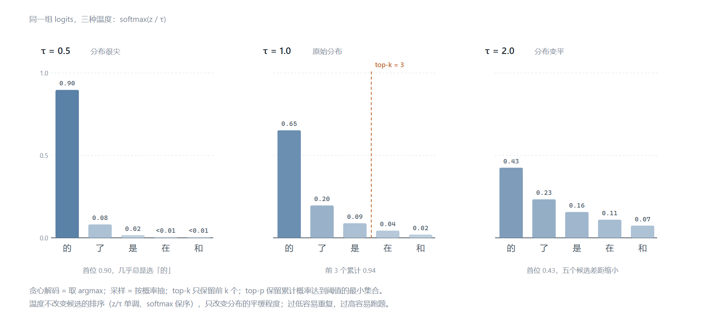

*描述：温度参数如何改变下一个 token 的概率分布。*

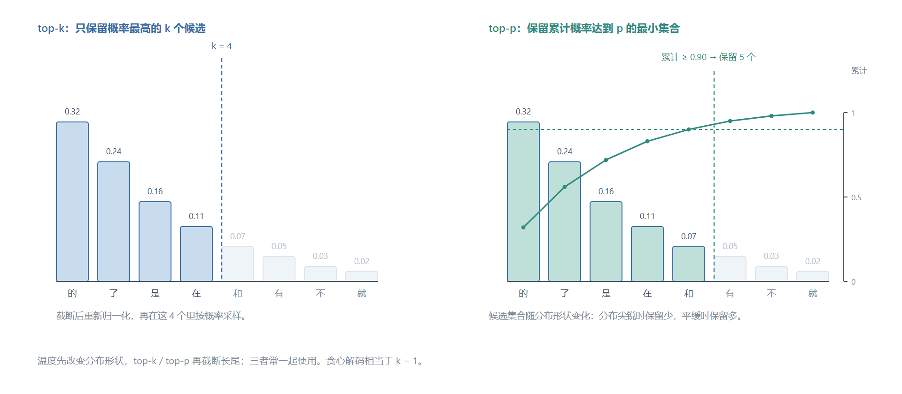

*描述：top-k 固定保留前 k 个候选，top-p 保留累计概率达到阈值的最小集合；温度先改变分布形状，截断再切掉长尾。*

选出的 token id 经 detokenization 变成文字，并加入上下文继续进行autoregressive生成，直至生成结束标记，或达到设定的输出长度时停止。对话界面上连续出现的文字，就是这个过程逐步产生的结果。

### 9.3 同一个接口承载不同任务

同一次生成过程，怎样服务于翻译、摘要、代码解释这些不同任务？关键在于：任务说明、背景材料、对话历史和示例，都会被组织成一段 token 序列输入给模型。模型仍然执行第七节的 Transformer 计算，变化主要在于上下文里放了什么。

我们给模型的任务描述、背景材料和示例，通常统称为**提示（prompt）**；模型本次计算能够读取的整段内容称为**上下文（context）**。例如，同一段实验记录，配上“概括结论”得到摘要，配上“提取温度、时间和样品编号”得到结构化数据，配上“翻译成英文”又对应另一项任务。

### 9.4 为什么给几个例子，它就能照着做？

除了直接说明任务，我们还可以在上下文中给出几组示例，让模型从中识别当前的规则和输出格式。这称为[上下文学习（in-context learning）](https://arxiv.org/abs/2005.14165)。例如，要从实验记录中提取信息，可以给出：

记录：样品 A 在 80 ℃ 保温 10 分钟。<br>输出：`{"sample": "A", "temperature_C": 80, "duration_min": 10}`<br>记录：样品 B 在 100 ℃ 保温 5 分钟。<br>输出：`{"sample": "B", "temperature_C": 100, "duration_min": 5}`

随后给出样品 C 的记录，模型就可以沿用这个模式提取字段。只给任务说明，通常称为 **zero-shot**；再给几组示例，则称为 **few-shot**。两者都在利用模型已有的能力，根据当前上下文完成任务。

这个过程中的规则和例子随请求一起进入上下文，模型保持权重固定。

换句话说，few-shot 并没有在上下文里更新参数，只是把当前任务的模式作为条件，激活模型在预训练和后训练中已经学到的能力。模型仍然是在固定权重下做条件生成，只是条件里多了几组示例。这和后面第十节的微调形成对比：微调会用训练数据更新模型参数，让某种行为被写进权重，适合反复出现、需要稳定表现的任务；而 in-context learning 只是临时的条件化，适合一次性或变化较快的任务。随着基座模型能力增强，一些原先依赖微调才能做好的行为，也可以通过足够清晰的提示或少量示例达到相近效果。实际选择时，可以先判断这项能力是本次任务的临时要求，还是会长期复用。

好的提示往往把任务、所需材料、输出格式说清楚。比如“分析这段记录”可以进一步写成“从记录中提取样品编号、温度和时间，按上面的 JSON 格式输出；缺失字段填 null”。这相当于为第四节的函数明确输入内容和输出要求。

到这里，我们看到的是已经训练好的模型怎样被使用。这些能力从哪里来？下一节从预训练和后训练两个阶段看训练信号的来源。

## 10. 一个可用的大模型，通常怎样训练出来？

前面说明了模型怎样生成内容。要让它既有广泛的基础能力，又能按要求回答和解决问题，训练还需要不同形式的数据与反馈。我们可以先把它理解为三个层次：从大量材料中学习规律，从示范中学习任务行为，再根据评价和验证结果改进表现。预训练之后，围绕指令遵循、回答质量和解题能力继续进行的训练，通常统称为**后训练（post-training）**。

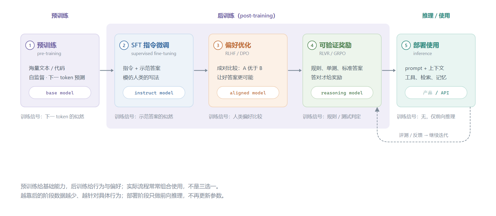

*描述：从预训练、后训练到实际使用模型的流程。*

### 10.1 预训练：先建立广泛的基础能力

**预训练（pre-training）** 使用大量文本、代码等数据学习参数。设文本经过分词后得到 $x_1,\ldots,x_T$，$x_{<t}$ 表示第 $t$ 个 token 之前的内容。每个位置的真实 token 都可以作为预测目标，训练时最小化平均负对数概率：

$$
L_{\mathrm{pretrain}}(\theta)
=-\frac{1}{T}\sum_{t=1}^{T}\log p_\theta(x_t\mid x_{<t}).
$$

这正是第四节交叉熵在序列上的应用：每个位置都是一次词表范围内的分类，再把各位置的损失汇总起来。文本自身同时提供了输入和目标，延续了第八节的自监督学习思路。

为什么是***“下一个 token(next token prediction)”***而不是其他自监督目标？因为它强制模型利用上下文中的长程依赖来预测后续内容，同时数据本身就提供了无穷无尽的监督信号，不需要额外人工标注。读到变量的定义后，后面的代码要正确使用它；读到一段论证后，结论要与前提连贯；读到一种写作风格后，续写要与它保持一致。在大量文本、代码和不同任务的例子上反复训练，模型逐步学到可复用的语言、知识和问题求解模式。训练后的**基础模型（base model）** 能够根据上下文续写内容；随后可以继续训练成适合对话、代码、数学或特定领域任务的模型。

在这个阶段，总计算量通常是有限的。在计算量固定的情况下，需要决定把资源更多用在增大模型参数，还是用在增加训练数据量。Chinchilla 的经典研究考察的就是：在训练算力固定的情况下，参数规模和数据量如何共同影响最终效果。结果表明，数据规模本身就是提升模型能力的重要因素，不能只把模型做大而忽略数据（Chinchilla scaling law，每 20 个 token 对应 1 个参数）。数据的内容同样重要——代码、数学材料、技术文档和日常对话，各自会给模型提供不同的学习信号。

**数据准备**因此也成为训练的一部分，包括去重、质量筛选和数据混合；模型生成并经过筛选的合成数据（synthetic data），也可以补充到训练材料中。用于评价模型的问题还需要与训练材料分开，延续第四节独立评估的思路。预训练之后，也可以用某个领域的材料做继续预训练（continued pre-training），进一步学习该领域的术语和表达规律。

### 10.2 指令微调：从“会续写”走向“会按要求回答”

用户希望得到的是针对任务的回答。**监督微调（Supervised Fine-Tuning，SFT）** 用“指令或问题—示范答案”继续训练模型，让它学习怎样响应要求、组织解释和遵守输出格式。[InstructGPT](https://arxiv.org/abs/2203.02155) 就展示了从示范回答开始进行后训练的路径。

例如，预训练材料可以是一篇介绍 pandas 的教程；SFT 样本则可以是“请解释下面这段 `groupby` 代码”，并配上一份清晰的回答。对话训练时，常把问题与已有对话作为上下文，在需要模型回答的位置计算预测损失。它沿用交叉熵和反向传播，变化主要在于训练样本怎样组织、哪些输出作为目标。

示范数据还可以包含推导过程、代码解题过程或对图表的解释。模型通过这些示范学习完成任务的步骤，数据质量也直接影响它学到的表达和求解习惯。

微调可以更新全部参数，也可以只训练一小部分附加参数。例如 [LoRA（Low-Rank Adaptation）](https://arxiv.org/abs/2106.09685) 固定原有权重，用两个较小矩阵的乘积表示权重调整；[QLoRA](https://arxiv.org/abs/2305.14314) 进一步结合量化来减少显存需求。这些方法降低了适配已有模型所需的训练资源。

### 10.3 偏好优化：从比较中学“更好”

SFT 提供的是“一份好的示范答案”。但很多任务没有唯一标准答案：同一个问题可以有几种都可接受的写法，差别体现在清晰度、组织方式、覆盖重点、语气和格式上。这时更适合用**偏好信号**：给出同一 prompt 的两个或多个回答，标注哪一个更好。

可以把“信号来源”和“优化算法”分开理解：

- **信号**：人类或模型给出的偏好比较。
- **RLHF**：先用偏好比较训练一个 **reward model**，再用 RL 方法（常见是 PPO）优化语言模型，使高奖励回答更可能出现。
- **DPO**：不再单独训练 reward model，而是把偏好对直接写进损失函数，用一个参考模型约束更新，使偏好回答的相对概率提高。

```
| 方法         | 偏好数据如何使用                   | 是否单独训练 reward model | 特点                 |
| ---------- | -------------------------- | ------------------- | ------------------ |
| RLHF + PPO | 训练 reward model，再用 RL 优化策略 | 是                   | 灵活，但流程更复杂，也需要稳定 RL |
| DPO        | 直接用偏好对更新策略                 | 否                   | 流程更简单，训练目标围绕相对偏好   |
```

这类优化主要解决“哪个回答更可取”的相对判断，常用于风格、安全性、帮助性和格式；它不天然保证事实或数学结果正确。

### 10.4 可验证奖励：从规则中学“更对”

数学题、代码题、结构化抽取等任务有更硬的判断标准：答案可以和标准结果比较，程序可以运行测试，JSON 字段可以校验。此时可以直接把验证结果作为 reward，这类训练称为 **RLVR**。

RLVR 描述的是**奖励来源**，不是某个具体算法。可以使用常见 RL 方法，也可以使用更适合这类任务的算法，例如 **GRPO**。GRPO 对同一个 prompt 采样一组回答，用组内相对奖励计算优势，从而不再需要单独的价值网络。

DeepSeek-R1 是这条路线的代表：它用可验证规则奖励替代学习得到的 reward model，并用 GRPO 优化推理行为。这里的“组内相对比较”降低了对绝对奖励尺度的依赖，使训练更稳定。

```
| 信号    | 典型来源       | 反馈形式  | 代表算法            | 主要解决什么      |
| ----- | ---------- | ----- | --------------- | ----------- |
| 偏好    | 人类或模型比较    | 相对排序  | RLHF + PPO、DPO  | 帮助性、风格、格式   |
| 可验证奖励 | 规则、测试、标准答案 | 正确性分数 | RLVR + PPO/GRPO | 数学、代码、可判定任务 |
```

实际后训练不一定三选一：SFT 先教基本行为，偏好优化调整回答质量，可验证奖励提升可判定任务的表现。三者可以组合使用。

## 11. 能力怎样继续扩展，又怎样用到实际问题里？

有了前面的基础，再看新模型和新方法，就可以把它们放进几个具体问题中：难题怎样解得更好，输入能否扩展到更多模态，计算怎样更高效，以及怎样让回答用上当前需要的资料。

### 11.1 推理时计算：为难题安排更多求解步骤

第十节的训练把能力学进参数。使用模型时，还可以为一道题安排更多计算：让模型展开中间步骤、检查并修正候选解法，或生成多个候选后进行比较和验证。这个方向通常称为 **test-time scaling** 或 **inference-time scaling**。

例如，对一道数学题，一条路线是逐步推导，检查中间结果后继续；另一条路线是独立生成几份解法，再比较结论或用验证器选择。前者增加一条求解路径的**深度**（单条路径上多步推导、反思与修正），后者增加候选路径的**宽度**（多条独立路径并行生成后再筛选）。两种方式对延迟、吞吐和正确率的影响不同，实际使用时需要根据预算做权衡。

推理时计算的研究关注的就是怎样把计算预算分配给这些步骤，让额外计算更有效地改善答案。

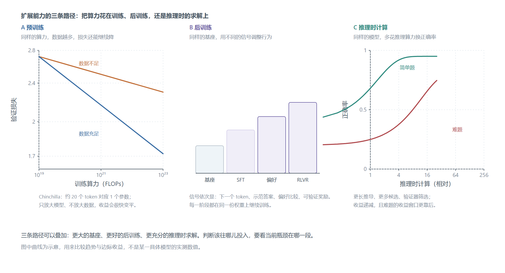

*描述：预训练、后训练和 test-time scaling 三类扩展路径。*

**思维链（Chain-of-Thought，CoT）** 描述的是生成中间推理步骤的形式。这些中间步骤本身也是模型逐个 token 生成的，通常称为 CoT token 或 reasoning token。它们和普通回答 token 在生成机制上没有区别，只是内容承担了“先推导、再得出结论”的功能。带有*推导过程的示例*和 *SFT* 可以教会模型模仿这种写法；而*强化学习*则让模型在追求正确结果的过程中，主动形成先展开推理再作答的习惯，并不需要人为强制要求。它把第九节的 token 生成用于逐步处理问题，生成出的中间结果又成为后续计算的上下文。

因此，使用模型时，除了看参数量，还可以看它怎样使用推理预算。简单的格式转换可以直接回答，复杂的证明、算法和多约束问题则可以安排更多推导、候选比较与验证，并结合正确率、时间和成本判断收益。

### 11.2 多模态：让模型一起阅读文字、图像、音频和视频

第七节已经说明，不同模态都可以转换成向量。多模态大模型进一步把这些表示接到一起训练：图像通过视觉编码器产生特征，音频通过相应的编码模块产生特征，再通过投影或其他连接模块，与文字表示一起进入后续网络。

这样，一张实验曲线配上一句“比较两条曲线的变化”，就构成了图文共同输入的任务；一段视频配上“描述操作先后顺序”，则需要同时利用画面和时间信息。模型通过图文配对、音文配对、视频说明和多模态问答等数据，学习不同模态之间的对应关系。

[Qwen3-VL](https://arxiv.org/abs/2511.21631) 等模型展示了文本、图像和视频共同理解的能力。更广义的多模态模型还可以连接语音或图像生成模块，形成文字、语音和视觉内容之间的交互。对科研和工程场景，这意味着输入可以从一段描述，扩展为“说明文字 + 曲线图 + 表格或图像”，由模型共同分析。

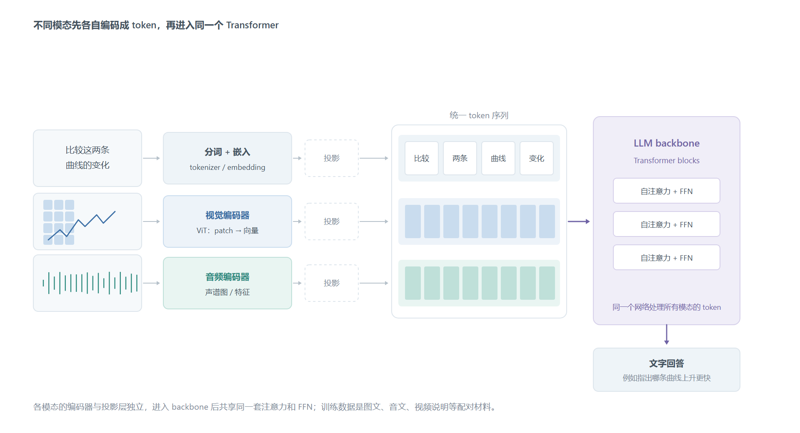

*描述：多模态模型如何把不同模态编码并接入 LLM backbone。*

### 11.3 更强与更省：把容量、训练和生成效率分开考虑

模型能力的扩展，也需要计算方式的改进。这里有三类经常出现的方法，各自解决一个问题。

**稀疏专家模型（Mixture of Experts，MoE）** 关注怎样增加模型容量。它可以把 Transformer 中的 FFN 换成多个专家子网络，由一个可学习的路由器为每个 token 选择少数专家，并汇总它们的输出。模型保存的全部权重构成**总参数量**，每个 token 实际调用的权重构成**激活参数量**。例如， [DeepSeek-V4-Pro](https://deepseek.com/en/news/v4-preview/)保存约 1.6T 参数，每个 token 激活约 49B。专家是联合训练得到的子网络，分工随数据形成；共享层仍参与计算，专家之间也需要交换数据。因此稀疏结构的效率还与执行方式和硬件有关：专家间的通信、负载均衡以及路由本身的计算开销，都会影响实际速度。

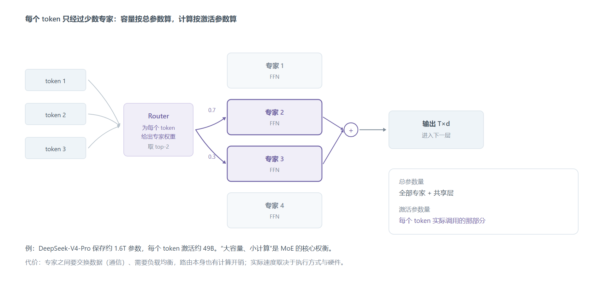

*描述：Mixture of Experts 层中的路由和加权汇总。*

**知识蒸馏（knowledge distillation）** 关注怎样把已有模型的能力传给另一个模型。教师模型提供输出概率、回答或解题过程，学生模型用这些信号训练。例如，先由较强模型生成经过筛选的解题示范，再训练较小模型学习这些过程(本质上就是用教师生成的数据做监督微调（SFT）)。[DeepSeek-R1 的蒸馏模型](https://arxiv.org/abs/2501.12948) 就采用了利用教师生成数据进行训练的路线。量化则进一步用更低精度的数值保存或计算权重，减少存储和数据搬运的开销。

[投机解码（speculative decoding）](https://arxiv.org/abs/2302.01318)关注怎样更快地生成：先由一个较快的模块草拟多个 token，主模型并行计算这些候选的概率，再通过接受和修正规则推进生成。**多 token 预测（Multi-Token Prediction，MTP）** 可以训练模型预测后续多个位置，并为这类生成加速提供草稿。它们尝试减少生成过程中的串行轮次。

这些方向也在组合发展。例如，NVIDIA 在 **2026 年 10 月** 公布的 [Nemotron 3.5](https://research.nvidia.com/labs/nemotron/Nemotron-3.5-Super-and-Lightning/)结合了 MoE、蒸馏、长上下文和 MTP 加速，还把 Transformer 与递推状态模块组合在同一架构中。看这类新模型时，可以分别追问：它扩大了哪一部分容量，怎样训练，又怎样减少每次使用的开销。

生成方式本身也在探索中。例如[扩散语言模型 LLaDA](https://arxiv.org/abs/2502.09992) 从带有遮盖位置的序列开始，通过多轮预测逐步恢复文本。它提供了另一种组织语言生成的思路，也沿用了 Transformer、预训练和指令微调等组件。

### 11.4 长上下文与检索：让回答用上当前需要的资料

在实际使用中，模型经常需要阅读一篇新论文、一份长报告，或当前版本的技术资料。这时，可以把材料放进上下文，与问题一起交给模型。**上下文窗口（context window）** 描述一次计算能够容纳的序列范围，通常需要容纳提示、材料、对话记录和后续生成内容。

长上下文让模型有机会在更多段落、页面或视频片段之间建立联系，也延续了第七节的计算与缓存问题。实际效果可以通过跨段检索、信息整合、长文问答等任务评价，考察模型能否稳定地使用这些材料。

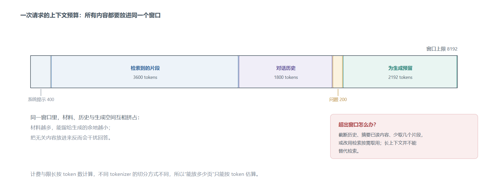

*描述：上下文窗口里，系统提示、检索片段、对话历史、当前问题和生成预留互相挤占，超出时只能截断、摘要或改用检索。*

如果资料是一整个文档库，可以先找出与问题相关的片段，再把片段加入上下文。这就是[检索增强生成（Retrieval-Augmented Generation，RAG）](https://arxiv.org/abs/2005.11401)。它的基本过程可以写成：

**问题 → 从资料库检索相关片段 → 片段与问题一起进入上下文 → 根据资料生成回答。**

例如，询问“这份规范对某项指标的要求是什么”，可以先检索当前版本中对应的条款，再让模型解释要求并给出出处。检索可以通过关键词匹配，也可以把问题与文档片段编码为向量，按语义相似度查找。长上下文帮助容纳更多材料，检索帮助选出相关材料，两者也可以配合使用。

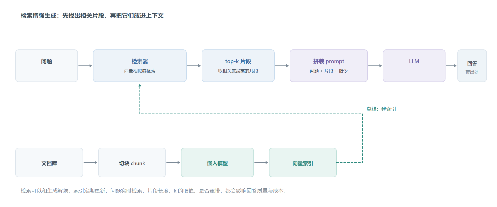

*描述：RAG 的在线路径与离线建索引：检索与生成解耦，索引定期更新，问题实时检索。*

随着模型工具调用和推理能力的提升，另一种做法是把检索过程本身***交给模型控制***：模型可以根据中间结果自主决定调用搜索、grep、数据库查询等工具，多次调整查询并交叉验证，而不是固定走一遍“检索→生成”。这种方式在问题较复杂、需要多步查找时往往更灵活。

实际选择时可以这样判断：如果资料库相对稳定、查询模式可预测，经典 RAG 通常更可控、延迟和成本更低；如果问题需要多步查找、交叉验证或动态调整查询，把检索决策交给模型往往更灵活。实际系统中也常把两者结合，由模型决定查什么，底层仍用高效的检索器完成具体查找。

这里有两个自然的改进方向：**微调改变模型怎样处理信息，补充上下文则提供本次任务所需的信息**。固定的输出习惯、反复出现的领域任务可以通过微调学习；经常更新的规范、内部报告和本次实验数据，可以在使用时作为资料提供(如`agents.md`)。

模型还会遇到**幻觉（hallucination）**：生成看起来合理，却缺少事实依据或与资料不一致的内容。例如，回答中可能出现格式完整但实际不存在的文献。语言模型本质上是在做条件分布采样，而不是在做事实检索——“看起来合理”和“有证据支持”是两件不同的事。因此，科研使用中可以要求附上依据，并检查原始条款、数值和引用；代码和数值计算则可以通过实际运行验证结果。这也把第四节“怎样评价输出”的问题带到了大模型应用中。

评价生成任务时，也可以把“好回答”拆成具体标准：信息提取看字段是否正确，摘要看关键事实是否保留，代码看测试是否通过，基于资料的问答看结论能否对应原文。这样，第四节的评价思路就从数值误差与分类正确率，扩展到了开放式的生成结果。

### 11.5 从回答问题，走向完成任务

到这里，我们已经看到了模型怎样从数据中学习，怎样根据上下文生成回答，以及怎样通过推理、多模态和检索扩展能力。接下来，还可以进一步提出一个任务：给定一份数据和分析目标，让系统读取文件、运行分析、检查结果，并整理成一份报告。

这样的任务需要把语言理解与实际操作连接起来。**当大模型与工具、执行环境结合，能够围绕目标选择后续步骤，并利用执行结果继续推进任务时，我们就走到了 Agent。** 模型负责理解与生成，工具和环境让这些输出能够转化为实际操作。

这就把课程从“模型怎样预测和生成”，接到了“系统怎样完成任务”。Agent 的组织方式与具体实践，留到后续课程单独展开。Scaling law 也进入了**Agentic Scaling**的新阶段

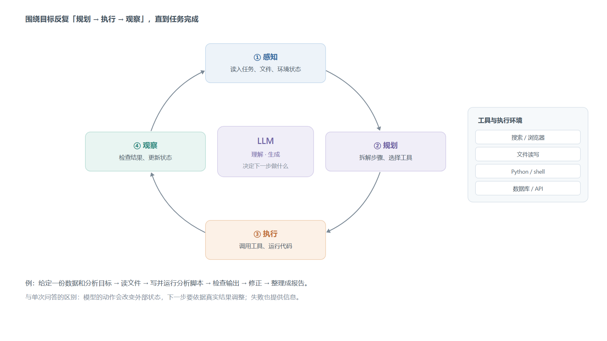

*描述：Agent 的感知—推理—规划—执行—观察循环。*

# 附录 A：选择性深入的数学与工程问题

## A.1 为什么监督学习与大模型之间有连续性？

表格回归优化 $\ell(f_\theta(x),y)$，语言模型优化 $-\log p_\theta(x_t\mid x_{1:t-1})$。它们都根据样本构造目标函数，并用梯度优化参数。不同之处来自输入输出形式、训练数据规模、模型容量和训练后如何使用模型。

## A.2 参数不变时，大模型还能“学习”吗？

这里至少有三种含义：

- **上下文学习**：模型在已有上下文中识别当前任务；权重通常不变。
- **外部记忆**：系统把资料存入文件或数据库，后续检索；权重不变。
- **参数学习**：通过微调或其他训练过程修改权重。
这三种方式分别让信息进入当前上下文、外部存储和模型参数。它们保存信息的位置不同，也会带来不同的后续使用方式。

## A.3 Attention 为什么用 $1/\sqrt{d_k}$？

用一个简单估算来看：设 Query 和 Key 的各分量相互独立、均值为零、方差为一。点积是 $d_k$ 个乘积的和，方差为 $d_k$，标准差为 $\sqrt{d_k}$。除以 $\sqrt{d_k}$ 后，打分就回到方差约为一的尺度，softmax 也更容易在多个候选之间分配有变化的权重。这给出了缩放项的直观动机。

## A.4 如何区分 RAG、微调和工具？

```
| 需求               | 可以先考虑          | 原因             |
| ---------------- | -------------- | -------------- |
| 查询经常更新的内部文档      | 检索 / RAG       | 资料独立于模型权重更新    |
| 输出格式或特定任务行为反复不稳定 | 指令与数据设计、必要时微调  | 调整模型对特定输入的响应方式 |
| 精确计算一个数值         | Python 或专门计算工具 | 可以得到可复现结果      |
| 需要跨多步读取和修改文件     | 应用程序编排多个工具调用   | 需要执行顺序与状态管理    |
```

几种方案可以组合使用。比如应用程序可以先检索参考文档，再调用 Python 验证数值。

## A.5 科学机器学习里，物理先验能放到哪里？

可以体现在输入特征、模型架构、损失函数、参数约束以及输出后的校验中。例如利用旋转或平移对称性、增加边界条件惩罚，或者将守恒量用作模型评估的额外指标。

还可以把物理检查写成独立的数值计算：把模型预测代入守恒关系、边界条件或几何约束，再比较偏差。这样，领域知识既能参与训练，也能成为解释和评价输出的依据。

## A.6 拓展讨论：模型可以代替实验设计吗？

预测模型可以帮助筛选有希望的实验条件，实验设计则安排怎样获得能区分不同解释的数据。例如，要比较两套 alignment recipe，可以安排相同工艺条件下的样片进行比较，再在不同批次上重复，观察残差与独立量测结果怎样变化。这样，方案之间的差异就有了清楚的数据依据。

这就接到了**实验设计（Design of Experiments，DOE）**：有计划地改变可控因素，比较对应结果。模型提出候选条件，实验提供新的证据，再用这些数据更新模型，两者可以形成相互促进的循环。

## A.6 **贝尔曼方程**

贝尔曼方程描述了价值函数满足的递归关系，是几乎所有基于价值的强化学习算法的理论基础。

回顾 return 的定义。在时刻 $t$，智能体处于状态 $s_t$，采取动作 $a_t$ 后获得奖励 $r_{t+1}$，并转移到 $s_{t+1}$。从该时刻起的折扣回报为

$$
G_t = r_{t+1} + \gamma r_{t+2} + \gamma^2 r_{t+3} + \cdots = r_{t+1} + \gamma G_{t+1}.
$$

状态价值函数定义为在该策略下的期望回报：

$$
V^\pi(s) = \mathbb{E}[G_t \mid s_t = s].
$$

将 $G_t = r_{t+1} + \gamma G_{t+1}$ 代入并取条件期望，得到

$$
V^\pi(s) = \mathbb{E}[r_{t+1} + \gamma G_{t+1} \mid s_t = s].
$$

由于马尔可夫性，下一时刻的期望回报只依赖于下一状态 $s_{t+1}$，即 $\mathbb{E}[G_{t+1} \mid s_{t+1}] = V^\pi(s_{t+1})$。进一步把期望按策略和环境转移概率展开，就得到**贝尔曼方程**：

$$
V^\pi(s) = \sum_a \pi(a \mid s) \sum_{s'} P(s' \mid s, a) \big[ R(s, a, s') + \gamma V^\pi(s') \big].
$$

它的含义是：当前状态的价值等于“按策略选择动作后，立即获得的期望奖励，加上折扣后的下一状态价值”。这个方程对任意策略 $\pi$ 都成立，它只是把 return 的定义递归地写了一遍。

对于动作价值函数，同样可以写出对应的贝尔曼方程：

$$
Q^\pi(s, a) = \sum_{s'} P(s' \mid s, a) \Big[ R(s, a, s') + \gamma \sum_{a'} \pi(a' \mid s') Q^\pi(s', a') \Big].
$$

在最优策略下，智能体在每个状态都会选择使价值最大的动作，因此最优价值函数 $V^*$ 和 $Q^*$ 满足**贝尔曼最优方程**（将上面式子中对动作的加权平均替换为最大化）：

$$
V^*(s) = \max_a \sum_{s'} P(s' \mid s, a) \big[ R(s, a, s') + \gamma V^*(s') \big],
$$

$$
Q^*(s, a) = \sum_{s'} P(s' \mid s, a) \Big[ R(s, a, s') + \gamma \max_{a'} Q^*(s', a') \Big].
$$

贝尔曼方程的重要性在于：它把一个需要计算无限长期望和的问题，转化为可以用动态规划或时序差分（temporal-difference）方法逐步逼近的递归形式，从而使得价值函数的估计在实际算法中成为可能。

# 参考资料

**表示学习与生成模型**：

- Hamilton et al. (2017), [Inductive Representation Learning on Large Graphs](https://arxiv.org/abs/1706.02216)
- Keller Jordan (2024), [Muon: An optimizer for hidden layers in neural networks](https://kellerjordan.github.io/posts/muon/)
- Goodfellow, Bengio & Courville (2016), [Deep Learning: Autoencoders](https://www.deeplearningbook.org/contents/autoencoders.html)
- Kingma & Welling (2013), [Auto-Encoding Variational Bayes](https://arxiv.org/abs/1312.6114)
- Goodfellow et al. (2014), [Generative Adversarial Networks](https://arxiv.org/abs/1406.2661)
- Ho et al. (2020), [Denoising Diffusion Probabilistic Models](https://arxiv.org/abs/2006.11239)
- Rombach et al. (2021), [High-Resolution Image Synthesis with Latent Diffusion Models](https://arxiv.org/abs/2112.10752)
- Peebles & Xie (2022), [Scalable Diffusion Models with Transformers](https://arxiv.org/abs/2212.09748)
**大模型的重要基础**：

- Vaswani et al. (2017), [Attention Is All You Need](https://arxiv.org/abs/1706.03762)
- Lewis et al. (2020), [Retrieval-Augmented Generation](https://arxiv.org/abs/2005.11401)
- Hoffmann et al. (2022), [Training Compute-Optimal Large Language Models](https://arxiv.org/abs/2203.15556)
- Wei et al. (2022), [Chain-of-Thought Prompting](https://arxiv.org/abs/2201.11903)
- Rafailov et al. (2023), [Direct Preference Optimization](https://arxiv.org/abs/2305.18290)
- Jiang et al. (2024), [Mixtral of Experts](https://arxiv.org/abs/2401.04088)
**大模型训练与前沿方向**：

- Brown et al. (2020), [Language Models are Few-Shot Learners](https://arxiv.org/abs/2005.14165)
- Ouyang et al. (2022), [Training language models to follow instructions with human feedback](https://arxiv.org/abs/2203.02155)
- Hu et al. (2021), [LoRA: Low-Rank Adaptation of Large Language Models](https://arxiv.org/abs/2106.09685)
- DeepSeek-AI (2025), [DeepSeek-R1](https://arxiv.org/abs/2501.12948)
- Snell et al. (2024), [Scaling LLM Test-Time Compute Optimally](https://arxiv.org/abs/2408.03314)
- Qwen Team (2025), [Qwen3-VL Technical Report](https://arxiv.org/abs/2511.21631)
- NVIDIA (2026), [Nemotron 3.5 Super and Lightning](https://research.nvidia.com/labs/nemotron/Nemotron-3.5-Super-and-Lightning/)
- Nie et al. (2025), [Large Language Diffusion Models](https://arxiv.org/abs/2502.09992)