# 强化学习：从试错到可验证奖励

> 这是一份面向理工科研究生的强化学习拓展讲义。它假设你熟悉监督学习、梯度下降、概率与线性代数，但**没有**系统学过强化学习。读完之后，你应该能够：
>
> 1. 说清强化学习与监督学习到底差在哪，以及这个差别为什么让问题变难；
> 2. 从贝尔曼方程一路推出时序差分、Q-learning 与策略梯度；
> 3. 理解 actor-critic、信任域与 PPO 之间的逻辑关系；
> 4. 看懂 RLHF、DPO、GRPO 这些大模型后训练技术在解决什么问题、付出什么代价；
> 5. 对"RL 到底让大模型变强了什么"有一个不吹不黑的判断。

---

## 0. 一张地图

先看三个具体问题，它们几乎概括了强化学习的全部难点。

**问题一：我怎么知道自己刚才那步走得对不对？**
监督学习里，每个输入都配着一个标准答案；强化学习里通常没有。你只会在事后拿到一个数字——赢了还是输了、得分多少、用户是否满意。这种反馈叫**评价性反馈（evaluative feedback）**：它告诉你"这个结果有多好"，却不告诉你"正确的动作是什么"。

**问题二：结果是最后才出现的，功劳该记在谁头上？**
一局棋下 200 手，只有最后分出胜负；一段推理写 3000 个 token，只有最后的答案能被判对错。中间每一步都对最终结果有贡献，但没有任何一步单独拿到标签。这就是**信用分配（credit assignment）**问题。

**问题三：我用来学习的数据，是我自己产生的。**
监督学习的训练集是固定的；强化学习的数据来自当前策略与环境的交互。策略一变，采到的数据分布就变——于是"用旧数据训练新策略"这件事变得微妙，甚至可能把训练带偏。这是**分布漂移（distribution shift）**问题，也是 on-policy / off-policy 之分的根源。

### 0.1 三种学习范式的位置

| | 监督学习 | 无监督学习 | 强化学习 |
|---|---|---|---|
| 数据 | $(x, y)$ 成对 | 只有 $x$ | 交互产生的 $(s,a,r,s')$ |
| 反馈 | 指令性：告诉你该输出什么 | 无反馈，只有结构 | 评价性：只告诉你结果多好 |
| 目标 | 拟合条件分布 | 找结构 / 密度 | 最大化长期累积回报 |
| 数据分布 | 固定 | 固定 | **由策略决定，随训练变化** |

三者并非互斥，而是可以组合的视角：同一个模型结构，换一种学习信号就是另一种范式。第七节之后你会看到，大模型的后训练恰好是把"指令性反馈"（SFT）与"评价性反馈"（RLHF / RLVR）拼在一起。

### 0.2 两条技术路线

理解强化学习的算法史，抓住两条线就够了：

- **价值路线**：先学"处于某个状态有多好"（价值函数），再由价值导出行为。它的心脏是**贝尔曼方程**——把无限长的回报求和改写成递归。动态规划、时序差分、Q-learning、DQN 都属于这条线。
- **策略路线**：不学价值，直接调"在什么状态选什么动作"的参数化策略，用采样估计梯度。REINFORCE、actor-critic、TRPO、PPO 属于这条线。

两条线在 **actor-critic** 汇合：actor 走策略路线，critic 走价值路线，用 critic 降低 actor 的方差。今天所有主流的大模型强化学习算法（PPO、GRPO）都站在这条汇合线上。

### 0.3 记号

| 记号 | 含义 |
|---|---|
| $s_t, a_t, r_t$ | 时刻 $t$ 的状态、动作、奖励 |
| $\gamma\in[0,1)$ | 折扣因子 |
| $\pi(a\mid s)$ 或 $\pi_\theta$ | 策略；参数化时记作 $\pi_\theta$ |
| $P(s'\mid s,a)$ | 状态转移概率 |
| $G_t$ | 从 $t$ 开始的折扣回报 |
| $V^\pi(s), Q^\pi(s,a)$ | 状态价值、动作价值 |
| $A^\pi(s,a)$ | 优势函数 $Q^\pi-V^\pi$ |
| $\tau$ | 一条轨迹 $(s_0,a_0,r_1,s_1,\dots)$ |

约定：带 $\pi$ 上标的量依赖策略，带 $*$ 的量对应最优策略。

---

## 1. 只有评价，没有答案：多臂老虎机

先把"序贯"这件事拿掉，只留下最纯的"从评价中学习"。

### 1.1 问题

面前有 4 台老虎机（臂），每台给出奖励的分布不同，但你不知道具体分布。你可以拉 $T=1000$ 次，每次拉完立刻看到奖励。目标：让总奖励尽量大。

这是一个**多臂老虎机（multi-armed bandit）**问题。它简单到可以手算，却已经包含了强化学习最核心的张力：**探索（exploration）与利用（exploitation）**。

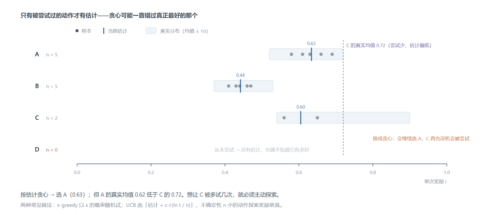

*图 1：每台老虎机有真实的奖励分布（浅色带），你只能看到自己拉出来的样本（灰点），据此形成估计（蓝色竖线）。按估计贪心会一直选 A，但真正最好的是 C——它只被试过两次。*

### 1.2 形式化

设臂 $a$ 的奖励服从某个分布，均值记为

$$
q_*(a)=\mathbb E[R_t\mid A_t=a].
$$

如果你知道 $q_*(a)$，问题就退化成"选最大的那个"，没有学习可言。真正的困难在于：**只有被尝试过的臂才有样本，只有有样本的臂才能被估计**。

在第 $t$ 次，对臂 $a$ 的**样本平均**估计是

$$
Q_t(a)=\frac{\sum_{i=1}^{t-1}R_i\cdot\mathbb 1\{A_i=a\}}{\sum_{i=1}^{t-1}\mathbb 1\{A_i=a\}},
$$

分母为 0 时约定 $Q_t(a)$ 取一个乐观初值。这个估计有一个漂亮的增量形式：

$$
Q_{n+1}=Q_n+\frac{1}{n}\big(R_n-Q_n\big),
$$

即"新估计 = 旧估计 + 步长 × 误差"。把 $1/n$ 换成一个常数 $\alpha$，就得到**指数加权平均**——它更适应分布缓慢变化的情形。后面所有 TD 更新都是这个形状。

### 1.3 贪心的失败与遗憾

**贪心策略**每次选 $\arg\max_a Q_t(a)$。它会失败，而且失败得很安静：一旦某个次优臂在早期碰巧给出几个高奖励，贪心就会一直选它，真正的优臂再也得不到样本，估计永远停在一个偏低的初值上。

衡量这种损失的标准量是**遗憾（regret）**：

$$
\mathrm{Regret}(T)=T\cdot q_*-\mathbb E\Big[\sum_{t=1}^{T}q_*(A_t)\Big],\qquad q_*=\max_a q_*(a).
$$

好的算法应该让遗憾随 $T$ **次线性**增长；线性增长意味着"一直在犯同样的错"。

### 1.4 两种处理不确定性的办法

**$\varepsilon$-greedy**：以 $1-\varepsilon$ 的概率贪心，以 $\varepsilon$ 的概率随机。简单、通用，缺点是探索是"盲"的——它均匀地试，不管哪个臂更值得试。

**UCB（upper confidence bound）**：选

$$
A_t=\arg\max_a\Big[Q_t(a)+c\sqrt{\frac{\ln t}{N_t(a)}}\Big],
$$

其中 $N_t(a)$ 是臂 $a$ 被拉过的次数。第二项是"乐观奖励"：样本越少、$N_t(a)$ 越小，奖励越大。它的依据是 Hoeffding 不等式——对 $[0,1]$ 有界的奖励，均值以 $1-\delta$ 的概率落在样本均值附近 $\sqrt{\ln(1/\delta)/2n}$ 的范围内。取 $\delta\sim 1/t$ 就得到了 $\sqrt{\ln t/n}$ 的形状。UCB 的遗憾是 $O(\sqrt{KT\ln T})$，接近理论下界。

### 1.5 这一节要带走的三件事

1. **探索不是可选项，而是估计的成本**：不试就没有信息，没有信息就无法保证选对。
2. **估计的不确定性本身可以作为决策依据**（UCB 的思想）。后面 PPO 的熵奖励、GRPO 的组内标准化，都是这个思想的变体。
3. **数据由你的行为产生**。在老虎机里这一点无害（每次拉臂不改变分布）；一旦环境有状态、动作会改变未来，它就会变成核心难题。

---

## 2. 序贯决策：马尔可夫决策过程

把老虎机换成网格世界：动作会改变状态，状态又决定下一步能做什么。

### 2.1 一个具体的网格世界

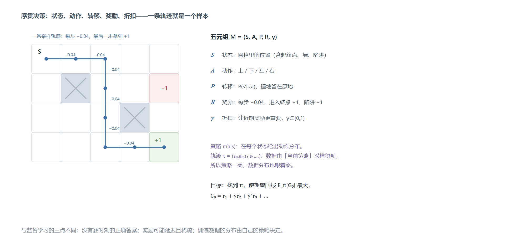

*图 2：4×5 的网格。S 是起点，+1 是终点，−1 是陷阱，✕ 是墙。每走一步 −0.04，进入终点 +1。蓝色折线是一条实际采样出来的轨迹。*

这个游戏里，每一步的奖励都差不多（−0.04），真正决定好坏的是"能不能更快走到终点"。也就是说，**单步奖励并不等于好坏**；要评估一个动作，必须看它把局面带向哪里。

### 2.2 形式化：五元组

**马尔可夫决策过程（MDP）**由五元组 $\mathcal M=(\mathcal S,\mathcal A,P,R,\gamma)$ 描述：

- $\mathcal S$：状态集合；
- $\mathcal A$：动作集合；
- $P(s'\mid s,a)$：状态转移概率；
- $R(s,a,s')$：奖励（可以只依赖 $(s,a)$，记作 $R(s,a)$）；
- $\gamma\in[0,1)$：折扣因子。

在 $t$ 时刻，智能体观察 $s_t$，按策略 $\pi(a\mid s_t)$ 选 $a_t$，环境给出 $r_{t+1}\sim R(\cdot\mid s_t,a_t)$ 并转移到 $s_{t+1}\sim P(\cdot\mid s_t,a_t)$。这样不断交互，得到一条**轨迹**

$$
\tau=(s_0,a_0,r_1,s_1,a_1,r_2,s_2,\dots).
$$

**马尔可夫性**是这个模型的核心假设：给定 $s_t$ 与 $a_t$，未来的分布与更早的历史无关。它不要求"状态包含了世界的全部信息"，只要求"**对于做决策而言**，$s_t$ 已经够用"。如果不够用，那就说明状态表示设计得不好——这一点在 LLM 里尤其微妙：把整个生成前缀当作状态，马尔可夫性是**构造出来的**。

### 2.3 回报与折扣

从 $t$ 时刻起的**折扣回报**是

$$
G_t=r_{t+1}+\gamma r_{t+2}+\gamma^2 r_{t+3}+\cdots=\sum_{k=0}^{\infty}\gamma^k r_{t+k+1}.
$$

$\gamma$ 有两个作用。

**数学上**：保证级数收敛（只要奖励有界）。**语义上**：它定义了一个"有效视野"。若奖励大致平稳，$\sum_k \gamma^k=1/(1-\gamma)$，所以 $\gamma=0.99$ 的有效视野约 100 步，$\gamma=0.9$ 约 10 步。$\gamma\to 1$ 表示"我不着急，未来和现在一样重要"。

还要注意一个常被忽略的点：**$\gamma<1$ 会让智能体偏好"早拿奖励"**。两套方案总奖励相同，先拿到的那套折扣后更大。这既是建模工具（贴现、利息），也可能是偏差来源（LLM 里常把 $\gamma$ 设为 1，正是因为不想引入"越短越好"的偏好）。

### 2.4 目标

策略 $\pi$ 的好坏用**期望回报**衡量：

$$
J(\pi)=\mathbb E_{\tau\sim\pi}\Big[\sum_{t=0}^{\infty}\gamma^t r_{t+1}\Big].
$$

强化学习要解的就是 $\pi^\star=\arg\max_\pi J(\pi)$。（在持续任务里用平均奖励代替，本讲不展开。）

### 2.5 与监督学习的三个差别，严格地说

1. **没有逐时刻的标签**。监督学习最小化 $\frac1N\sum_i \ell(f(x_i),y_i)$，每个样本都有 $y_i$；强化学习只有轨迹末端的标量回报，中间步骤的"正确答案"未知。
2. **奖励延迟且稀疏**。$r_{t+1}$ 可能与 $a_t$ 关系很弱，真正的因果链跨越几十上百步。
3. **数据分布随策略变化**。训练数据的分布是 $d^\pi(s)=\sum_t\gamma^t P(s_t=s\mid\pi)$，它依赖 $\pi$ 本身。你优化 $\pi$，数据就变；数据变了，你对 $\pi$ 的估计也变。这是强化学习优化不稳定的总根源。

---

## 3. 价值：把一个状态值多少钱

回报 $G_t$ 是随机的。同一策略、同一状态，两次采样得到的 $G_t$ 可能差很多。所以要评估"好不好"，我们取期望。

### 3.1 两个价值函数

**状态价值（state value）**：

$$
V^\pi(s)=\mathbb E_\pi\big[G_t\mid s_t=s\big].
$$

它回答："如果我现在在 $s$，并且从此以后都按 $\pi$ 行动，平均能拿到多少折扣回报？"

**动作价值（action value）**：

$$
Q^\pi(s,a)=\mathbb E_\pi\big[G_t\mid s_t=s,a_t=a\big].
$$

它回答："如果在 $s$ 先**强制**做 $a$，此后按 $\pi$ 行动，平均能拿到多少？"

两者的关系是显然的：$V^\pi$ 是 $Q^\pi$ 按策略概率的加权平均，

$$
V^\pi(s)=\sum_a \pi(a\mid s)\,Q^\pi(s,a).
$$

### 3.2 优势：比"一般水平"好多少

$$
A^\pi(s,a)=Q^\pi(s,a)-V^\pi(s).
$$

$V^\pi(s)$ 是这个状态下的"平均分"，$A^\pi$ 是某个动作相对平均分的**超额**。它的期望按策略加权为 0：

$$
\sum_a \pi(a\mid s)A^\pi(s,a)=0.
$$

这个"零均值"性质正是优势在策略梯度里好用的原因：它自动扣掉了"这个状态本来就难/本来就容易"的部分，只看动作之间的相对好坏。

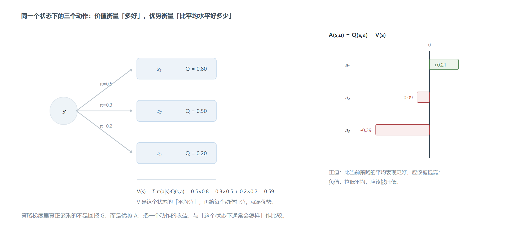

*图 3：一个状态 $s$，三个动作的 $Q$ 值分别为 0.80、0.50、0.20，按策略概率 $(0.5,0.3,0.2)$ 加权得到 $V(s)=0.59$。优势就是每个 $Q$ 与 $V$ 的差：$+0.21,-0.09,-0.39$。*

### 3.3 为什么需要 $Q$，而不只是 $V$

如果只知道 $V$，要选动作还得知道转移概率：

$$
a^\star=\arg\max_a\sum_{s'}P(s'\mid s,a)\big[R(s,a,s')+\gamma V(s')\big].
$$

$P$ 通常是未知的——这正是"无模型（model-free）"方法要回避的东西。而 $Q(s,a)$ 已经把"这个动作之后会怎样"打包进去了，选动作只需要

$$
a^\star=\arg\max_a Q(s,a),
$$

不需要任何环境模型。这就是 Q-learning 一类的价值方法在离散动作任务上特别受欢迎的原因。

### 3.4 一个容易忽略的点：价值依赖策略

$V^\pi$ 的右上角那个 $\pi$ 不是装饰。同一个状态，按保守策略走和按激进策略走，价值完全不同。所以"价值"永远是"某个策略的价值"。

由此引出两个不同的目标：

- **预测（prediction）**：给定 $\pi$，估计 $V^\pi$ 或 $Q^\pi$。这是"策略评估"。
- **控制（control）**：在估计的同时改进 $\pi$，最终拿到 $\pi^\star$。

后面第 5 节用动态规划做这两件事，第 6–7 节用采样做这两件事。

---

## 4. 贝尔曼方程：把无限求和变成递归

$G_t$ 是无限项之和，直接算不可能。但注意到一个恒等式：

$$
G_t=r_{t+1}+\gamma G_{t+1}.
$$

**当前回报 = 眼前奖励 + 折扣后的未来回报**。把它代进期望，就得到贝尔曼方程。

### 4.1 期望形式（策略评估）

对 $V^\pi$：

$$
\begin{aligned}
V^\pi(s)
&=\mathbb E_\pi[G_t\mid s_t=s]\\
&=\mathbb E_\pi\big[r_{t+1}+\gamma G_{t+1}\mid s_t=s\big]\\
&=\sum_a\pi(a\mid s)\sum_{s'}P(s'\mid s,a)\Big[R(s,a,s')+\gamma\,V^\pi(s')\Big].
\end{aligned}
$$

第二步用了"塔性质"：先对一步转移取期望，剩下的 $G_{t+1}$ 的期望正是 $V^\pi(s')$。**这就是马尔可夫性的全部用处**——它让我们可以用"下一个状态的价值"来表示"当前状态的价值"。

对 $Q^\pi$ 同理：

$$
Q^\pi(s,a)=\sum_{s'}P(s'\mid s,a)\Big[R(s,a,s')+\gamma\sum_{a'}\pi(a'\mid s')Q^\pi(s',a')\Big].
$$

### 4.2 最优形式

最优价值满足**贝尔曼最优方程**：把对动作的加权平均换成取最大，

$$
V^\star(s)=\max_a\sum_{s'}P(s'\mid s,a)\big[R(s,a,s')+\gamma V^\star(s')\big],
$$

$$
Q^\star(s,a)=\sum_{s'}P(s'\mid s,a)\Big[R(s,a,s')+\gamma\max_{a'}Q^\star(s',a')\Big].
$$

同样的结构：**当前 = 一步奖励 + 折扣 × 下一层的最优值**。

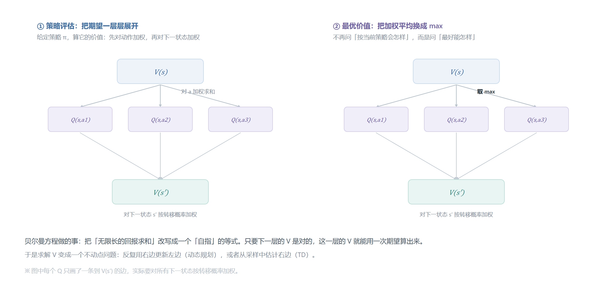

*图 4：贝尔曼方程把价值函数展开成"V → Q → V′"的三层结构。左边是策略评估（对动作加权、对下一状态加权），右边是最优价值（对动作取 max）。*

### 4.3 矩阵形式与不动点

把 $V^\pi$ 看成向量，$R^\pi$ 与 $P^\pi$ 是对策略取期望后的奖励与转移矩阵，则

$$
V^\pi=R^\pi+\gamma P^\pi V^\pi
\;\Longleftrightarrow\;
(I-\gamma P^\pi)V^\pi=R^\pi
\;\Longleftrightarrow\;
V^\pi=(I-\gamma P^\pi)^{-1}R^\pi.
$$

$(I-\gamma P^\pi)$ 一定可逆（因为 $P^\pi$ 是随机矩阵、$\gamma<1$，谱半径小于 1）。这给出了一个**闭式解**——但矩阵求逆是 $O(n^3)$，状态多了就不能用。真正有用的是它对应的**不动点迭代**：

$$
V_{k+1}=R^\pi+\gamma P^\pi V_k .
$$

### 4.4 为什么这个递归如此重要

它把三个难题一次性解决了：

1. **无限求和**变成有限递归：只要知道下一层，这一层就能算。
2. **信用分配**被局部化：一个状态的价值只取决于它的即时奖励和下一状态的价值，链式地往后传。这正是"功劳沿轨迹回传"的数学形式。
3. **策略改进**有了依据：如果某个动作的 $Q$ 比当前策略的平均值高，就说明改做它更好（下一节）。

你可以把贝尔曼方程理解成**动态规划的最优性原理**在一个随机过程上的具体化：整体最优，当且仅当每一段都相对于它的后继最优。

---

## 5. 模型已知：动态规划

假设 $P$ 与 $R$ 都已知。这时求解 MDP 就是一个规划问题，经典解法是动态规划。

### 5.1 策略评估：反复套用贝尔曼期望

给定 $\pi$，初始化 $V_0$ 任意，反复

$$
V_{k+1}(s)\leftarrow\sum_a\pi(a\mid s)\sum_{s'}P(s'\mid s,a)\big[R(s,a,s')+\gamma V_k(s')\big]
$$

直到 $\|V_{k+1}-V_k\|_\infty<\epsilon$。

**为什么收敛？** 定义算子 $(T^\pi V)(s)=\sum_a\pi\sum_{s'}P[R+\gamma V(s')]$，则

$$
\|T^\pi V-T^\pi V'\|_\infty\le\gamma\|V-V'\|_\infty,
$$

即 $T^\pi$ 是 $\gamma$-**压缩映射**。由 Banach 不动点定理，它在该范数下唯一收敛到 $V^\pi$，且误差按 $\gamma^k$ 几何衰减。$\gamma$ 越接近 1，收敛越慢——这与"视野越长越难估"是同一件事。

### 5.2 策略改进：用一步贪心保证不退化

有了 $V^\pi$，定义新策略

$$
\pi'(s)=\arg\max_a\;Q^\pi(s,a)
=\arg\max_a\sum_{s'}P(s'\mid s,a)\big[R(s,a,s')+\gamma V^\pi(s')\big].
$$

**策略改进定理**：$V^{\pi'}(s)\ge V^\pi(s)$ 对所有 $s$ 成立。

证明只要三行：

$$
V^\pi(s)\le\max_a Q^\pi(s,a)=Q^\pi(s,\pi'(s))=\mathbb E\big[r+\gamma V^\pi(s')\big]\le\mathbb E\big[r+\gamma V^{\pi'}(s')\big]=V^{\pi'}(s),
$$

最后一个不等号对 $s'$ 逐点使用归纳假设。直观上：**"每一步都选当前看起来最好的动作"至少不会更差**——因为原来那条策略本身就是可选的动作之一。

### 5.3 策略迭代与值迭代

**策略迭代**：评估（把 $V^\pi$ 算准）→ 改进（贪心）→ 再评估……策略空间有限，每轮严格改进，所以有限步内收敛到 $\pi^\star$。它通常迭代轮数很少，但每轮评估很贵。

**值迭代**：干脆把"评估"和"改进"合成一步，

$$
V_{k+1}(s)\leftarrow\max_a\sum_{s'}P(s'\mid s,a)\big[R(s,a,s')+\gamma V_k(s')\big].
$$

这等价于对贝尔曼最优算子 $T^\star$ 做不动点迭代；$T^\star$ 同样是 $\gamma$-压缩，所以 $V_k\to V^\star$。收敛后，最优策略就是 $\arg\max_a Q^{\star}(s,a)$。

**两者是同一件事的两种拆法**：策略迭代"把评估做到底再改进"，值迭代"每步都改进一点"。它们都属于**广义策略迭代（GPI）**：评估与改进交替进行，直到两者都不再变化。

### 5.4 动态规划的局限

- **需要模型**：$P$ 和 $R$ 必须已知。真实问题里通常不知道。
- **需要遍历所有状态**：每一轮要扫过整个状态空间，状态数随维度指数增长（维度灾难）。
- **需要枚举所有动作**：连续动作空间下 $\max_a$ 本身就是一个优化问题。

这三点恰好指向后面三条出路：**用采样代替模型**（第 6 节）、**用函数逼近代替表格**（第 8 节）、**用策略梯度处理连续动作**（第 9 节）。

---

## 6. 模型未知：从采样中学习

没有模型，就没法算贝尔曼方程右边那个期望。但我们有样本——可以用样本**估计**右边。

### 6.1 蒙特卡洛：用真实回报做目标

最直接的想法：跑到回合结束，拿到真实的 $G_t$，把 $V(s_t)$ 往它身上拉：

$$
V(s_t)\leftarrow V(s_t)+\alpha\big[G_t-V(s_t)\big].
$$

这就是**蒙特卡洛（MC）**方法。$G_t$ 是 $V^\pi(s_t)$ 的**无偏**估计（它是同一个量的样本），所以只要步长满足 Robbins–Monro 条件（$\sum\alpha_t=\infty,\ \sum\alpha_t^2<\infty$），在表格表示下就收敛到 $V^\pi$。

代价有两个：

- **必须等回合结束**。没有终止的任务（持续控制）用不了；回合很长时更新很慢。
- **方差大**。$G_t$ 里累积了几十上百个随机奖励，方差随视野长度增长。

### 6.2 时序差分：用估计更新估计

既然贝尔曼方程说 $V^\pi(s)=\mathbb E[r+\gamma V^\pi(s')]$，那么"一步奖励 + 下一状态的价值"本身就是 $V^\pi(s)$ 的一个估计。于是

$$
V(s_t)\leftarrow V(s_t)+\alpha\underbrace{\big[r_{t+1}+\gamma V(s_{t+1})-V(s_t)\big]}_{\text{TD 误差 }\delta_t}.
$$

这就是 **TD(0)**。它只走一步，用**自己当前的估计** $V(s_{t+1})$ 补上后面——这叫**自举（bootstrapping）**。

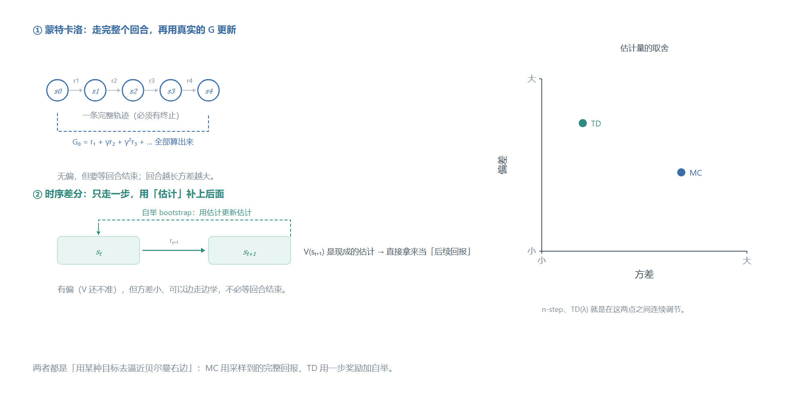

*图 5：MC 要等整条轨迹走完，用真实 $G_0$ 更新；TD 只走一步，用 $r_{t+1}+\gamma V(s_{t+1})$ 更新。右图是两者的取舍：MC 无偏但方差大，TD 有偏但方差小。*

TD 的偏差来自"$V(s_{t+1})$ 还不准"。但换来的是：

- **可以在线学习**：每一步都能更新，不必等回合结束；
- **方差小得多**：只含一个随机奖励；
- **通常收敛更快**（在同样的样本量下，均方误差往往更小）。

一个常被引用的对比：在随机游走任务上，TD(0) 的均方误差曲线明显低于常数步长的 MC。这不是巧合——TD 利用了"马尔可夫性"这一结构信息，而 MC 没有。

### 6.3 TD 在数学上做了什么

把 TD 更新写成

$$
V\leftarrow V+\alpha\big(\hat{\mathcal T}V-V\big),
$$

其中 $\hat{\mathcal T}V(s)=r+\gamma V(s')$ 是贝尔曼算子的一次**采样**。这正是求解不动点方程 $V=\mathcal TV$ 的**随机近似**（Robbins–Monro）。所以 TD 不是启发式：它是"用带噪声的算子迭代去逼近不动点"，收敛性由随机逼近理论保证。

由此也能理解为什么 $\gamma$ 越接近 1 越难学：算子的压缩系数是 $\gamma$，压缩越弱，收敛越慢，方差传播得越远。

### 6.4 在两者之间：n-step 与 TD(λ)

- **n-step TD**：走 $n$ 步再自举，目标为 $r_{t+1}+\gamma r_{t+2}+\cdots+\gamma^{n-1}r_{t+n}+\gamma^n V(s_{t+n})$。$n=1$ 是 TD(0)，$n\to\infty$ 是 MC。
- **TD(λ)**：把所有 $n$ 的目标按 $(1-\lambda)\lambda^{n-1}$ 加权平均，$\lambda=0$ 退化为 TD(0)，$\lambda=1$ 退化为 MC。实现上用**资格迹（eligibility trace）**，每步计算量与 TD(0) 同阶。

这三个方法的关系可以一句话概括：**它们都在估计同一个期望，差别只在"用多长的真实回报、从哪里开始自举"**。

---

## 7. 控制：从价值到策略

把"评估"换成"评估 + 改进"，就得到无模型的控制算法。核心仍是广义策略迭代：**用当前策略采数据，用数据更新价值，用价值改进策略，再用新策略采数据**。

### 7.1 SARSA：学自己正在走的策略

$$
Q(s_t,a_t)\leftarrow Q(s_t,a_t)+\alpha\big[r_{t+1}+\gamma Q(s_{t+1},a_{t+1})-Q(s_t,a_t)\big].
$$

名字来自五元组 $(s_t,a_t,r_{t+1},s_{t+1},a_{t+1})$。注意 $a_{t+1}$ 是**实际按当前策略采样出来的**动作，所以它评估的是 $\pi$ 本身——这是 **on-policy** 方法。配合 $\varepsilon$-greedy，它收敛到"带探索的策略"的最优值。

### 7.2 Q-learning：学最优策略，用别人的数据

$$
Q(s_t,a_t)\leftarrow Q(s_t,a_t)+\alpha\big[r_{t+1}+\gamma\max_{a'}Q(s_{t+1},a')-Q(s_t,a_t)\big].
$$

目标里用的是 $\max$，与行为策略无关。所以它学的是 $Q^\star$——这是 **off-policy**：行为策略可以是 $\varepsilon$-greedy、可以是旧策略、甚至可以是人类演示，只要每个 $(s,a)$ 被访问足够多次，就能收敛到最优。

### 7.3 悬崖行走：两种"正确"的差别

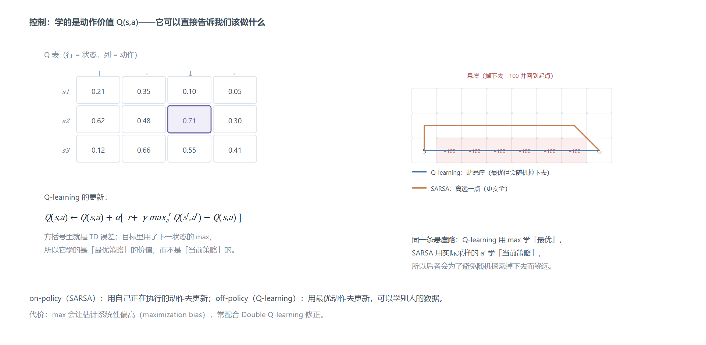

*图 6：悬崖行走。Q-learning 学到贴着悬崖的最短路径（最优），SARSA 学到绕远一点的安全路径。*

这个经典例子说明：**off-policy 的最优 ≠ on-policy 的最优**。Q-learning 的目标是"如果以后都不再随机探索，这条路最好"；但训练时 $\varepsilon$-greedy 会随机走，贴悬崖就时不时掉下去。SARSA 把这种随机性算进了价值里，于是自动学得保守。

这也提示一个实践问题：**你评估的到底是"部署时的策略"还是"训练时的策略"**？如果部署时还会带温度采样，那么 SARSA 的目标可能更贴近真实表现。

### 7.4 $\max$ 的代价：最大化偏差

$\mathbb E[\max_a X_a]\ge\max_a\mathbb E[X_a]$。当 $Q$ 有噪声时，$\max$ 会系统性地挑中"被高估"的动作，于是估计越更新越高。这就是 **maximization bias**。

**Double Q-learning** 的修法：用两份估计 $Q_1,Q_2$，一份选动作、另一份评估：

$$
Q_1(s,a)\leftarrow Q_1(s,a)+\alpha\big[r+\gamma Q_2\big(s',\arg\max_{a'}Q_1(s',a')\big)-Q_1(s,a)\big].
$$

选择与评估用不同的估计，噪声就不再系统性地抬高目标。这个思想在深度 RL 里同样重要（Double DQN）。

### 7.5 探索策略

- **$\varepsilon$-greedy**：简单、通用；探索是均匀的，不聪明。
- **乐观初始化**：给没试过的动作一个高初值，逼着算法去试。
- **softmax / 玻尔兹曼**：按 $Q$ 值做温度采样，价值高的动作更常被选。
- **计数 / 伪计数 / 熵奖励**：鼓励访问"没见过"的状态。深度 RL 里最常用的是**熵奖励**——在目标里加 $\beta\,\mathcal H(\pi(\cdot\mid s))$，防止策略过早坍缩成确定性。

---

## 8. 函数逼近与深度 RL

表格方法要求每个状态（或状态-动作对）有一个独立的值。状态一多就不可能：图像输入的状态空间是 $256^{H\times W}$ 量级。

### 8.1 用参数化函数代替表格

把 $V(s)\approx V_\phi(s)$ 或 $Q(s,a)\approx Q_\phi(s,a)$ 交给神经网络。损失用 TD 误差的平方：

$$
L(\phi)=\mathbb E\Big[\big(r+\gamma V_\phi(s')-V_\phi(s)\big)^2\Big].
$$

但注意：**目标里也含 $\phi$**。如果对目标求梯度，会得到"追逐自己尾巴"的更新。实践中只对预测项求梯度，把目标当常数——这叫**半梯度（semi-gradient）**方法。它没有真正的梯度下降的收敛保证，但在实践中工作得很好。

### 8.2 致命三角

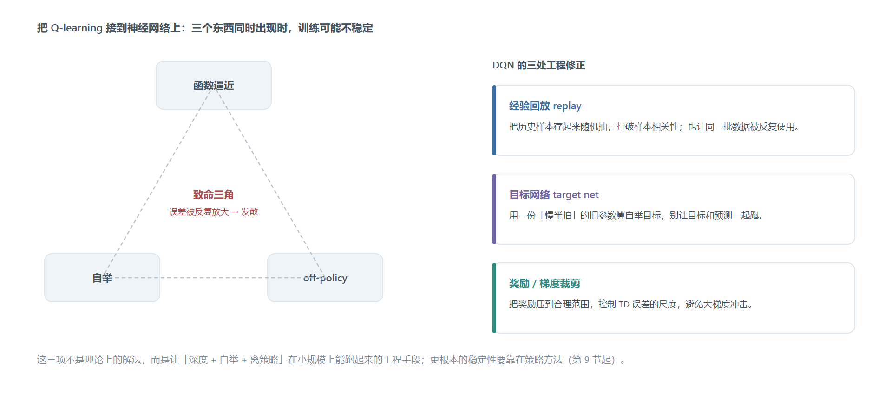

*图 7：函数逼近、自举、off-policy 三者同时出现时，价值估计可能发散。DQN 用经验回放、目标网络、奖励裁剪把它压住。*

Sutton 与 Barto 把这三者的组合称为**致命三角（deadly triad）**：

- **函数逼近**：一个状态的更新会"溢出"到其他状态（泛化）；
- **自举**：目标依赖自己的估计，误差会沿时间反向传播；
- **off-policy**：数据分布与当前策略不一致，更新可能把价值推向没被充分采样的区域。

表格方法只有自举，是安全的；MC 没有自举，也是安全的。三者凑齐，就可能发散。

### 8.3 DQN 的三处工程修正

2015 年的 DQN 用三个手段让"Q-learning + 深度网络"在 Atari 上跑起来：

1. **经验回放（replay buffer）**：把历史转移存起来随机抽。它打破相邻样本的相关性（否则像"用同一局的数据连续更新"，方差极大），也让一条数据被多次使用。
2. **目标网络（target network）**：用一份每隔 $C$ 步才同步的参数 $\phi^-$ 计算目标 $r+\gamma\max_{a'}Q_{\phi^-}(s',a')$，避免"目标和预测一起跑"。
3. **奖励裁剪**：把奖励截到 $[-1,1]$，控制 TD 误差的尺度。

有一点必须说清楚：**这三项是工程上的稳定化手段，不是对致命三角的理论解决**。DQN 在有些任务上依然不稳，超参敏感，样本效率低（要几千万帧）。真正从结构上缓解不稳定性的，是后面要讲的策略方法。

---

## 9. 策略梯度：直接优化策略

价值方法有一个共同的问题：**策略是从价值里"读"出来的**（$\arg\max_a Q$）。当动作是连续的、或者最优策略本身是随机的，这个"读"就很别扭。而且价值估计的一点点误差，可能导致策略完全改变。

换个思路：**把策略本身参数化，直接对目标 $J(\theta)$ 做梯度上升**。

### 9.1 目标与它的难点

$$
J(\theta)=\mathbb E_{\tau\sim\pi_\theta}\Big[\sum_{t}\gamma^t r_{t+1}\Big].
$$

难点在于期望的分布依赖 $\theta$：$\tau$ 是采样出来的，采样过程不可导。你不能直接对"采样"求导。

### 9.2 对数导数技巧

记一条轨迹的概率为

$$
\pi_\theta(\tau)=p(s_0)\prod_{t}\pi_\theta(a_t\mid s_t)\,P(s_{t+1}\mid s_t,a_t).
$$

对 $\theta$ 求梯度，只有策略项含 $\theta$：

$$
\nabla_\theta\pi_\theta(\tau)=\pi_\theta(\tau)\sum_t\nabla_\theta\log\pi_\theta(a_t\mid s_t).
$$

于是

$$
\nabla_\theta J(\theta)
=\nabla_\theta\!\int\pi_\theta(\tau)R(\tau)\,d\tau
=\int\pi_\theta(\tau)\nabla_\theta\log\pi_\theta(\tau)R(\tau)\,d\tau
=\mathbb E_{\tau\sim\pi_\theta}\Big[\Big(\sum_t\nabla_\theta\log\pi_\theta(a_t\mid s_t)\Big)R(\tau)\Big].
$$

**这个式子的意义**：期望的梯度可以写成"采样轨迹、乘以一个权重、再对 $\log\pi$ 求梯度"的期望。于是我们可以用样本估计梯度，而不需要对环境求导——环境可以是黑盒、可以有随机性、甚至可以不可微。

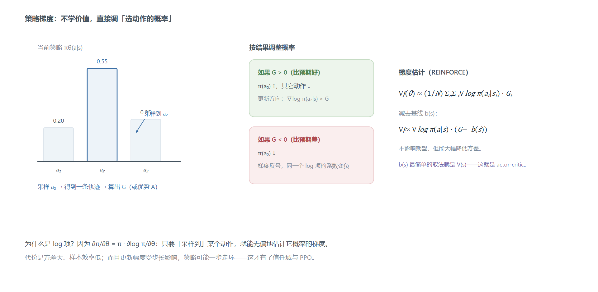

*图 8：策略是一组概率。采样到某个动作后，用它的结果 $G$（或优势 $A$）作为权重去调这个动作的对数概率：结果好就提高，结果差就降低。*

### 9.3 REINFORCE

用一条完整轨迹的回报 $G_t$ 作为权重，得到最原始的算法：

$$
\nabla_\theta J(\theta)\approx\frac1N\sum_{n=1}^{N}\sum_{t=0}^{T_n}\nabla_\theta\log\pi_\theta(a_t^n\mid s_t^n)\,G_t^n,
$$

$$
\theta\leftarrow\theta+\alpha\nabla_\theta J(\theta).
$$

直觉：**如果一条轨迹的总回报高，就把这条轨迹上所有动作的概率都提高一点**。注意"所有动作"——不管某一步是好是坏，只要整条轨迹好，就一起奖。这正是信用分配问题在策略梯度里的表现。

### 9.4 基线：不减方差就没法用

REINFORCE 的方差大到几乎不可用。原因是 $G_t$ 的绝对大小受"这个任务本身有多难"影响，而与"这个动作有多好"关系不大。

减去一个只依赖状态的基线 $b(s)$ 不改变期望：

$$
\mathbb E\big[\nabla_\theta\log\pi_\theta(a\mid s)\,b(s)\big]
=b(s)\sum_a\nabla_\theta\pi_\theta(a\mid s)
=b(s)\,\nabla_\theta 1=0.
$$

但方差会显著下降。最自然的基线就是 $V^\pi(s)$，减去它之后权重变成**优势** $A^\pi(s,a)$。这就得到了**策略梯度定理**：

$$
\nabla_\theta J(\theta)=\mathbb E_{\pi_\theta}\Big[\sum_t\nabla_\theta\log\pi_\theta(a_t\mid s_t)\,A^{\pi_\theta}(s_t,a_t)\Big].
$$

一句话：**别奖励"结果好"，要奖励"比预期好"**。

---

## 10. Actor-Critic 与 PPO

### 10.1 用 critic 估优势

策略梯度需要 $A^\pi$。用一条轨迹的 $G_t$ 去估，方差大；用一个学出来的 $V_\phi$ 去估，方差小。于是让两个网络分工：

- **actor** $\pi_\theta(a\mid s)$：决定怎么做，用策略梯度更新；
- **critic** $V_\phi(s)$：评价做得怎么样，用 TD 学习更新。

优势的估计用 TD 误差：

$$
\hat A_t=r_{t+1}+\gamma V_\phi(s_{t+1})-V_\phi(s_t).
$$

这就是 **A2C / A3C** 的基本形态（advantage actor-critic）。critic 提供了低方差的基线，actor 提供了策略改进的方向。

**GAE（generalized advantage estimation）** 把多步的 TD 误差按 $\lambda$ 加权：

$$
\hat A_t^{\mathrm{GAE}(\lambda)}=\sum_{l=0}^{\infty}(\gamma\lambda)^l\delta_{t+l},\qquad \delta_t=r_{t+1}+\gamma V_\phi(s_{t+1})-V_\phi(s_t).
$$

$\lambda=0$ 是单步 TD（低方差、高偏差），$\lambda=1$ 是蒙特卡洛（高方差、低偏差）。实践中 $\lambda\approx0.95$、$\gamma\approx0.99$ 是常见起点。

### 10.2 为什么不能直接反复用同一批数据

策略梯度的样本来自 $\pi_{\theta_{\text{old}}}$。如果更新一次就把这批数据扔掉，样本效率太低；如果想多用几次，就变成了 off-policy，需要**重要性采样（importance sampling）**修正：

$$
\nabla_\theta J=\mathbb E_{\pi_{\text{old}}}\Big[\frac{\pi_\theta(a\mid s)}{\pi_{\text{old}}(a\mid s)}\nabla_\theta\log\pi_\theta(a\mid s)\hat A\Big].
$$

记比值 $r_t(\theta)=\pi_\theta(a_t\mid s_t)/\pi_{\text{old}}(a_t\mid s_t)$。$r$ 偏离 1 越远，估计的方差越大——两个分布差太多时，重要性采样的估计几乎不可用。

**TRPO** 的做法是把它写成约束优化：

$$
\max_\theta\;\mathbb E\big[r_t(\theta)\hat A_t\big]\quad\text{s.t.}\quad \mathbb E\big[\mathrm{KL}(\pi_{\text{old}}\,\|\,\pi_\theta)\big]\le\delta.
$$

用二阶近似求解，理论漂亮，实现复杂。

**PPO** 换了一个更简单的手段：直接裁剪目标函数，

$$
L^{\mathrm{CLIP}}(\theta)=\mathbb E\Big[\min\big(r_t(\theta)\hat A_t,\ \mathrm{clip}(r_t(\theta),1-\epsilon,1+\epsilon)\hat A_t\big)\Big].
$$

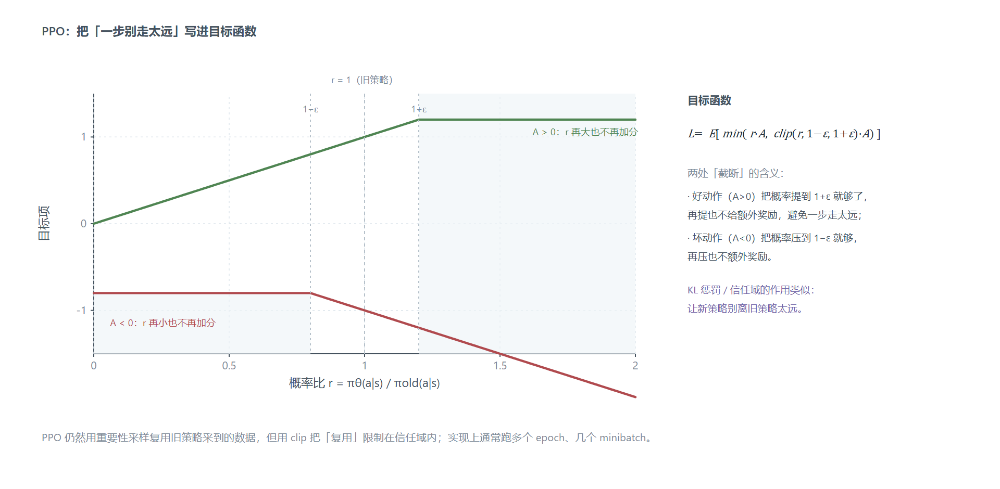

*图 9：横轴是新旧策略的概率比 $r$。当 $A>0$（好动作），$r$ 超过 $1+\epsilon$ 后目标不再增长；当 $A<0$（坏动作），$r$ 低于 $1-\epsilon$ 后目标也不再增长。于是"往好的方向走"的激励被限制在信任域内。*

为什么这个裁剪有效：它没有真的加约束，而是让**越界的更新拿不到额外收益**。你仍然可以采样、仍然可以多跑几个 epoch，但策略不会因为一次更新而跑得太远。

### 10.3 把它放到 LLM 上，还差什么

到这里，算法框架已经有了。但要把它用到语言模型上，还需要回答：状态、动作、奖励分别是什么？奖励从哪来？这就是下半部分的内容。

---

## 11. 把一次生成写成 MDP

### 11.1 状态、动作、奖励

给定提示 $x$，模型逐 token 生成 $y=(y_1,\dots,y_T)$。把它写成 MDP：

| RL 概念 | 在语言模型里 |
|---|---|
| 状态 $s_t$ | 提示 + 已经生成的前缀 $(x,y_{<t})$ |
| 动作 $a_t$ | 从词表里选下一个 token $y_t$ |
| 转移 $P$ | **确定的**：$s_{t+1}=s_t\oplus y_t$ |
| 奖励 $r$ | 通常只在 $t=T$ 给一次：奖励模型打分，或验证器判对错 |
| 策略 $\pi_\theta$ | 语言模型本身 |

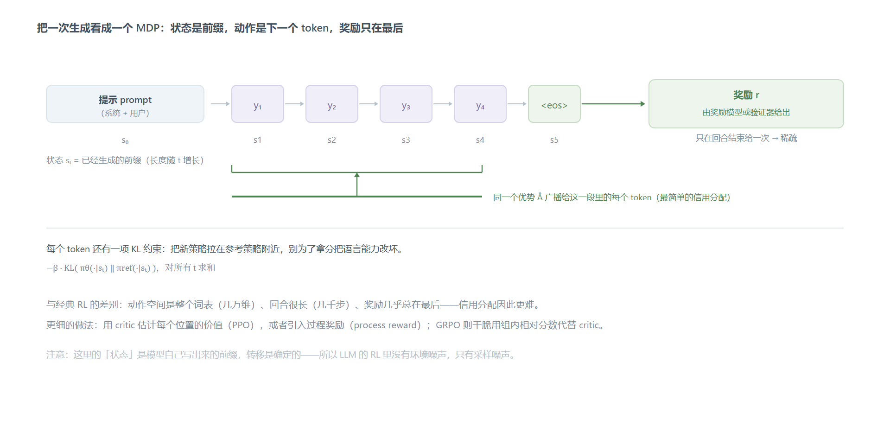

*图 10：一次生成就是一个 MDP。状态是前缀，动作是 token，奖励只在回合结束出现一次；每个 token 还带一项相对参考模型的 KL 惩罚。*

### 11.2 三个"不一样"

**动作空间巨大**。词表有 $10^4\sim10^5$ 个动作，策略是一个巨大的 softmax。好处是所有动作的概率可以一次算出（一次前向），坏处是几乎所有动作的概率都极小。

**回合极长、奖励极稀疏**。一段推理可能几千个 token，而奖励只在最后出现。这就是第 0 节那个信用分配问题在 LLM 上的极端形态。

**转移是确定的**。这是 LLM 与经典 RL 的一个关键差别：环境没有随机性，随机性全部来自采样。因此不存在"环境噪声"，只有"采样噪声"；也不需要学环境模型。

### 11.3 KL 正则：为什么必须把策略拴住

单纯最大化 $r(x,y)$ 会出问题：

- 模型会找到奖励模型的漏洞（**reward hacking**）——生成讨喜但空洞的内容；
- 语言分布会整体漂移，通用能力退化（**language drift**）；
- 采样会迅速坍缩到少数几个高分模式，多样性消失。

标准做法是在目标里加一项**相对参考策略的 KL 惩罚**：

$$
\max_\theta\;\mathbb E_{x\sim\mathcal D,\,y\sim\pi_\theta(\cdot\mid x)}\Big[r(x,y)-\beta\sum_{t=1}^{T}\mathrm{KL}\big(\pi_\theta(\cdot\mid x,y_{<t})\,\big\|\,\pi_{\mathrm{ref}}(\cdot\mid x,y_{<t})\big)\Big].
$$

$\pi_{\mathrm{ref}}$ 通常是 SFT 之后的模型。$\beta$ 控制"能偏离多远"：$\beta$ 大则保守、学得慢；$\beta$ 小则激进、容易跑偏。逐 token 的 KL 还可以写成采样近似：

$$
\mathrm{KL}_t\approx\log\pi_\theta(y_t\mid s_t)-\log\pi_{\mathrm{ref}}(y_t\mid s_t).
$$

实践中常把它并入每个 token 的奖励，于是奖励变成"终端奖励 + 沿途的 KL 罚分"——稀疏奖励因此有了一点"形状"。

---

## 12. RLHF：从人的偏好里学一个奖励

### 12.1 三段式

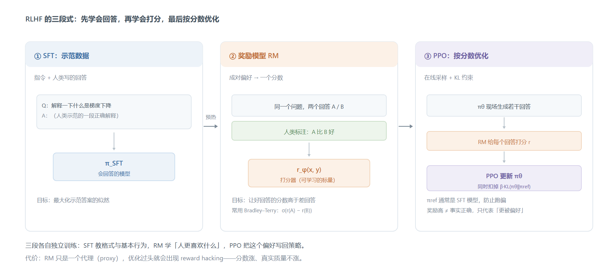

*图 11：SFT 教模型"会回答"，RM 学"人更喜欢哪种回答"，PPO 用 RM 的分数去优化策略，同时用 KL 拴住参考模型。*

1. **SFT**：用人工写的示范回答做监督微调，得到一个会按格式回答的模型 $\pi_{\mathrm{SFT}}$。
2. **奖励模型**：对同一个提示，让人比较两个回答哪个更好，训练一个打分器 $r_\phi(x,y)$。
3. **RL 微调**：用 PPO 优化 $\pi_\theta$，奖励是 $r_\phi$ 减 KL。

### 12.2 奖励模型：Bradley–Terry

假设"人更偏好 $y_w$ 而不是 $y_l$"的概率由两者的分数差决定：

$$
P(y_w\succ y_l\mid x)=\sigma\big(r_\phi(x,y_w)-r_\phi(x,y_l)\big),\qquad \sigma(z)=\frac{1}{1+e^{-z}}.
$$

这就是 **Bradley–Terry 模型**（ originally 用于成对比较的排序）。训练奖励模型就是最大化这个似然：

$$
\mathcal L_{\mathrm{RM}}(\phi)=-\mathbb E_{(x,y_w,y_l)}\Big[\log\sigma\big(r_\phi(x,y_w)-r_\phi(x,y_l)\big)\Big].
$$

注意它只约束**差值**：把所有分数同时加一个常数，损失不变。所以奖励模型的绝对值没有意义，只有相对大小有意义。这一点在 DPO 的推导里会起关键作用。

### 12.3 PPO 阶段的目标

$$
\max_\theta\;\mathbb E\Big[\frac{\pi_\theta(y\mid x)}{\pi_{\mathrm{old}}(y\mid x)}\,r_\phi(x,y)-\beta\,\mathrm{KL}(\pi_\theta\|\pi_{\mathrm{ref}})\Big].
$$

实现上就是第 10 节的 PPO：用策略梯度、用裁剪限制步长、用 KL 拴住参考模型。区别只是"序列级的重要性比"要拆成 token 级的乘积，优势通常用序列级的奖励直接广播到每个 token（因为只有终点有奖励）。

### 12.4 奖励模型是代理，不是真理

RLHF 的奖励来自人的偏好，而偏好只反映"看起来更好"，不等于"事实正确"。优化一个代理指标过头，就会出现：

- **reward hacking**：模型学会迎合奖励模型的偏好（更长、更客气、更多"首先/其次/最后"），而不是更正确；
- **过度优化（over-optimization）**：KL 越放越松，代理奖励上升，真实质量先升后降（Goodhart 定律的经验版本）；
- **标注噪声**：偏好数据本身有分歧，奖励模型的"最优"可能只是标注者的平均口味。

所以后来的工作往两个方向走：**换更硬的奖励**（可验证奖励，第 14 节）、**换更简单的优化**（DPO，下一节）。

---

## 13. DPO：把奖励模型代数地消掉

RLHF 的流程很长：训 RM、跑 PPO、调 KL 系数。能不能一步到位？

### 13.1 从 KL 正则目标推出闭式解

考虑

$$
\max_{\pi}\;\mathbb E_{y\sim\pi(\cdot\mid x)}\big[r(x,y)\big]-\beta\,\mathrm{KL}\big(\pi(\cdot\mid x)\,\|\,\pi_{\mathrm{ref}}(\cdot\mid x)\big).
$$

这是一个带 KL 约束的期望最大化。把 KL 展开：

$$
\max_\pi\;\sum_y\pi(y\mid x)\Big[r(x,y)-\beta\log\frac{\pi(y\mid x)}{\pi_{\mathrm{ref}}(y\mid x)}\Big].
$$

对每个 $y$ 单独看，这是"在 $\sum_y\pi=1$ 约束下最大化线性函数"——解在指数族上，且满足

$$
\pi^\star(y\mid x)\propto\pi_{\mathrm{ref}}(y\mid x)\exp\!\big(r(x,y)/\beta\big).
$$

记归一化常数 $Z(x)=\sum_y\pi_{\mathrm{ref}}(y\mid x)\exp(r(x,y)/\beta)$，就得到

$$
\pi^\star(y\mid x)=\frac{1}{Z(x)}\,\pi_{\mathrm{ref}}(y\mid x)\exp\!\big(r(x,y)/\beta\big).
$$

### 13.2 把奖励反解出来

对上式取对数并整理：

$$
r(x,y)=\beta\log\frac{\pi^\star(y\mid x)}{\pi_{\mathrm{ref}}(y\mid x)}+\beta\log Z(x).
$$

这就是 **DPO 的核心恒等式**：在 KL 正则的最优策略下，奖励可以被"表示"成策略本身的对数概率比。换句话说，**策略就隐含了一个奖励模型**。

### 13.3 代入 Bradley–Terry，常数消掉

把上式代进 $\sigma(r_w-r_l)$。注意 $\beta\log Z(x)$ 对 $y_w$ 和 $y_l$ 是同一个常数，相减就没了：

$$
P(y_w\succ y_l\mid x)=\sigma\Big(\beta\log\frac{\pi_\theta(y_w\mid x)}{\pi_{\mathrm{ref}}(y_w\mid x)}-\beta\log\frac{\pi_\theta(y_l\mid x)}{\pi_{\mathrm{ref}}(y_l\mid x)}\Big).
$$

于是损失函数里不再有奖励模型：

$$
\mathcal L_{\mathrm{DPO}}(\theta)=-\mathbb E_{(x,y_w,y_l)}\log\sigma\Big(\beta\log\frac{\pi_\theta(y_w\mid x)}{\pi_{\mathrm{ref}}(y_w\mid x)}-\beta\log\frac{\pi_\theta(y_l\mid x)}{\pi_{\mathrm{ref}}(y_l\mid x)}\Big).
$$

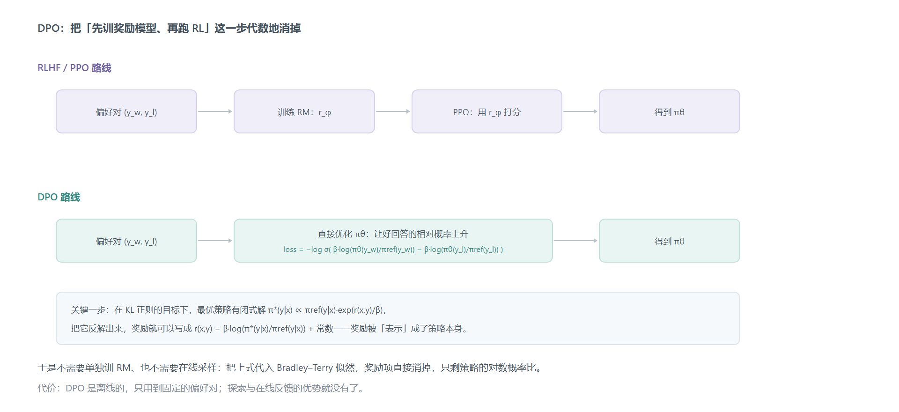

*图 12：同一条 KL 正则目标的两种解法。RLHF 显式训练 RM 再跑 PPO；DPO 把最优策略的闭式解代入，奖励被策略的对数概率比替代，于是可以直接在偏好对上做监督式优化。*

### 13.4 怎么理解 DPO 的梯度

对 $\mathcal L_{\mathrm{DPO}}$ 求梯度，可以得到一个很直观的形式：

$$
\nabla_\theta\mathcal L_{\mathrm{DPO}}\propto-\beta\,\sigma\big(\hat r_l-\hat r_w\big)\Big[\nabla_\theta\log\pi_\theta(y_w\mid x)-\nabla_\theta\log\pi_\theta(y_l\mid x)\Big],
$$

其中 $\hat r=\beta\log(\pi_\theta/\pi_{\mathrm{ref}})$ 是隐式奖励。也就是说：**把好回答的似然往上推、把差回答的似然往下压，权重取决于"当前判断错得有多离谱"**——错得越离谱，梯度越大。

### 13.5 DPO 的取舍

**优点**：不需要单独训 RM、不需要在线采样、实现就是一个带参考模型的分类损失，训练稳定且便宜。

**代价**：

- **离线**。只用到固定的偏好对，没有探索；数据没覆盖到的区域学不到。
- **依赖参考模型**。$\pi_{\mathrm{ref}}$ 固定，等于把"能偏离多远"写死在一个超参 $\beta$ 上。
- **可能偏好长度**。如果偏好数据里长回答更容易赢，DPO 会把"变长"学进去（RLHF 里也有类似问题，只是 KL 与 RM 会部分抵消）。
- **对数据分布敏感**。偏好对的质量和覆盖面直接决定上限。

一句话总结：**DPO 用"离线 + 闭式解"换掉了"在线 + 奖励模型"，简单但少了探索**。

---

## 14. 可验证奖励与 GRPO

### 14.1 换一种奖励：从"人喜欢"到"可判定"

数学题有标准答案，代码有单元测试，结构化抽取可以校验字段。这些任务的奖励不需要人来打分，可以用规则直接判定：

- 数学：最终答案与标准答案一致（数值 / 表达式等价）；
- 代码：通过全部或部分测试用例；
- 抽取：字段与格式校验通过；
- 格式：是否按规定的模板输出（常作为辅助奖励）。

这类训练统称 **RLVR（RL with Verifiable Rewards）**。它的好处是奖励**客观、便宜、可扩展**；坏处是**只适用于可判定的任务**，而且模型会学会"钻验证器的空子"（比如猜答案、套格式）。

### 14.2 组内相对优势：GRPO

用 PPO 做 RLVR 有一个现实问题：critic 与策略同规模，显存翻倍；而在"奖励只在末尾、且是 0/1"的设定下，学一个 token 级价值函数并不容易。

**GRPO（Group Relative Policy Optimization）** 的办法是：对同一个问题采样一组（$G$ 个）回答，用**组内的相对分数**当优势。

$$
\hat A_i=\frac{r_i-\mathrm{mean}(r_1,\dots,r_G)}{\mathrm{std}(r_1,\dots,r_G)}.
$$

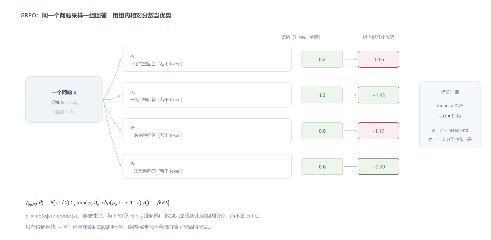

*图 13：同一个问题采样 4 个回答，各自拿到 0/1 或部分分；组内标准化后得到优势，同一个优势广播给该回答的每个 token；不需要 critic。*

目标函数与 PPO 同构：

$$
J_{\mathrm{GRPO}}(\theta)=\mathbb E\Big[\frac1G\sum_{i=1}^{G}\min\big(\rho_i\hat A_i,\ \mathrm{clip}(\rho_i,1-\epsilon,1+\epsilon)\hat A_i\big)-\beta\,\mathrm{KL}\Big],
$$

其中 $\rho_i=\pi_\theta(o_i\mid x)/\pi_{\mathrm{old}}(o_i\mid x)$。

**为什么有效**：

1. **省掉 critic**：一份与策略同规模的模型，显存和计算都省一半。
2. **自动消掉奖励尺度**：组内标准化后，0/1 奖励与 0~1 的部分分在同一个尺度上，KL 系数更好调。
3. **方差更低**：同一问题的多个样本共享题目难度，相对比较比绝对分数稳定。

**它的假设**：同一组里必须**有对有错**。如果全对或全错，标准差为 0，优势全为 0，这条数据就没有梯度——所以课程式、由易到难的数据安排很重要。

### 14.3 DeepSeek-R1 的观察

DeepSeek-R1 的技术报告里有一个值得注意的现象：从基座模型出发，**只用可验证奖励 + GRPO 做纯 RL**（R1-Zero），模型会自发出现"先展开推理、再给答案"的长思维链，以及自我检查、回溯等行为——这些行为没有用 SFT 教过。

这被广泛解读为"RL 可以激励出推理能力"。但要注意两点：

- 这些行为**是否真的"新"**，取决于基座模型是否本来就"会"（见下一节）；
- R1-Zero 同时出现了可读性差、语言混杂等问题，最终 R1 还是加入了冷启动 SFT 与多阶段训练。

### 14.4 什么时候该用哪种

| 场景 | 推荐 | 原因 |
|---|---|---|
| 有标准答案 / 可运行测试 | RLVR（PPO 或 GRPO） | 奖励客观，扩展性好 |
| 只有人的偏好（写作、对话风格） | RLHF 或 DPO | 偏好是唯一可得的信号 |
| 偏好数据固定、算力有限 | DPO | 离线、便宜、稳定 |
| 需要探索、且能在线打分 | PPO / GRPO | 在线反馈能覆盖新行为 |
| 冷启动、格式都不对 | 先 SFT | 没有基本行为，RL 无从探索 |

---

## 15. RL 到底改变了什么

这是最值得认真对待的一节。前面所有算法都在优化 $J(\theta)$，但 $J$ 变高，到底意味着模型"变强了"，还是只是"换了个采样方式"？

### 15.1 分布锐化：RL 主要在重新加权

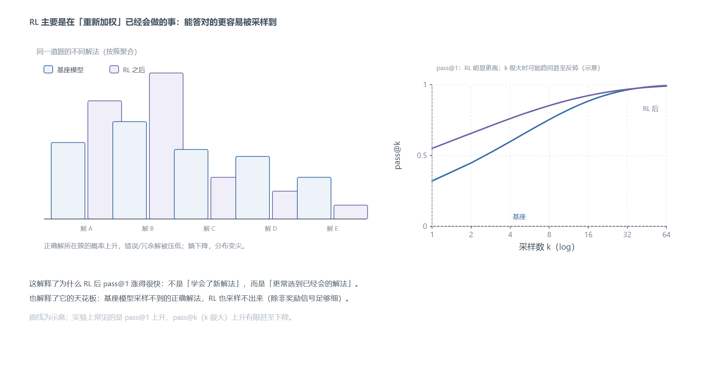

*图 14：左，RL 把概率质量集中到少数"能拿分"的解法簇上，熵下降、分布变尖；右，pass@1 显著上升，但 pass@k 在大 k 时可能趋同甚至反转（示意图）。*

策略梯度做的事情可以这样理解：**对已有的行为按结果重新加权**。能得分的轨迹概率上升，不能得分的下降。如果基座模型从来采样不出某个正确解法，那么在这个过程中它**永远不会被采到**，也就永远不会被奖励——RL 无法凭空创造它。

这就是"分布锐化（sharpening）"假说：RL 提升的是**采样效率**（更快找到已知的好答案），而不是**能力边界**（能解出原本解不出的题）。

### 15.2 证据：pass@k 的分裂

有研究系统比较了 RLVR 前后的模型，发现在 $k$ 很大时，**基座模型的 pass@k 可以追上甚至超过 RL 后的模型**（Yue et al., 2025）。这支持了上面的判断：RL 把概率集中到了正确路径上，但并没有扩展基座模型能到达的解空间。

这不意味着 RL 没用——采样效率本身就是巨大的实用价值（同样的预算下答对更多）。但它提醒我们：**"RL 让模型学会了推理"是一个需要限定的说法**。

### 15.3 三个常见副作用

**熵坍缩（entropy collapse）**。训练久了，策略越来越确定，输出多样性下降。表现出来是 pass@1 上升、pass@k 下降，训练后期甚至整体退化。常见对策：熵奖励、KL 系数调整、难度课程、限制更新幅度。

**长度偏置**。偏好模型与可验证奖励都可能偏爱更长的回答（"想得更多所以更对"）。结果是模型学会"凑长度"，推理成本上升，效果未必提升。对策：长度惩罚、按长度归一化的奖励、在数据里控制长度分布。

**奖励攻击（reward hacking）**。模型会找到奖励函数的漏洞：猜答案、套模板、在代码里写 `assert True`、把测试用例硬编码。可验证奖励比人类偏好更硬，但**验证器本身仍是代理**。对策：隐藏测试集、多验证器交叉、人工抽检、把"过程"也纳入检查。

### 15.4 一个更有用的心智模型

把 RL 后的模型看成"**在基座模型的支持集上，按奖励重新分配概率质量**"。由此可以推出几条实用结论：

- **基座能力是天花板**。想突破天花板，得靠更好的预训练、蒸馏、工具，或引入新的监督信号（更细的过程奖励、更强的验证器）。
- **奖励的形状决定学到的行为**。奖励只看答案，模型就可能只优化答案；奖励看过程，才可能学到过程。
- **KL 与信任域是"防止跑偏"的保险丝**，不是可有可无的正则项。
- **评测要看 $k$ 条曲线**，只看 pass@1 会高估 RL 的作用。

---

## 16. 总结：一张图与十条要点

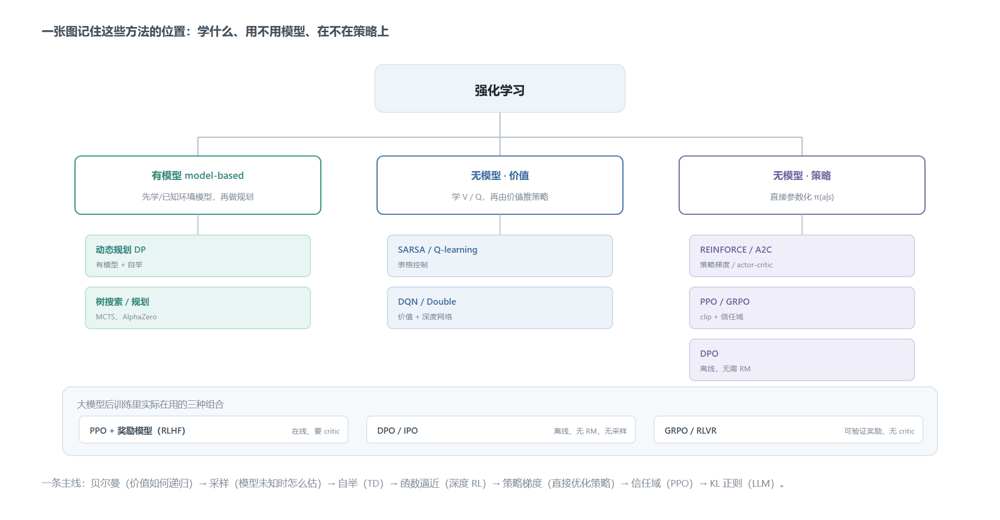

*图 15：把本讲提到的方法放到同一张图上：学什么（价值 / 策略）、有没有模型、在不在策略上。*

### 16.1 十条要点

1. **强化学习 = 从评价性反馈中学习**。没有标签，只有结果；数据由策略产生。
2. **MDP 把序贯决策形式化**。马尔可夫性是建模假设，不是世界的事实。
3. **折扣回报**用 $\gamma$ 平衡近期与远期，有效视野约 $1/(1-\gamma)$。
4. **贝尔曼方程**把无限求和变成递归，是价值方法的全部基础。
5. **DP 需要模型**：策略迭代 / 值迭代都是"评估 + 改进"的交替。
6. **TD 是贝尔曼算子的随机近似**：自举带来偏差，也带来低方差与在线学习。
7. **Q-learning 是 off-policy 的 max 版本**；SARSA 是 on-policy 的样本版本；$\max$ 有系统性高估。
8. **策略梯度**用对数导数把"采样不可导"绕过去；基线/优势是让它可用的关键。
9. **actor-critic 把两条线合起来**；PPO 用裁剪把更新限制在信任域内。
10. **LLM 的 RL 是一个超长、稀疏、动作空间巨大的 MDP**；RLHF 学偏好，DPO 消掉奖励模型，GRPO 用组内比较省掉 critic。

### 16.2 四个常见误解

- **"RL 就是试错，试多了就会"**。错。没有合适的奖励与探索，试错会稳定地收敛到局部最优。
- **"奖励越高，模型越好"**。错。奖励是代理，优化过头就是 Goodhart。
- **"PPO 比 DPO 高级"**。不对。它们是同一目标的两种解法，取舍在"在线探索"与"离线简单"。
- **"RL 让模型学会了新能力"**。需要证据。更常见的解释是"把已有能力采样出来的概率提高了"。

### 16.3 练习

1. **老虎机**：证明 $\varepsilon$-greedy 在 $\varepsilon>0$ 时每个臂都会被无限次访问，从而 $Q_t(a)\to q_*(a)$。
2. **折扣**：证明当 $|r|\le r_{\max}$ 时，$|G_t|\le r_{\max}/(1-\gamma)$，并解释为什么这保证了贝尔曼算子是压缩的。
3. **贝尔曼**：对 $\gamma=0.9$、两状态两动作的小 MDP，手算一轮策略评估与一次策略改进（自己设奖励）。
4. **TD 与 MC**：给出一个例子，说明 TD(0) 的估计在某个状态上有偏，但方差比 MC 小得多。
5. **策略梯度**：证明减去与动作无关的基线不改变梯度期望；再说明为什么用 $V(s)$ 作基线通常比用常数好。
6. **PPO**：画出 $A=+1$ 与 $A=-1$ 时 $L^{\mathrm{CLIP}}$ 随 $r$ 变化的曲线，标出梯度为 0 的区间。
7. **DPO**：从 KL 正则目标推导 $\pi^\star\propto\pi_{\mathrm{ref}}e^{r/\beta}$（提示：对每个 $y$ 用拉格朗日乘子，或对 $\pi$ 求变分）。
8. **GRPO**：若一组 8 个回答全部正确，优势是多少？这对训练意味着什么？可以怎样缓解？
9. **思考题**：如果 RL 主要是"重新加权"，那么"用 RL 提升基座模型能力上限"需要什么额外条件？

### 16.4 延伸阅读

- Sutton & Barto, *Reinforcement Learning: An Introduction* (2nd ed.) —— 标准教材，第 3、4、6、13 章与本讲最相关。
- Mnih et al., *Human-level control through deep reinforcement learning*, Nature 2015（DQN）。
- Schulman et al., *Trust Region Policy Optimization*（TRPO）；*Proximal Policy Optimization Algorithms*（PPO）；*High-Dimensional Continuous Control Using Generalized Advantage Estimation*（GAE）。
- Williams, *Simple Statistical Gradient-Following Algorithms for Connectionist Reinforcement Learning*（REINFORCE 的原始文献）。
- Christiano et al., *Deep Reinforcement Learning from Human Preferences*；Ouyang et al., *Training Language Models to Follow Instructions with Human Feedback*（RLHF / InstructGPT）。
- Rafailov et al., *Direct Preference Optimization*（DPO）。
- Shao et al., *DeepSeekMath*（GRPO 的提出）；DeepSeek-AI, *DeepSeek-R1*。
- Yue et al., *Does Reinforcement Learning Really Incentivize Reasoning Capacity in LLMs Beyond the Base Model?*（2025）。
- Cui et al., *The Entropy Mechanism of Reinforcement Learning for Reasoning Language Models*（2025）。

---

*本讲配套插图均为代码生成的 SVG/PNG，见 `rl/images/`；生成脚本在 `build/figs/rl_core.py` 与 `build/figs/rl_llm.py`，重渲染命令见 `build/README.md`。*

