# 强化学习

主讲义第 8.6 节留下了一个循环：智能体观察状态，按策略采取动作，环境返回奖励和下一状态。附录里的贝尔曼方程则说明，从现在起的长期回报可以收成“这一步的奖励，加上折扣后的下一状态价值”。这篇把这两件事展开。目标是看清强化学习里的对象为什么要这样定义，采样算法为什么会一次次改写，以及这些改写怎样接到大模型的偏好优化和可验证奖励上。

阅读需要条件期望、链式法则，以及主讲义里已经出现的策略、回报和价值。不需要事先学过动态规划或策略梯度。

记号与主讲义后半的公式一致。在时刻 $t$，智能体处于状态 $s_t$，采取动作 $a_t$，随后收到奖励 $r_{t+1}$，并进入 $s_{t+1}$。奖励写在 $t+1$，是因为它发生在动作之后。

## 1. 只有结局被打分的时候

监督学习的一条样本通常带着目标。输入 $x$，就有一个要去拟合的 $y$：下一张图的类别、下一个 token、一个回归值。损失可以在这一步立刻计算。

有些任务没有这种逐步目标。走一条路，每一步只是向北、开门或等待，奖励可能到终点才出现。下一手棋没有标准着法，胜负要等终局。让语言模型回答一道数学题，也可以只在最后检查答案是否正确，中间那些 token 并没有逐字的标准写法。

这类问题仍然可以看成在优化一个策略。困难在于学习信号来晚了，而且信号本身不标明前面哪一步造成了它。这件事叫**信用分配（credit assignment）**。

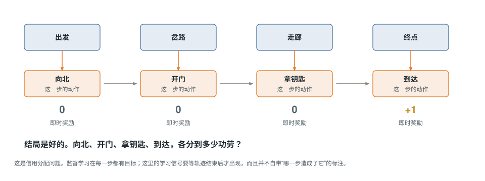

*描述：延迟奖励并不标明前面哪一步有功劳。*

强化学习处理的就是这种信号。它不假设每一步都有人写好正确答案。它假设智能体可以反复行动，环境会在某些时刻给出奖励，学习的目标是让长期累计的奖励变大。

因此强化学习里有两个必须分开的角色。**智能体（agent）** 负责选择。**环境（environment）** 负责转移和打分。智能体看不见、也不能直接改写环境的转移规则。它能改的是自己的选择方式。

## 2. 把交互写成决策过程

一轮交互是：智能体看见 $s_t$，按自己的规则选出 $a_t$，环境给出 $r_{t+1}$ 和 $s_{t+1}$。从起始到结束的一整串

$$
\tau=(s_0,a_0,r_1,s_1,a_1,r_2,\ldots)
$$

称为一条**轨迹（trajectory）**。智能体的选择规则称为**策略（policy）**。随机策略写成条件分布 $\pi(a\mid s)$，参数化之后记为 $\pi_\theta$。

环境这边有两样东西。**转移核** $P(s'\mid s,a)$ 是在状态 $s$ 做了动作 $a$ 之后，下一状态的分布。**奖励**可以是随机的，它的条件期望写成 $R(s,a,s')$。策略、转移、奖励是三件不同的事：同一种走法，换一个环境，奖励可以完全不同。

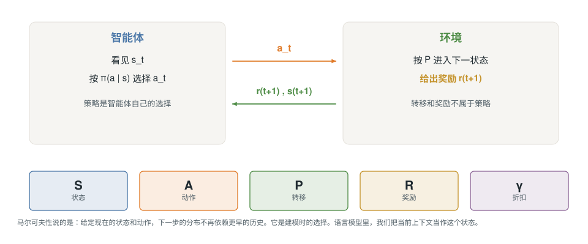

*描述：策略、转移和奖励在交互里各占一个位置。*

如果下一步的分布只依赖当前状态和当前动作，不再另依赖更早的历史，环境就是**马尔可夫（Markov）** 的。这时的数学模型是**马尔可夫决策过程（Markov decision process，MDP）**。常用的五元组是

$$
(\mathcal S,\mathcal A,P,R,\gamma).
$$

$\mathcal S$ 是状态集，$\mathcal A$ 是动作集，$\gamma\in[0,1]$ 是后面要进入回报的折扣。片段式任务会在有限步内结束，这时 $\gamma$ 可以取 1。任务若可能一直继续，就需要 $\gamma<1$，否则一份永不停止的单位奖励会让回报变成无穷大。有的任务还写明起始分布 $\rho(s_0)$。到终止状态就结束的任务称为**片段式（episodic）** 任务。

马尔可夫性是建模时的约定，环境并不会自己保证它。真实因果若依赖没被写进 $s$ 的信息，而我们仍只用 $s$ 做决策，那么这个 $s$ 只是我们选来当作状态的观测。语言模型里，这个选择很具体：状态就是当前上下文，动作就是下一个 token。上下文里没写进去的东西，策略就看不见。

在参数为 $\theta$ 的策略下，一条有限轨迹的概率可以拆开：

$$
P(\tau\mid\theta)=\rho(s_0)\prod_t \pi_\theta(a_t\mid s_t)\,P(s_{t+1}\mid s_t,a_t).
$$

转移概率 $P$ 不含 $\theta$。后面给策略求梯度时，这一点会把环境的未知转移从导数里消掉，只留下 $\log\pi_\theta$。

策略若一开始就只走当前看起来最好的动作，很多状态永远不会被访问到。所以行为时通常保留随机性。最简单的做法是 **$\varepsilon$-greedy**：以 $1-\varepsilon$ 的概率选当前估计最好的动作，以 $\varepsilon$ 的概率在全部动作里均匀抽。$\varepsilon$ 是探索的比例。后面会看到，采样用的策略和正在被评价的策略可以是同一个，也可以不是。

## 3. 回报、价值，以及高出平均的那一部分

单步奖励太短。从时刻 $t$ 往未来看，**回报（return）** 是折扣后的奖励之和：

$$
G_t=r_{t+1}+\gamma r_{t+2}+\gamma^2 r_{t+3}+\cdots=\sum_{k=0}^{\infty}\gamma^k r_{t+k+1}.
$$

它满足递归 $G_t=r_{t+1}+\gamma G_{t+1}$。折扣有两层作用。$\gamma<1$ 时，即便奖励永远是 1，无穷和也等于 $1/(1-\gamma)$，目标是有限的。同时，$\gamma$ 把“更早拿到的 1”和“更晚拿到的 1”区分开。

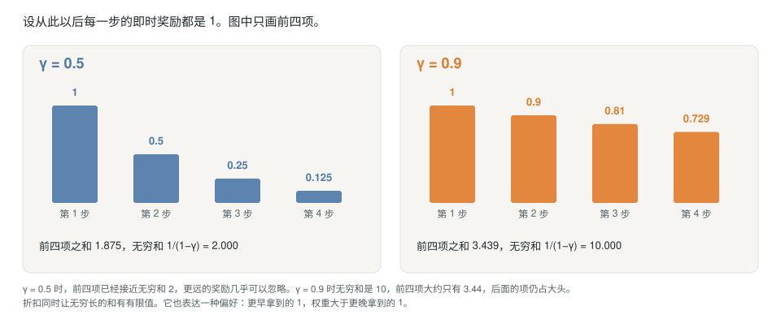

*描述：同样是 1 的未来奖励，折扣不同时分量差很多。*

$\gamma=0.5$ 时无穷和是 2，前四项已经有 1.875。$\gamma=0.9$ 时无穷和是 10，前四项只有 3.439，更远的奖励仍占大部分。语言模型若把一整段回答的分数都折进每个 token，使用的 $\gamma$ 往往很接近 1，因为句末的正确性和句首的用词处在同一条要被评价的轨迹上。

$G_t$ 随轨迹随机。直接拿它当优化对象不方便，于是取条件期望，得到两个价值函数。

**状态价值（state value）**

$$
V^\pi(s)=\mathbb{E}[G_t\mid s_t=s,\ \text{之后一直按 }\pi]
$$

回答：已经在 $s$，并且以后都按 $\pi$ 行动，还能期望拿到多少回报。

**动作价值（action value）**

$$
Q^\pi(s,a)=\mathbb{E}[G_t\mid s_t=s,\ a_t=a,\ \text{之后按 }\pi]
$$

回答：在 $s$ 先强制做 $a$，然后再回到 $\pi$，期望回报是多少。

两者由策略连在一起。状态价值是动作价值按 $\pi$ 的平均：

$$
V^\pi(s)=\sum_a \pi(a\mid s)\,Q^\pi(s,a).
$$

高出这个平均的部分称为**优势（advantage）**：

$$
A^\pi(s,a)=Q^\pi(s,a)-V^\pi(s).
$$

优势回答的是另一个问题：这个动作比“在这个状态按当前策略随便做”好多少。按 $\pi$ 对 $a$ 求期望，优势是 0。好动作的正优势和差动作的负优势互相抵消。

用一组具体数字可以把这句话算完。三个动作“走、等、退”的概率是 $0.5$、$0.3$、$0.2$，动作价值是 $4$、$0$、$1$。则

$$
V=0.5\times 4+0.3\times 0+0.2\times 1=2.2,
$$

优势是 $+1.8$、$-2.2$、$-1.2$。再按概率加权：$0.5\times 1.8+0.3\times(-2.2)+0.2\times(-1.2)=0$。

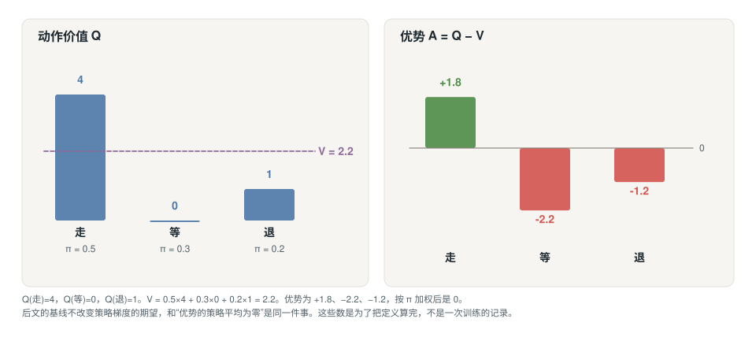

*描述：V 是 Q 的策略平均，优势是相对这条平均线的差。*

后面几乎所有策略更新用的都是这种“相对量”。绝对回报里有一大块是“这个状态本来就好或本来就差”，它不该算成刚刚那个动作的功劳。优势把这一块扣掉。

目标可以写成：找一个策略，使每个状态的 $V^\pi(s)$ 都尽量大。因为转移和策略都可能随机，优化的是期望，是对 $\pi$ 会产生的全部轨迹取的。

## 4. 贝尔曼方程：无限长的和可以只看一步

把 $G_t=r_{t+1}+\gamma G_{t+1}$ 代进 $V^\pi$ 的定义：

$$
V^\pi(s)=\mathbb{E}[r_{t+1}+\gamma G_{t+1}\mid s_t=s].
$$

奖励 $r_{t+1}$ 和下一状态 $s_{t+1}$ 由这一步的动作和转移决定。到了 $s_{t+1}$ 之后，剩下的期望回报又是 $V^\pi(s_{t+1})$，这里用了两件事：以后仍按 $\pi$ 行动，以及下一步的分布只依赖 $(s_t,a_t)$。于是

$$
V^\pi(s)=\sum_a\pi(a\mid s)\sum_{s'}P(s'\mid s,a)\big[R(s,a,s')+\gamma V^\pi(s')\big].
$$

这就是 $V^\pi$ 的**贝尔曼方程（Bellman equation）**。它没有增加新的假设。它把一条无限长的和，写成了当前策略下的一步期望。动作价值有对应的形式：先沿着 $a$ 走到 $s'$，再在 $s'$ 按 $\pi$ 平均。

$$
Q^\pi(s,a)=\sum_{s'}P(s'\mid s,a)\Big[R(s,a,s')+\gamma\sum_{a'}\pi(a'\mid s')Q^\pi(s',a')\Big].
$$

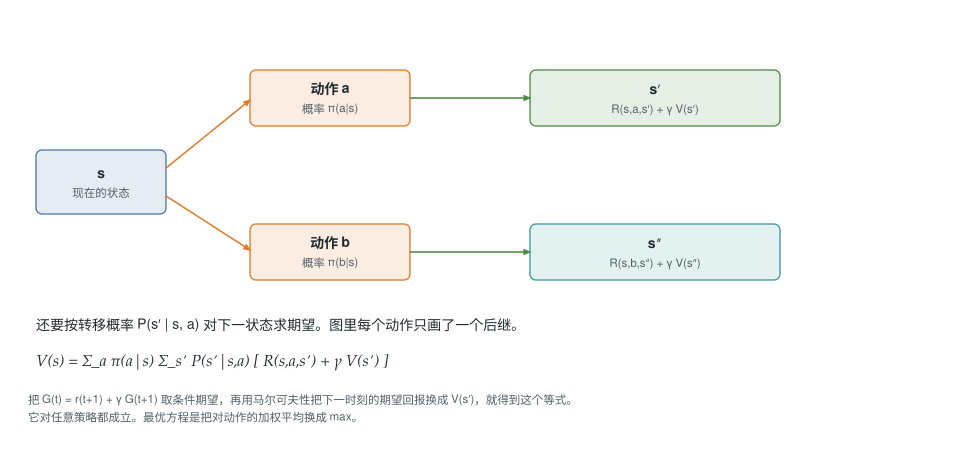

*描述：一步备份：奖励加上折扣后的下一状态价值。*

若策略可以在每个状态挑选动作，价值还有上界。**最优价值** $V^*$、$Q^*$ 满足把“按 $\pi$ 平均”换成“取最大”之后的方程：

$$
V^*(s)=\max_a\sum_{s'}P(s'\mid s,a)\big[R(s,a,s')+\gamma V^*(s')\big],
$$

$$
Q^*(s,a)=\sum_{s'}P(s'\mid s,a)\Big[R(s,a,s')+\gamma\max_{a'}Q^*(s',a')\Big].
$$

对应的贪心策略 $\pi^*(s)=\arg\max_a Q^*(s,a)$ 是最优策略。$\gamma<1$、状态和动作都有限时，这个最优价值是唯一的，从任意初值反复做上面的备份，会收敛到它。

已知 $P$ 和 $R$ 时，可以在计算里完成两件不同的事。

**策略评估**固定 $\pi$，解它的贝尔曼方程，得到 $V^\pi$ 或 $Q^\pi$。这一步只回答“这套策略有多好”。

**策略改进**再令每个状态改选 $Q^\pi$ 最大的动作。新策略在每个状态上的价值不会变差。评估和改进交替进行，就是**策略迭代（policy iteration）**。把两步合成一次带 $\max$ 的备份，不必等评估完全收敛再改进，就是**价值迭代（value iteration）**。

这条路线的前提是转移和奖励已经写在纸上。棋类的规则、已知的网格世界属于这种情形。奖励要等真人比较、或者要等程序判分，而下一状态的分布并没有被写成 $P$ 时，备份无法直接算。后面的算法都是在这个前提下工作：用采样代替对 $P$ 的求和。若另外学一个环境模型，再在模型里做规划，那是基于模型的路线。这篇沿无模型的路线往下走。语言模型的“环境”通常就是评分方式，不是一个还要去预测的物理模拟器。

## 5. 采样之后：等到结局，还是走一步就更新

没有 $P$，就从交互里收集轨迹。评价一个策略，有两种使用这些轨迹的方式。

**蒙特卡洛（Monte Carlo，MC）** 等到片段结束，用真实的 $G_t$ 当作 $V^\pi(s_t)$ 的样本。$G_t$ 的期望就是 $V^\pi(s_t)$，所以这个目标无偏。它的方差也大：后面每一步的随机都叠进了这一个数。而且必须等到结束。

**时序差分（temporal difference，TD）** 不等结束。它用贝尔曼方程的右边做目标：

$$
r_{t+1}+\gamma V(s_{t+1}).
$$

更新是把 $V(s_t)$ 往这个目标拉一点。$V(s_{t+1})$ 是自己当前的估计，这种用估计去更新估计的做法称为**自举（bootstrapping）**。当前的 $V$ 还不是 $V^\pi$ 时，TD 目标有偏。它只含一个随机奖励，方差通常比整段 $G_t$ 小，而且每走一步就能学。

看一条三步的轨迹就能把差别算出来。$\gamma=0.9$，三步之后的奖励依次是 $0$、$0$、$1$，然后进入结束状态，结束状态的价值记为 0。从后往前：

$$
G_2=1,\qquad G_1=0.9,\qquad G_0=0.81.
$$

若价值函数此刻全是 0，三个 TD 目标分别是

$$
0+0.9\times 0=0,\qquad 0+0.9\times 0=0,\qquad 1+0.9\times 0=1.
$$

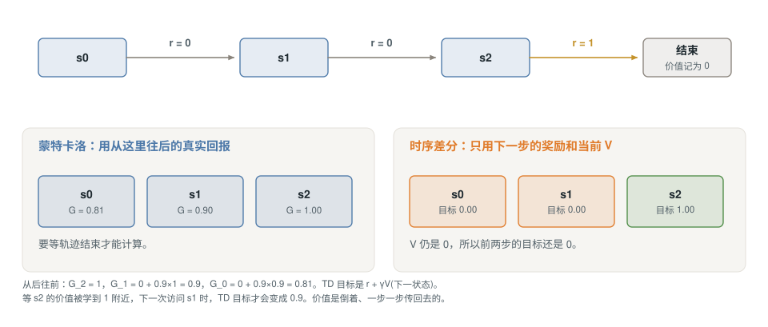

*描述：同一条轨迹上，蒙特卡洛要用整段回报，时序差分只用下一步。*

蒙特卡洛在 $s_0$ 就已经给出 $0.81$。时序差分在价值还是 0 时，只能先学到 $s_2$ 的目标是 1。等 $V(s_2)$ 接近 1，下一次访问 $s_1$，目标才变成 $0.9$。价值是倒着、一步一步传回去的。

这是后面整条算法谱系的偏差–方差选择。看得越远，越接近真实回报，也越容易被后半段的噪声带动。只看下一步，更新快，但传递正确数值需要很多次访问。第 8 节的 $\lambda$ 就是在这两个极端之间取点。

## 6. 从评价策略到改进策略

上一节还只是在问“这套 $\pi$ 有多好”。控制问题要改 $\pi$。价值方法的做法是学 $Q$，再从 $Q$ 里读出策略。最简单的读法是每个状态选 $Q$ 最大的动作。学习过程中若始终这样选，没试过的动作就永远没有机会改正 $Q$。所以采样时常用 $\varepsilon$-greedy，更新时再决定自己到底在评价哪一套策略。

这里出现同策略和离策略的差别。

**SARSA** 的目标使用下一步实际采取的动作 $a'$：

$$
r_{t+1}+\gamma Q(s_{t+1},a').
$$

采样用什么策略，更新就在评价什么策略。行为策略和改进中的策略是同一个，这是**同策略（on-policy）**。

**Q-learning** 的目标使用下一状态上最大的动作价值：

$$
r_{t+1}+\gamma\max_{a'}Q(s_{t+1},a').
$$

即便这一次为了探索走了较差的动作，备份仍指向当前认为最好的动作。学的是贪心策略，采样策略可以更随机。数据可以来自另一个策略，这是**离策略（off-policy）**。

同一条转移上，两个目标可以差很多。设 $\gamma=0.9$，这一步奖励是 1。下一状态有两个动作，表格里的 $Q$ 分别是 2 和 0，探索时实际走了 $Q=0$ 的那个。SARSA 的目标是 $1+0.9\times 0=1$。Q-learning 的目标是 $1+0.9\times 2=2.8$。

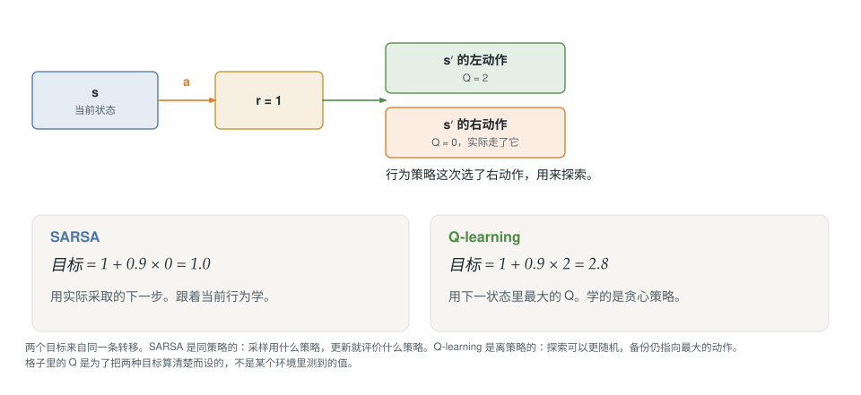

*描述：SARSA 跟实际走的下一步，Q-learning 跟下一状态的最大 Q。*

表格方法在状态和动作都能枚举时成立。状态是图像、句子或连续向量时，表格放不下，于是用参数 $\theta$ 表示 $Q(s,a;\theta)$，用采样梯度去减小 TD 误差。这件事不能只理解为“把表格换成神经网络”。

困难有两层。连续到来的转移高度相关，网络会沿着最近的一小段经历猛改。TD 目标里又含着同一个网络的 $Q$，目标随着参数每一步都在动。**深度 Q 网络（Deep Q-Network，DQN）** 用两个在今天看来很朴素的设计稳住了这种更新。**经验回放（experience replay）** 把转移存进一个池子再随机抽取，既打乱时间上的相关，也让一条经验被用不止一次。**目标网络（target network）** 把备份右边的参数隔一段时间才同步一次，学习目标在这段时间里保持不动。

还有一条需要记住的边界。函数逼近、自举、离策略三件事情叠在一起时，价值更新可能发散。这三件一起出现的情形常被称为 deadly triad。DQN 使 Atari 上的训练成为可行的工程，它并没有把这个组合变成一条一般性的收敛定理。读后面的策略梯度时，可以把它看成另一条路线：少依赖“用自己的 $Q$ 去引导自己的 $Q$”，改成直接调整策略的概率。

## 7. 直接对策略求梯度

价值方法先学 $Q$，再由 $\arg\max$ 得到动作。动作是离散且不多时，这很自然。动作本身就是一个大分布时，$\arg\max$ 并不是我们想交付的对象。语言模型要交付的就是下一个 token 的分布。于是可以让 $\pi_\theta$ 自己成为被优化的函数，哪条轨迹的回报高，就提高这条轨迹里实际出现过的动作的概率。

目标取起始状态的价值，也就是轨迹回报的期望：

$$
J(\theta)=\mathbb{E}_{\tau\sim\pi_\theta}[G_0].
$$

轨迹概率的对数里，和 $\theta$ 有关的只有策略项：

$$
\nabla_\theta\log P(\tau\mid\theta)=\sum_t\nabla_\theta\log\pi_\theta(a_t\mid s_t).
$$

把期望的梯度写成“概率乘以对数概率的梯度”，得到

$$
\nabla_\theta J(\theta)=\mathbb{E}_{\tau\sim\pi_\theta}\Big[G_0\sum_t\nabla_\theta\log\pi_\theta(a_t\mid s_t)\Big].
$$

这就是 **REINFORCE** 的起点。实现时用采样轨迹代替这个期望，沿梯度上升更新 $\theta$。监督学习通常对损失做梯度下降。这里的符号相反，因为 $J$ 是要被最大化的回报。

$G_0$ 还可以换成从时刻 $t$ 往后的 $G_t$。时刻 $t$ 之前已经拿到的奖励，不再由 $a_t$ 造成。把它们从第 $t$ 项里拿掉，期望梯度不变，方差通常下降。直观地说：这一步的概率，只按这一步之后发生的事来升降。

还可以再减一个只依赖状态、不依赖动作的**基线（baseline）** $b(s_t)$。它不改变期望，因为在固定的 $s$ 上，

$$
\sum_a\pi(a\mid s)\,\nabla_\theta\log\pi(a\mid s)=\sum_a\nabla_\theta\pi(a\mid s)=\nabla_\theta 1=0.
$$

基线与得分函数相乘后的期望是 0。$b(s)$ 选得越接近 $V^\pi(s)$，剩下的随机部分越小。剩下的就是优势的位置：用 $G_t-V(s_t)$，或用 $Q(s_t,a_t)-V(s_t)$，去乘 $\nabla\log\pi$。

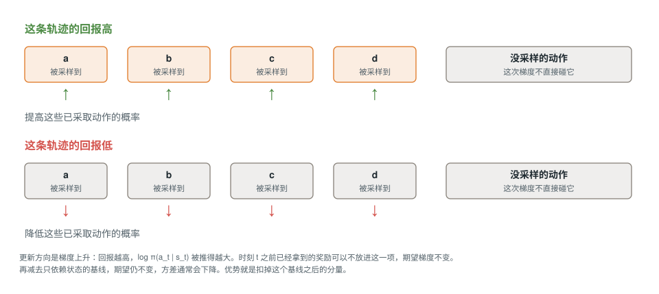

*描述：高回报轨迹提高已采取动作的概率，低回报轨迹则降低。*

有一个直接的后果。某次更新只能改写这条轨迹里出现过的动作。没被采样到的动作，这一次的梯度不直接碰到它。探索仍然必要：策略若从不尝试一个动作，就得不到提高它或压低它的样本。

REINFORCE 用整段回报，无偏，方差大。轨迹一长，少数极端样本会主导更新。这是下一节要把评论者引进来的原因。

## 8. 评论者提供优势，演员负责选择

**Actor-Critic** 把第 7 节的策略和第 5 节的价值估计放在同一次学习里。

**演员（actor）** 是 $\pi_\theta(a\mid s)$，它对外做选择，参数沿策略梯度更新。

**评论者（critic）** 估计 $V_\phi(s)$，用 TD 目标训练，和价值方法里更新 $V$ 的方式相同。

演员使用的系数是优势的估计，而不是原始回报。最容易写下来的一步估计就是 TD 误差：

$$
\delta_t=r_{t+1}+\gamma V_\phi(s_{t+1})-V_\phi(s_t).
$$

$\delta_t$ 大，表示这一步的结果比评论者原先对 $s_t$ 的预期更好，演员就提高 $a_t$ 的概率。$\delta_t$ 为负，就降低。

只看一步又回到了 TD 的偏差。**广义优势估计（Generalized Advantage Estimation，GAE）** 把后续的 TD 误差按 $\gamma\lambda$ 加回去：

$$
\hat A_t=\sum_{l=0}^{\infty}(\gamma\lambda)^l\,\delta_{t+l}.
$$

$\lambda=0$ 时只剩 $\delta_t$。$\lambda=1$ 且终止价值为 0 时，它回到 $G_t-V(s_t)$，也就是折扣后的蒙特卡洛优势。$\lambda$ 位于两者之间：向后看得越远，越接近整段回报，也越容易被后半段的偶然奖励拉动。

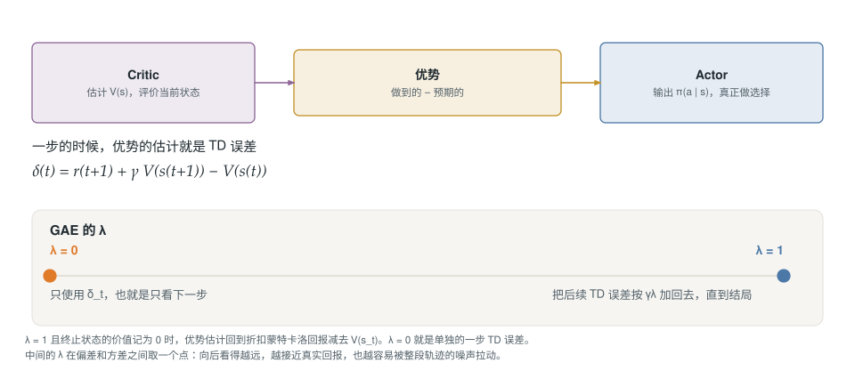

*描述：评论者提供预期，演员按优势修改策略；λ 选择向后看多远。*

评论者本身也在学习，所以优势仍是估计。评论者越准，演员收到的系数越不像一整段噪声。这就是用一个可学习的 $V$ 代替第 7 节里那个固定基线。

## 9. 采样策略和被更新的策略不能差太远

Actor-Critic 的梯度，理论上是在当前 $\pi_\theta$ 的分布下取的期望。实现里若用同一批轨迹做好几步参数更新，$\theta$ 已经变了，轨迹却仍是旧策略采的。旧样本上的 $\nabla\log\pi_\theta$ 不再是新策略那条期望的无偏估计。

补救是把旧策略下的样本，按概率比率重新加权。记采集数据的策略为 $\pi_{\theta_{\mathrm{old}}}$，

$$
\rho_t(\theta)=\frac{\pi_\theta(a_t\mid s_t)}{\pi_{\theta_{\mathrm{old}}}(a_t\mid s_t)}.
$$

在单个状态上，新策略下某个量的期望，等于旧策略下“比率乘这个量”的期望。比率远离 1 时，少数样本的权重会非常大，估计又变得不稳定。

**近端策略优化（Proximal Policy Optimization，PPO）** 的做法是最大化一个截断后的目标。设 $\hat A_t$ 是优势估计，

$$
L^{\mathrm{CLIP}}(\theta)=\mathbb{E}\Big[\min\big(\rho_t\hat A_t,\ \mathrm{clip}(\rho_t,\,1-\epsilon,\,1+\epsilon)\,\hat A_t\big)\Big].
$$

$\mathrm{clip}$ 把比率限制在 $[1-\epsilon,\,1+\epsilon]$ 里再与优势相乘。外层的 $\min$ 在“未截断”和“截断”之间取更小的那个，也就是更不乐观的那个。

用 $\epsilon=0.2$、优势分别为 $+1$ 和 $-1$ 可以把形状算清楚。优势为正时，目标在比率到达 $1.2$ 之后变成常数 $1.2$，不再随比率上升。优势为负时，目标在比率低于 $0.8$ 之后变成常数 $-0.8$，不再随着比率继续下降而变得更负。变平的那段对比率的梯度是 0。

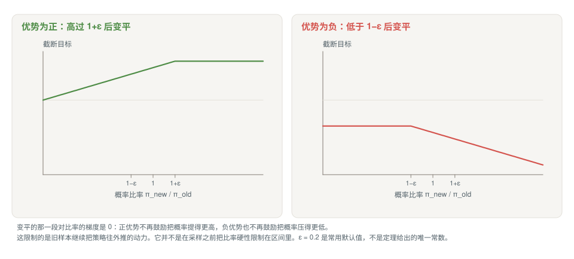

*描述：优势为正时，比率超过 1+ε 后目标变平；优势为负时，低于 1−ε 后变平。*

正优势的样本，不会再推动概率无限提高。负优势的样本，也不会再推动概率无限压低。这限制的是旧样本继续把参数往外推的动力。它并不是在采样之前把比率锁死在区间内。一次新的前向计算里，比率仍然可能落在区间外面。$\epsilon=0.2$ 是实现里常见的默认值，是步长的尺度，不是由定理唯一决定的常数。

PPO 的代码里通常还有两项。一项让评论者去拟合回报或 TD 目标。一项给策略熵一个小的正系数，避免概率过早集中到单一动作。这两项分别是价值学习和探索。PPO 这个名字指向的是上面的截断比率。

## 10. 奖励可以来自比较

到这里，奖励仍然像是环境给的一个数。许多任务里没有这样的数。两份回答哪一份更清楚、更有帮助，人往往说得出比较，却给不出一个绝对分数。

把比较写成概率的常用模型是 **Bradley–Terry**：在提示 $x$ 下，$y_w$ 优于 $y_l$ 的概率只依赖两者的奖励差，

$$
P(y_w\succ y_l\mid x)=\sigma\big(r(x,y_w)-r(x,y_l)\big).
$$

$\sigma$ 是 logistic 函数。用偏好数据最大化这个概率，就得到一个**奖励模型（reward model）** $r_\phi$。它学到的是比较，是“在这些标注里，怎样的回答更容易被选中”。它不是一份独立于标注过程的真理。

**基于人类反馈的强化学习（reinforcement learning from human feedback，RLHF）** 把这个奖励模型接到第 9 节的更新上。常见的流程是：先有一个已经会按指令回答的参考模型 $\pi_{\mathrm{ref}}$，多半来自监督微调；用它或其他模型产生回答，收集偏好，训练 $r_\phi$；再从当前策略采样新的回答，用 PPO 去提高奖励。

若奖励就是 $r_\phi$，策略会寻找奖励模型的漏洞，写出高分但糟糕的文字，同时离开原来已经学会的语言分布。所以放进 PPO 的通常是塑形之后的奖励：

$$
\tilde r(x,y)=r_\phi(x,y)-\beta\log\frac{\pi_\theta(y\mid x)}{\pi_{\mathrm{ref}}(y\mid x)}.
$$

第二项是当前策略相对参考模型的 KL 惩罚。$\beta$ 越大，最优策略越不愿意离开 $\pi_{\mathrm{ref}}$。由 $\pi\propto \pi_{\mathrm{ref}}\exp(r/\beta)$ 可以直接看出：$\beta$ 变大时，指数里的奖励被压平，策略更接近参考模型。

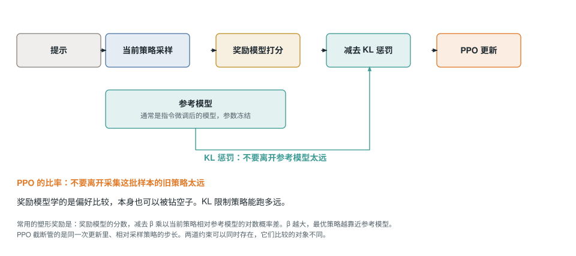

*描述：奖励模型的 KL 对着参考模型，PPO 的比率对着采样时的旧策略。*

这两道约束比较的对象不同，可以同时存在。PPO 的比率比较当前参数和采集这批样本的旧策略，为的是重要性加权仍然可信。奖励里的 KL 比较当前策略和参考模型，为的是保留监督微调已经得到的行为，并限制对奖励模型的利用。把其中一道理解成另一道，后面的 DPO 就会看起来像是把 PPO 删掉了那么简单。DPO 消掉的是奖励模型，它的 $\beta$ 仍然是相对参考模型的那一道约束。

## 11. 比较里的配分函数会消去

RLHF 要维护奖励模型，还要在训练中不断从当前策略采样，再用 PPO 更新。若目标确实是“在 KL 约束下最大化奖励”，最优策略有封闭形式：

$$
\pi_r(y\mid x)=\frac{1}{Z(x)}\,\pi_{\mathrm{ref}}(y\mid x)\exp\big(r(x,y)/\beta\big),
$$

$$
Z(x)=\sum_y \pi_{\mathrm{ref}}(y\mid x)\exp\big(r(x,y)/\beta\big).
$$

$Z(x)$ 只依赖提示，把参考模型按 $\exp(r/\beta)$ 重新归一化。反解奖励：

$$
r(x,y)=\beta\log\frac{\pi_r(y\mid x)}{\pi_{\mathrm{ref}}(y\mid x)}+\beta\log Z(x).
$$

代回 Bradley–Terry。两个回答相减时，$\beta\log Z(x)$ 出现两次，符号相反，消失。胜出的概率只剩策略与参考模型的对数比：

$$
P(y_w\succ y_l\mid x)=\sigma\Big(
\beta\log\frac{\pi_r(y_w\mid x)}{\pi_{\mathrm{ref}}(y_w\mid x)}
-\beta\log\frac{\pi_r(y_l\mid x)}{\pi_{\mathrm{ref}}(y_l\mid x)}
\Big).
$$

**直接偏好优化（Direct Preference Optimization，DPO）** 把这里的 $\pi_r$ 换成正在训练的 $\pi_\theta$，在固定的偏好对上做二元分类。损失是

$$
\mathcal L_{\mathrm{DPO}}(\theta)=-\mathbb{E}\log\sigma\Big(
\beta\log\frac{\pi_\theta(y_w\mid x)}{\pi_{\mathrm{ref}}(y_w\mid x)}
-\beta\log\frac{\pi_\theta(y_l\mid x)}{\pi_{\mathrm{ref}}(y_l\mid x)}
\Big).
$$

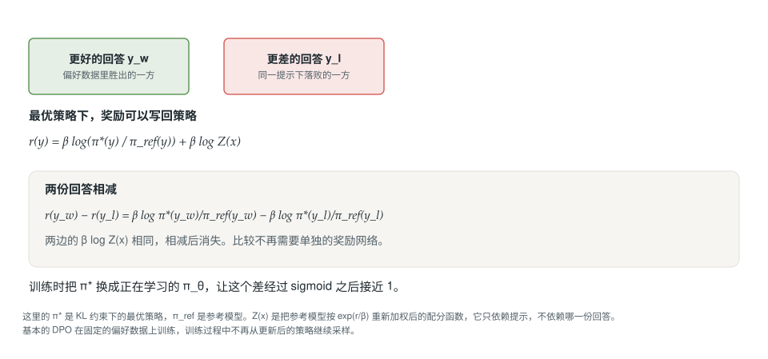

*描述：两份回答的奖励相减之后，只依赖提示的配分函数消失。*

$\beta\log(\pi_\theta/\pi_{\mathrm{ref}})$ 就是一个隐含的奖励。它没有单独的网络，但仍然对应第 10 节那个带 KL 约束的最优解。$\beta$ 的含义也还在：越大，最优策略越靠近参考模型。

基本形式的 DPO 使用已经收集好的偏好，训练时不再从更新后的策略抽样。这省掉了在线采样和 PPO 的循环，也带来分布上的空隙：偏好数据来自旧的采样分布，当前策略走远之后，这些比较不再覆盖它正在生成的回答。后来的迭代式做法会重新采样、重新标注，把在线的那一步补回来。那已经是在 DPO 的损失和 RLHF 的数据收集之间折中。

DPO 也继承了偏好本身的限度。它提高的是“在标注里更常被选中”的回答的相对概率。标注若没有检查事实或计算，这个损失不会自动补上那一项。

## 12. 奖励可以交给判定程序

数学题可以对照标准答案，代码可以跑测试，结构化输出可以做格式校验。这时奖励来自一个判定程序，而不是来自另一个神经网络对偏好的拟合。主讲义把这种奖励来源称为 **RLVR**。它描述的是分数从哪来，没有指定必须用 PPO、DPO 还是别的更新。

判定奖励常常只有几个离散值，比如对或错。再训练一个评论者去拟合这种分数，既费参数，也对奖励的绝对尺度敏感。**组相对策略优化（Group Relative Policy Optimization，GRPO）** 改用同一道题上的一组样本做基线。对一个提示采样 $G$ 份回答，得到奖励 $r_1,\ldots,r_G$，令

$$
\hat A_i=\frac{r_i-\mathrm{mean}(r)}{\mathrm{std}(r)}.
$$

一份奖励高于组内平均，优势为正；低于平均，优势为负。组内优势的平均是 0。策略更新仍可以沿用 PPO 的截断比率，只是 $\hat A_i$ 不再来自一个学出来的 $V$。

四个奖励 $1,0,1,0$ 可以把这个定义算完。均值是 $0.5$。按总体标准差，四个偏差的平方平均是 $0.25$，标准差是 $0.5$，优势变成 $+1,-1,+1,-1$。

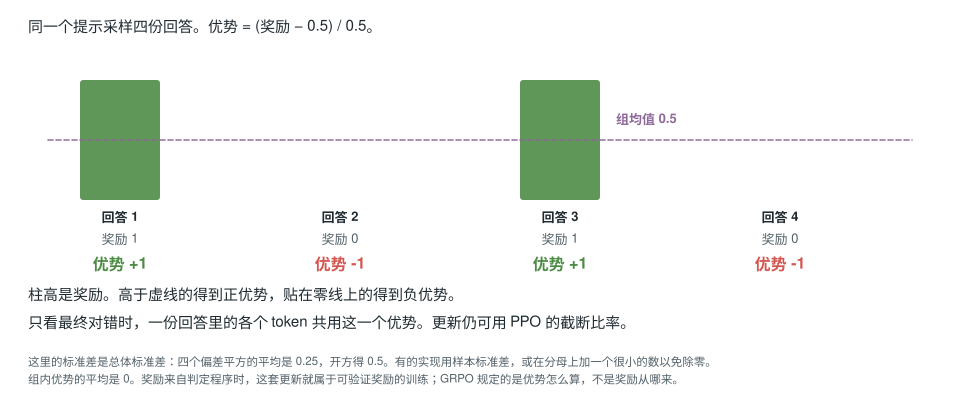

*描述：同一道题的四份回答，优势是相对组均值的标准化分数。*

实现里有的用样本标准差，有的在分母上加一个很小的数，避免一组回答分数完全相同时除以 0。这些是数值细节。结构上的选择是：基线来自同一提示下的同伴，而不是来自一个单独的价值网络。

GRPO 仍然要从当前策略采样这一组回答。省掉的是评论者的训练和它占用的显存，采样成本还在。

只在最终答案上给奖励时，中间的推导 token 没有逐字监督。若某种写法使最终答案更常被判对，这些 token 会因为共享同一个正优势而被保留下来。这可以让模型形成“先写推导、再给答案”的习惯。它并不自动证明每一个中间句都正确。若希望中间步骤各自接受检查，就要使用过程奖励：由人或程序给步骤打分。那是奖励被定义在轨迹中间，信用分配会短一些，标注成本则高一些。

## 13. 语言模型里的状态就是上下文

把前面的定义逐项对应到自回归模型上，轨迹的形状就清楚了。

| 强化学习中的对象 | 语言模型里的样子 |
| --- | --- |
| 状态 $s_t$ | 提示加上已经生成的 token |
| 动作 $a_t$ | 下一个 token |
| 策略 $\pi_\theta$ | 语言模型本身 |
| 轨迹 | 一次完整的回答或解题过程 |
| 转移 | 把选中的 token 接进上下文。这一步是确定的 |
| 奖励 | 偏好分数、答案检查、测试结果，常常在结束时才出现 |

环境的转移在这里几乎没有不确定性：动作一旦选定，下一个状态就是旧上下文加上这个 token。随机性主要在策略里，也在奖励的标注或判定里。第 2 节的轨迹概率因此更简单，

$$
\log\pi_\theta(y\mid x)=\sum_t\log\pi_\theta(y_t\mid x,y_{<t}).
$$

若整段回答只有一个序列奖励 $R$，基线为 $b$，REINFORCE 型的梯度就是把同一个系数乘到每一个已生成 token 上：

$$
(R-b)\sum_t\nabla_\theta\log\pi_\theta(y_t\mid x,y_{<t}).
$$

GRPO 在只看最终对错时，正是让一份回答中的各个 token 共用该回答的优势。PPO 或 GAE 若使用评论者，则可以让系数沿位置变化。评论者这时估计的是“从这一个前缀往后，还能期望拿到多少序列奖励”。

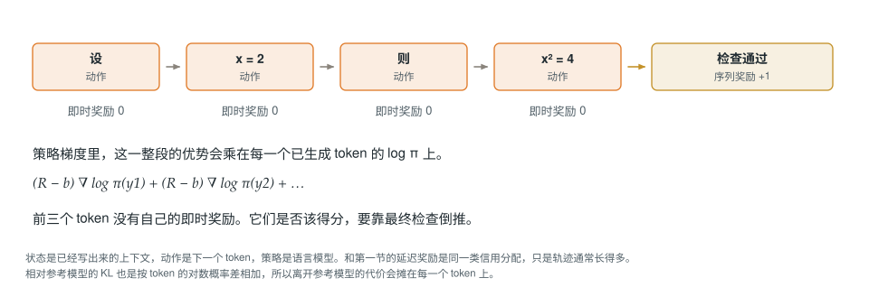

*描述：序列奖励只在检查之后出现，却乘在每一个已生成 token 的梯度上。*

这把第 1 节的信用分配原样搬了过来，而且通常更长。一段推理可能有几百到几千个 token，奖励仍可能只有结束时的一个对或错。前面的用词、一次换元、一个自检，都乘上同一个数。GAE、过程奖励、以及“先生成再判定”的验证器，都是在缩短或核对这段倒推。

相对参考模型的 KL 也按 token 相加。序列上的

$$
\log\pi_\theta(y\mid x)-\log\pi_{\mathrm{ref}}(y\mid x)
$$

就是每个位置的对数概率差之和。离开参考模型的代价因此摊在整段生成上，不只打在最后一个 token。

采样是否必须来自当前策略，决定了训练的花费。PPO 和 GRPO 需要当前策略的新样本，否则第 9 节的比率会失去它要修正的那个分布。DPO 的基本形式使用存好的偏好，避免了这一圈采样，也因此要面对第 11 节说的分布空隙。选择哪一种，是在“更新所依据的分布是否仍是现在的策略”和“每一步要花多少次生成”之间做的。

预训练时，每个位置的目标 token 来自语料，损失在每一步都能计算。后训练里的 RLHF、DPO、RLVR 把这条损失换成了另一类信号：比较、或可以自动执行的判定。模型仍然是在调整 $\pi_\theta(y_t\mid x,y_{<t})$。变的是系数从哪来，以及这个系数在约束策略不要离开哪一个参考分布。

## 14. 这些改写各自在补哪一个缺口

把整篇的顺序看成一条依赖，而不是一份编年目录。每一行都是前一行留下的困难。

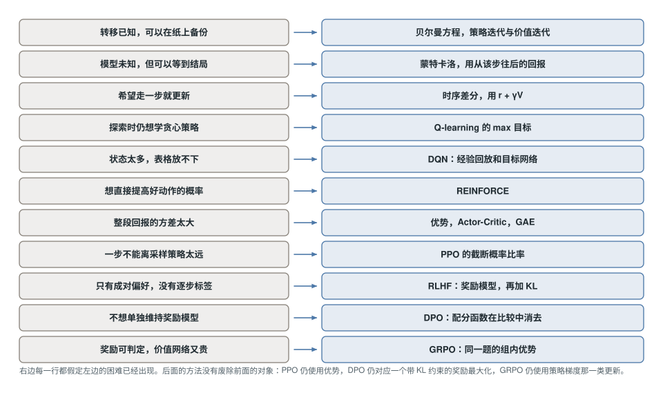

*描述：从已知模型的备份，到组内优势，每一步都在处理前一步的缺口。*

后面的方法没有把前面的对象作废。PPO 使用的仍然是优势。DPO 对应的仍然是带 KL 约束的奖励最大化，只是奖励和配分函数在两份回答的比较里被换掉了。GRPO 使用的仍然是“概率比率乘优势”这一类策略更新，只是优势改由同一提示下的一组奖励来估计。

读一个新的后训练算法时，可以用四个问题把它放回这张图。奖励来自环境、偏好，还是判定程序？优势来自整段回报、评论者、还是一组同伴？更新有没有限制相对采样策略的步长？有没有一个参考模型在限制策略漂移？四个回答确定之后，新名字里的大部分结构就已经可见了。

## 和主讲义的接口

第 8.6 节的循环、回报、$V$ 与 $Q$，是第 2 节到第 4 节的起点。附录里的贝尔曼方程在第 4 节按同一种 $r_{t+1}$ 的记号推了一次，并接到策略迭代和采样。主讲义第 10.3 节的 RLHF 与 DPO，对应这里的第 10 节和第 11 节。第 10.4 节的可验证奖励和 GRPO，对应第 12 节。第 11.1 节所说的、在推理时把推导写长，和这里的关系是：过程本身仍是一条 token 轨迹；强化学习改变的是模型有多倾向于生成这样的轨迹，推理时计算则决定一次回答里这条轨迹可以有多长。

## 参考资料

- Bellman, R. (1957). *Dynamic Programming*.
- Sutton, R. S. & Barto, A. G. (2018). *Reinforcement Learning: An Introduction*, 2nd ed.
- Watkins, C. J. C. H. & Dayan, P. (1992). [Q-learning](https://link.springer.com/article/10.1007/BF00992698). *Machine Learning*.
- Williams, R. J. (1992). [Simple statistical gradient-following algorithms for connectionist reinforcement learning](https://link.springer.com/article/10.1007/BF00992696). *Machine Learning*. REINFORCE.
- Mnih, V. et al. (2015). [Human-level control through deep reinforcement learning](https://www.nature.com/articles/nature14236). *Nature*. DQN.
- Schulman, J. et al. (2016). [High-Dimensional Continuous Control Using Generalized Advantage Estimation](https://arxiv.org/abs/1506.02438).
- Schulman, J. et al. (2017). [Proximal Policy Optimization Algorithms](https://arxiv.org/abs/1707.06347).
- Christiano, P. et al. (2017). [Deep Reinforcement Learning from Human Preferences](https://arxiv.org/abs/1706.03741).
- Ouyang, L. et al. (2022). [Training language models to follow instructions with human feedback](https://arxiv.org/abs/2203.02155). InstructGPT.
- Rafailov, R. et al. (2023). [Direct Preference Optimization](https://arxiv.org/abs/2305.18290).
- Lightman, H. et al. (2023). [Let's Verify Step by Step](https://arxiv.org/abs/2305.20050). 过程奖励.
- Shao, Z. et al. (2024). [DeepSeekMath: Pushing the Limits of Mathematical Reasoning in Open Language Models](https://arxiv.org/abs/2402.03300). GRPO.
- DeepSeek-AI (2025). [DeepSeek-R1](https://arxiv.org/abs/2501.12948).
